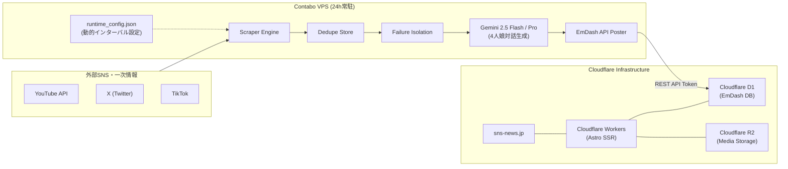

# 🌐 『SNSにゅーす』最新システム統合仕様書 (v3.0 確定版)

> **作成日時:** 2026-11-01  
> **対象メディア:** 『SNSにゅーす (Social Media News)』 (`sns-news.jp`) ＆ 『Atelier Rei』  
> **準拠ステータス:** Step 0 〜 Step 3995 全確定事項・再監査指摘を完全統合・凍結済み

---

## 1. プロジェクト基本方針 ＆ 全体アーキテクチャ

### 1.1 メディアコンセプト
* **事業ゴール:** 世界中のマルチSNS（YouTube, X, TikTok, Instagram）のトレンド・バズ・炎上ネタを収集し、4人のAIキャラクターによるバラエティ番組風の掛け合い解説を行う高トラフィック・ハイブリッドメディア。
* **USP (独自の強み):**
  * 「天才プログラマー・健康＆等身大・ド派手ロック歌姫・法務デザイナー」の4人娘による多角的でテンポの良い対話解説。
  * 著作権法第32条（適法引用）に厳格に準拠した一次情報リファレンスと公式埋め込み。
  * 独自ブランド『Atelier Rei』によるグッズ展開（SUZURI連携）と多言語対応。

### 1.2 インフラストラクチャ構成（Cloudflare EmDash ＋ VPSハイブリッド）
* **ドメイン管理:** スタードメインにて `sns-news.jp` を取得。DNSは Cloudflare にて集中管理。
* **公開メディア基盤 (CMS & Frontend):** **Cloudflare EmDash ＋ Astro (SSR)**
  * ローカル開発環境: Node.js 24 + Astro SSR + SQLiteエミュレーション
  * 本番稼働環境: Cloudflare Workers + Cloudflare D1 (Database) + Cloudflare R2 (Media Storage)
* **データ収集・AIパイプライン基盤:** **Contabo VPS (24時間常駐稼働)**
  * Node.js / TypeScript による自作パイプライン（`pipeline/`）
  * 常駐管理: `pm2` による自動再起動と死活監視
  * 遠隔操作ハブ: **Discord Bot**（運用開始後のフェーズ2にて実装予定）

---

## 2. フロントエンド ＆ UI・デザイン厳格仕様

### 2.1 ナビゲーション・ボタン仕様（【厳格禁止】絵文字禁止ルール）
> [!IMPORTANT]
> **すべてのボタン内において、絵文字（`🛍️`, `📖`, `⚙️`, `💬`, `📸`, `🎵`, `▶` 等）のテキスト混入を一切禁止する。**  
> 許可されるのは、ちびキャラ等の円形画像アイコン（``）のみとする。

| ボタン名称 | 遷移先 | デフォルト配色 | ホバー時の反転挙動 | 固有ルール |
| :--- | :--- | :--- | :--- | :--- |
| **総合** | `/` | 薄いグレー背景 (`#F1F5F9`)、濃い文字 | ダークスレート背景 (`#0F172A`) ＋ 白文字 | トップページと総合は同一。トップ表示時は反転固定 |
| **X** | `/category/x` | 枠線・文字: 水色 (`#1D9BF0`)、白背景 | 水色背景 (`#1D9BF0`) ＋ 白文字 | 表記は英字の **`X`** のみ（特殊記号 `𝕏`、`X(Twitter)` やHOTバッジは禁止） |
| **YouTube** | `/category/youtube` | 枠線・文字: 赤 (`#FF0000`)、白背景 | 赤背景 (`#FF0000`) ＋ 白文字 | ブランド公式レッド厳守 |
| **TikTok** | `/category/tiktok` | 枠線・文字: シアン (`#00F2FE`) & フューシャ (`#FE0979`) 2色グラデーション | 2色グラデーション背景 ＋ 白文字 | 枠線はCSS background-clip border-boxで描画 |
| **Instagram** | `/category/instagram` | 枠線・文字: Instagramブランドグラデーション | グラデーション背景 ＋ 白文字 | |
| **Characters** | `/characters` | 4色（黄・緑・赤・紺）を文字が読める薄さで適用 | 100%ビビッドグラデーション背景 ＋ 白文字 | 4人娘ちびアイコン付属。`/characters` 表示時は反転固定 |
| **Atelier Rei(Goods)** | `/atelier-rei` | 落ち着いた薄い紺背景、濃い紺文字 | ディープネイビー背景 (`#172554`) ＋ 白文字 | 表記は必ず **`Atelier Rei(Goods)`**。怜衣ちびアイコン付属。ナビバー内の1箇所のみに配置 |
| **About Us** | `/about` | スレートグレー枠線・文字 | スレートグレー背景 (`#334155`) ＋ 白文字 | 本絵文字 (`📖`) 禁止 |
| **Admin** | `/_emdash/admin` | テキストのみ `Admin` | グレー背景反転 | 歯車絵文字 (`⚙️`) 禁止 |

### 2.2 背景 ＆ スクロール・アニメーション
* **トップ/総合の背景:**
  * ベースカラー: ソフトラベンダー (`#F7F5FD`)。
  * パターン: **微細なサイバーグリッド（薄い方眼正方形グリッド 24px × 24px）**。
  * **禁止事項:** 四隅を幾何学的に分断するラジアルグラデーションや、ダークモード強制黒背景は禁止（`:root { color-scheme: light !important; }` を適用）。
* **カテゴリー別背景:**
  * 各カテゴリー（例: TikTok）表示時は、画面全体に滑らかなグラデーションを適用。
* **固定ヘッダー（Sticky Header）:**
  * 背景: 濃厚スリガラス（`rgba(255, 255, 255, 0.95)`, `backdrop-filter: blur(20px)`）。
  * 挙動: ページスクロール時に、背後の記事テキストやカードが絶対に透過・重複して読みにくくならないこと。
* **速報ティッカー（Ticker）:**
  * 挙動: 25秒一定速度リニア無限水平ループ。マウスホバーで一時停止。
  * リンク: **実在する最新記事のスラッグへ動的にリンク**（記事が存在しない場合はティッカー自体を非表示）。

---

## 3. 4人娘キャラクター仕様 ＆ 対話生成ルール

### 3.1 キャラクター公式設定（マスター設定書 02準拠）
1. **有栖川 乃愛 (ありすがわ のあ / Noa) / AI 乃愛:**
   * テーマカラー: サイバーゴールド＆パール白 (`#FFD700`)
   * 性格・役割: **電脳オーロラ・サイバープロディジー（IT天才・アルゴリズム解析）**。自信に満ちたプログラマー視点で技術的ツッコミを行う。
2. **若葉 芽依 (わかば めい / Mei) / AI 芽依:**
   * テーマカラー: ネオエメラルド緑 (`#00D68F`)
   * 性格・役割: **ネオエレクトリック・バイオアスリート（健康・栄養オタク・初心者目線）**。素朴な疑問や健康・生活面への鋭いツッコミを行う。
3. **緋宮 詩羽 (ひみや うた / Uta) / AI 詩羽:**
   * テーマカラー: クリムゾンマゼンタ赤 (`#FF1E56`)
   * 性格・役割: **スーパーノヴァ・ロックディーヴァ（動画・音楽・超ド派手トレンドギャル）**。ハイテンションで流行トレンドを肯定・盛り上げる。
4. **黒曜 怜衣 (こくよう れい / Rei) / AI 怜衣:**
   * テーマカラー: ミッドナイトネイビー (`#172554`)
   * 性格・役割: **アバンギャルド・ネオゴシック審問令嬢（法務・知財・炎上リスク管理・『Atelier Rei』デザイナー）**。冷静沈着に著作権やビジネス構造を精査する。

### 3.2 記事内の対話・コメント表示ルール
* **名前の表記:**
  * 記事内のコメント吹き出し: **必ず `AI 乃愛`, `AI 芽依`, `AI 詩羽`, `AI 怜衣` と「AI」を前置する**（AIによる架空生成であることを読者に即座に開示）。
  * キャラクター図鑑（`/characters`）: 本名表記（`有栖川 乃愛`, `若葉 芽依`, `緋宮 詩羽`, `黒曜 怜衣`）。
* **対話構成ルール:**
  * 発言順は話題によって毎回自然にシャッフルする。
  * **1記事あたり必ず4人全員が発言し、最低4コメント以上** で構成する（不足はドラフト破棄）。
* **リアクションボタン:**
  * 初期値は「0」。クリック時にセッションローカルで +1 カウントアップする演出のみ。虚偽の事前数値は設定しない。

---

## 4. 収集・要約パイプライン ＆ 法務・著作権仕様

### 4.1 収集 ＆ 重複排除・障害隔離ロジック
* **対象プラットフォーム:** YouTube, X, TikTok。
* **重複排除:** `dedupeStore.ts` による永続化チェック。一度投稿成功した記事は二度と通さない。
* **失敗隔離 (H-2対応):** `failed_keys.json` により、3回連続で生成・バリデーションに失敗したトレンドは自動隔離してスキップ（Gemini課金ループの防止）。

### 4.2 著作権法第32条（適法引用）の遵守
* **元ネタサムネイル画像の直接流用禁止:**
  * 元ネタSNSのサムネイル画像直リンク・直保存は完全禁止。4人娘公式アイキャッチまたは公式埋め込みのみを使用。
* **一次情報リンク（引用元ボックス）の常置:**
  * 全記事に必ず `📎 一次情報・参考リンク` ボックスを常置する。
* **架空免責事項の明記:**
  * 全記事の最下部に以下の免責文を常置する：
    > 「※本記事内のキャラクターによる対話・コメントは、AI（LLM）によって自動生成された架空の論評であり、特定の個人・団体の公式見解を示すものではありません。」

### 4.3 LLM（Gemini）安全ガードレール
* **Gemini失敗時の偽コメント捏造禁止:**
  * エラー発生時はそのドラフトを即座に破棄・スキップし、嘘のコメントでの自動投稿を行わない。

---

## 5. 運用・保守 ＆ 動的設定仕様

* **VPS常駐環境:** Ubuntu Linux (Contabo Cloud VPS) / `pm2` による24時間常駐。
* **動的インターバル設定 (A4対応):**
  * `pipeline/data/runtime_config.json` により、デーモンプロセスを再起動することなく巡回間隔（デフォルト: 300秒）や最大取得件数を動的に変更可能。
* **Discord Bot 遠隔インターフェース:**
  * 本番運用開始後のフェーズ2にて実装。
