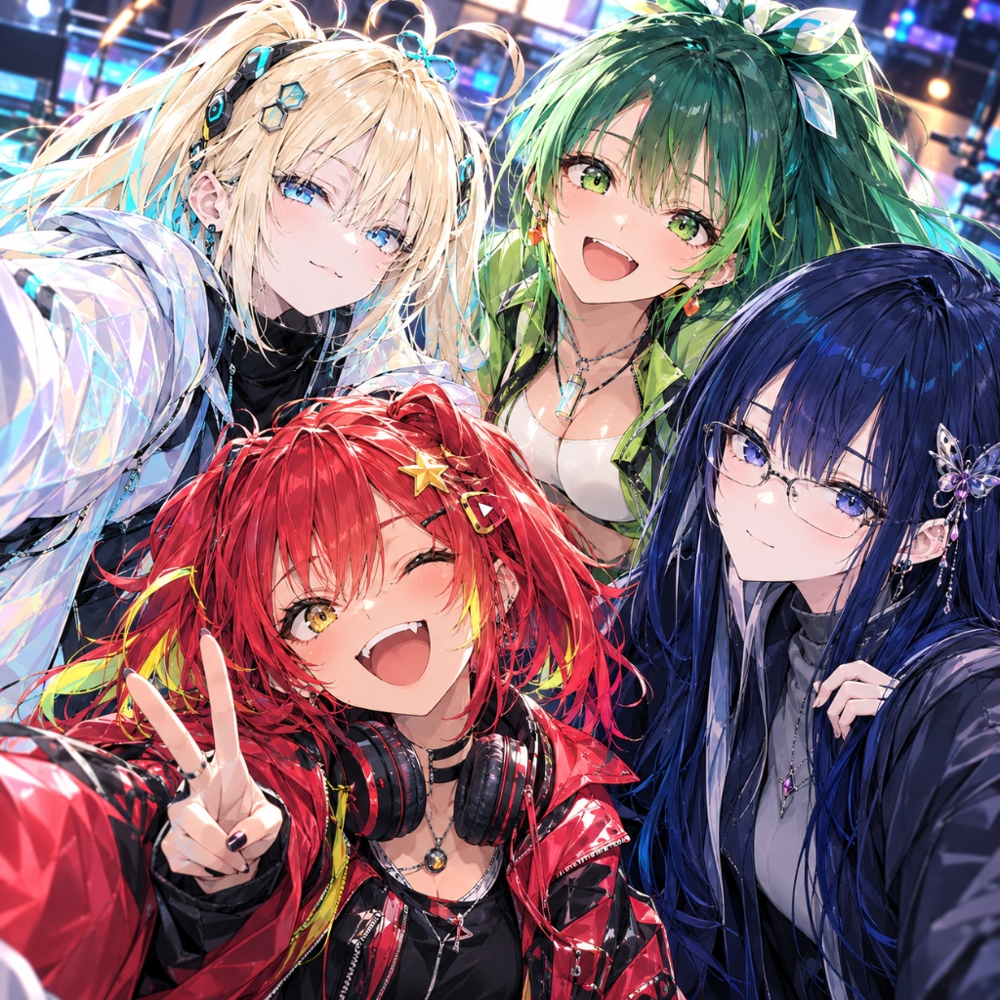
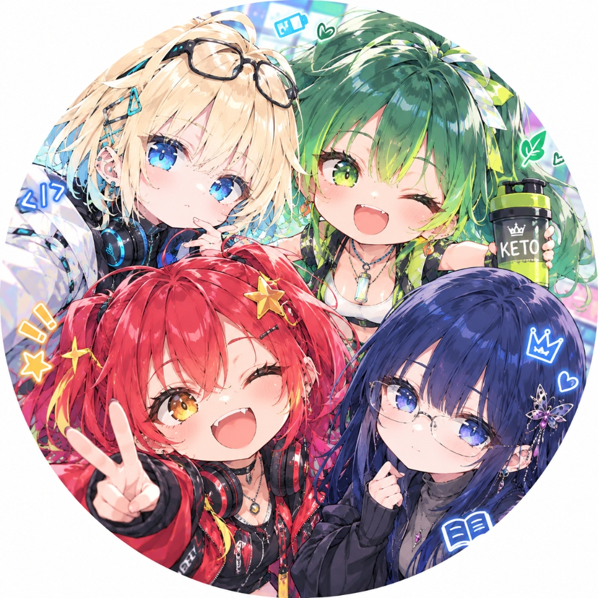
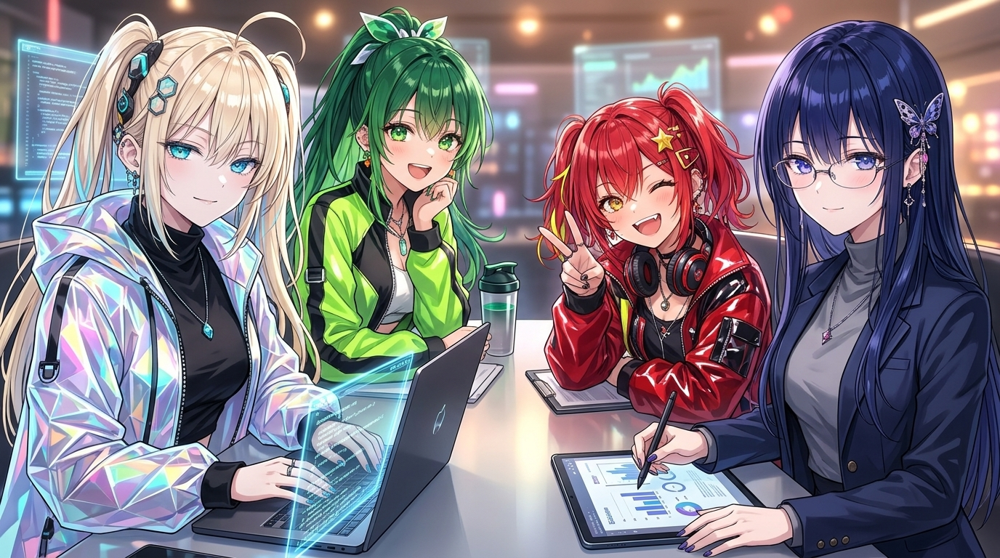
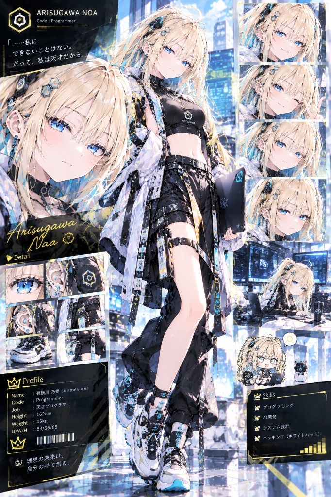
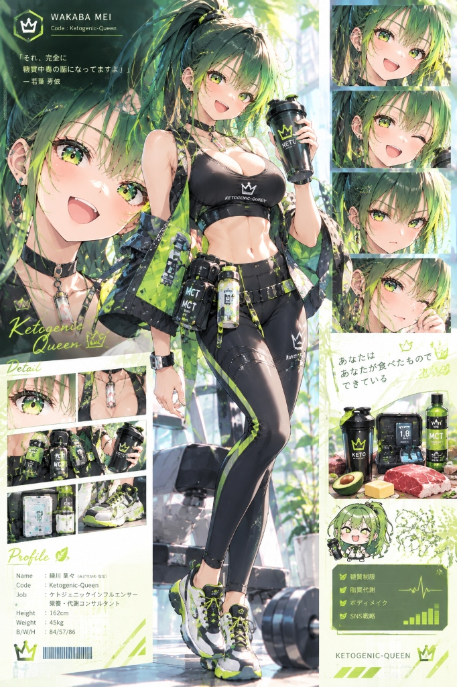
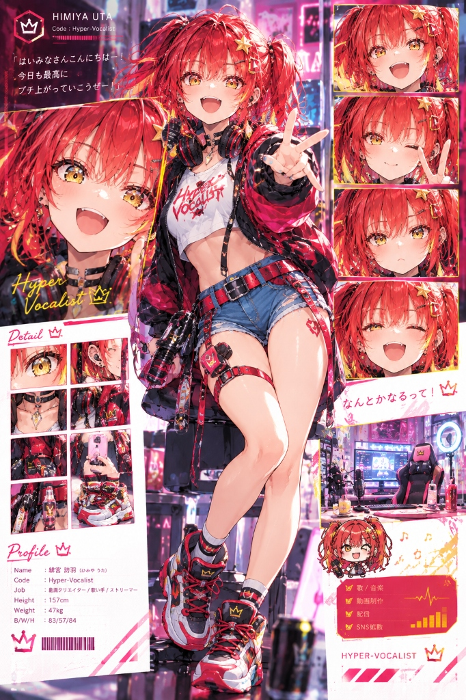
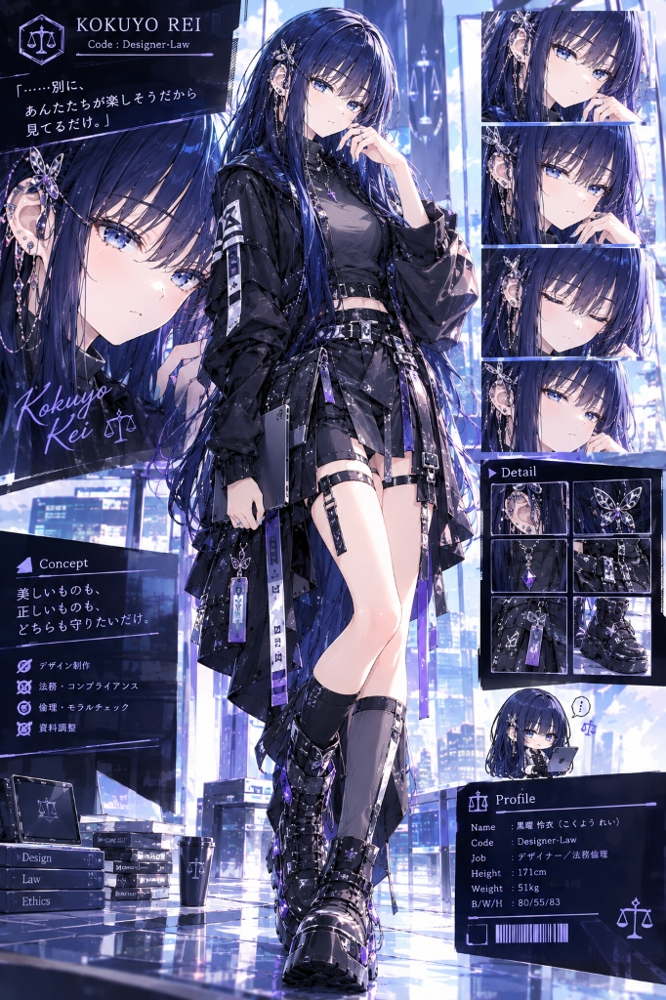

# 🎨 超ド派手・令和ネオポップ版 4人娘キャラクターデザイン完全ビジュアル仕様書

完全な50項目×4人（計200項目）の詳細は [[02_超ド派手4人娘キャラクター_完全バイブル]] を参照。

---

## 🖼️ 公式マスタービジュアル（通常ver ／ ちびキャラver ／ マンガver）

### 1. 通常ver（公式マスターキービジュアル・一枚絵用リファレンス）

* **ローカル保存パス:** `C:\Obsidian\LLM Folder\02_Projects\AI_Curation_Media\assets\01_4girls_normal_ver.jpg`
* **配置:** 左上：有栖川 乃愛（金髪） ／ 右上：若葉 芽依（緑髪） ／ 左下：緋宮 詩羽（赤髪） ／ 右下：黒曜 怜衣（紺髪）
* **用途:** メインビジュアル、サムネイル一枚絵、リッチな塗りのイラスト

### 2. ちびキャラ（ミニキャラ）ver（SNSアイコン・スタンプ・SDキャラ用リファレンス）

* **ローカル保存パス:** `C:\Obsidian\LLM Folder\02_Projects\AI_Curation_Media\assets\02_4girls_chibi_ver.jpg`
* **用途:** SNSアイコン、吹き出しアイコン、LINEスタンプ、ミニキャラ挿絵

### 3. マンガver（マンガ作成時・会話劇・シチュエーション挿絵用リファレンス）

* **ローカル保存パス:** `C:\Obsidian\LLM Folder\02_Projects\AI_Curation_Media\assets\03_4girls_manga_ver.jpg`
* **Artifactパス:** `C:\Users\user\.gemini\antigravity\brain\86f66ed1-d056-4c98-9ffd-4946dc326124\four_girls_creator_studio_meeting_1793332007468.jpg`
* **配置:** 左：有栖川 乃愛 ／ 中左：若葉 芽依 ／ 中右：緋宮 詩羽 ／ 右：黒曜 怜衣
* **用途:** マンガ・4コマ・掛け合いシーン・解説記事内のシチュエーション挿絵（輪郭線がくっきりして表情や小物の視認性が高いタッチ）

---

## 🖌️ 次回以降の画像生成用「3つの画風（通常ver ／ ちびキャラver ／ マンガver）」使い分けプロトコル

### 方法A：Antigravityに一言で依頼する方法（推奨・自動参照）
次回以降、用途に合わせて以下の3パターンのどれかを指定するだけで、該当するリファレンス画像を自動で読み込んで画風を固定します。

* **一枚絵・リッチなイラストを作りたい時：**
  > 「**通常ver**と同じ画風で、〇〇の画像を作成して」（➔ `01_4girls_normal_ver.jpg` を参照）
* **マンガ・掛け合い・会議シーンを作りたい時：**
  > 「**マンガver**と同じ画風で、〇〇の画像を作成して」（➔ `03_4girls_manga_ver.jpg` を参照）
* **SDキャラ・デフォルメを作りたい時：**
  > 「**ちびキャラver**と同じ画風で、〇〇の画像を作成して」（➔ `02_4girls_chibi_ver.jpg` を参照）

### 方法B：画風固定マスタープロンプト（コピペ用・他ツール兼用）
`通常ver`（1枚目）の画風DNA（色トレス極細線画×透明感と厚塗りのハイブリッド彩色×宝石瞳ハイライト×毛束のエアリーな抜け感×プリズム/レザーの質感対比）を言語化した固定スタイルプロンプトです。

#### 【日本語スタイル指定プロンプト】
```text
【画風・タッチ指定（公式通常ver準拠）】
現代日本のトップイラストレーター（Pixiv殿堂入り・最新ソシャゲSSRカードイラスト水準）が描いた、極めて緻密で華やかな現代アニメ・デジタルイラスト。
・線画：超極細の繊細なインクラインと、肌や髪の境界に馴染む「色トレス（カラーライン）」の併用。
・髪の描写：髪の毛一本一本の繊細な毛束感と、顔周り・毛先にふわっと舞うエアリーな遊び毛（ルーズストランド）。逆光を受けた毛先が半透明に透ける鮮やかなネオン・リムライト。
・瞳と表情：宝石やガラス玉のように幾重にもレイヤーが重なった「うるみ瞳（多層グラデーション＋繊細な光の粒ハイライト）」、束感のある長いまつ毛、頬と鼻先のほんのり温かい血色チーク、八重歯や口元の生き生きとした表情。
・塗りと質感（セミ厚塗り×透明水彩ハイブリッド）：アニメのベタ塗り（セル画）ではなく、滑らかな肌のグラデーションと、衣装ごとの異素材テクスチャ（乃愛のジャケットの幾何学プリズム・オーロラホログラム反射、詩羽の深紅パテントレザーの鋭い鏡面光沢、芽依のクリアカプセルの透過光、怜衣のマットなダーク生地と蝶モチーフの煌めき）を克明に描き分けるリッチなデジタルペインティング。
・ライティングと背景：背景は被写界深度（ボケ）が効いた鮮やかなサイバー都市/クリエイター空間のネオン玉ボケ（ボケ味のあるカラフルな光源）。キャラクターの輪郭を際立たせるドラマチックな逆光と柔らかい環境光の反射。
```

#### 【英語スタイル指定プロンプト（Image Generator内部伝達用）】
```text
Masterpiece contemporary Japanese anime digital illustration, flagship mobile game SSR key visual style, illustrated by a top-tier Pixiv/VTuber character designer. Ultra-fine delicate line art with subtle color-traced outlines (iro-trace). Semi-thick painterly rendering blended with luminous translucent watercolor gradients. Intricate airy hair strands with loose flyaway fibers and glowing translucent neon rim-lighting at the tips. Jewel-like multi-layered wet-look expressive anime eyes with crisp starlight/droplet highlights and long clustered eyelashes. Soft porcelain skin with warm rosy blush on cheeks and nose bridge. High-contrast material texture differentiation: geometric prismatic holographic iridescent reflections on PVC jacket, glossy specular highlights on crimson patent leather, glowing translucent glass capsule pendant, and delicate metallic butterfly filigree. Vibrant cyber-city neon bokeh background with shallow depth of field, cinematic backlighting, rich chromatic aberration accents, ultra-detailed 8k illustration.
```

---

## 👥 新生・超ド派手4人娘 ビジュアル＆テーマカラー3色（70:25:5）一覧

| No | 名前（読み） | 新コンセプト / 基本図形 | テーマカラー3色（メイン70% / サブ25% / アクセント5%） | 身長/体重/3サイズ | アイコニック装備・反復モチーフ |
|:---:|:---|:---|:---|:---|:---|
| **01** | **有栖川 乃愛**<br/>（ありすがわ のあ） | **電脳オーロラ・サイバープロディジー**<br/>【▽逆三角形 ＋ ∞曲線】 | 🟨 **Main:** サイバーゴールド＆パール白 (`#FFD700`/`#F8FAFC`)<br/>⬛ **Sub:** ディープスペース黒 (`#111625`)<br/>🟦 **Acc:** エレクトリックシアン (`#00F0FF`) | **148cm / 39kg**<br/>B74/W52/H76 (A) | ∞型ホログラムクリップ、半透明オーロラPVCジャケット、六角形ハニカムチョーカー、RGB厚底スニーカー |
| **02** | **若葉 芽依**<br/>（わかば めい） | **ネオエレクトリック・バイオアスリート**<br/>【●円形 ＋ ▲上向き三角】 | 🟩 **Main:** ネオエメラルド緑 (`#00D68F`)<br/>⬜ **Sub:** クリーミーアイボリー (`#F4F1EA`)<br/>🟧 **Acc:** サンライズオレンジ (`#FF6B35`) | **164cm / 52kg**<br/>B88/W56/H86 (F) | 双葉オーガンジーリボンシュシュ、雫型オレンジガラスイヤリング、六角形分子ゴールドヘアピン、MCTオイルアンプル |
| **03** | **緋宮 詩羽**<br/>（ひみや うた） | **スーパーノヴァ・ロックディーヴァ**<br/>【★星型・非対称放射状】 | 🟥 **Main:** クリムゾンマゼンタ赤 (`#FF1E56`)<br/>⬛ **Sub:** ジェットオニキス黒 (`#1A1A24`)<br/>🟨 **Acc:** スパークネオン黄 (`#FFE600`) | **157cm / 47kg**<br/>B83/W57/H84 (D) | ▶再生マーク＆★星型ピン、鏡面パテントレザー赤ライダース、声量連動LEDイコライザーチョーカー、360度ジンバル＆カスタムマイク |
| **04** | **黒曜 怜衣**<br/>（こくよう れい） | **アバンギャルド・ネオゴシック審問令嬢**<br/>【■垂直長方形 ＋ ｜鋭角線】 | 🟦 **Main:** ミッドナイトネイビー (`#1B2A4A`)<br/>⬜ **Sub:** プラチナシルバー (`#D8DEE9`)<br/>🟪 **Acc:** アメジストパープル (`#9D4EDD`) | **171cm / 51kg**<br/>B80/W55/H83 (C) | アメジスト星屑タッセル付きバタフライイヤーカフ、アメジストレースチョーカー、正義の天秤ブローチ、シルバーフィンガーブレスレット、電子六法全書液タブ |

---

## 🪪 キャラクター別 公式プロフィール設定画（全身・表情差分・ディテール図解）

### 01. 有栖川 乃愛（ありすがわ のあ / Arisugawa Noa）公式プロフィール設定画

* **ローカル保存パス:** `C:\Obsidian\LLM Folder\02_Projects\AI_Curation_Media\assets\profile_01_arisugawa_noa.jpg`

### 02. 若葉 芽依（わかば めい / Wakaba Mei）公式プロフィール設定画

* **ローカル保存パス:** `C:\Obsidian\LLM Folder\02_Projects\AI_Curation_Media\assets\profile_02_wakaba_mei.jpg`

### 03. 緋宮 詩羽（ひみや うた / Himiya Uta）公式プロフィール設定画

* **ローカル保存パス:** `C:\Obsidian\LLM Folder\02_Projects\AI_Curation_Media\assets\profile_03_himiya_uta.jpg`

### 04. 黒曜 怜衣（こくよう れい / Kokuyo Rei）公式プロフィール設定画

* **ローカル保存パス:** `C:\Obsidian\LLM Folder\02_Projects\AI_Curation_Media\assets\profile_04_kokuyo_rei.jpg`
