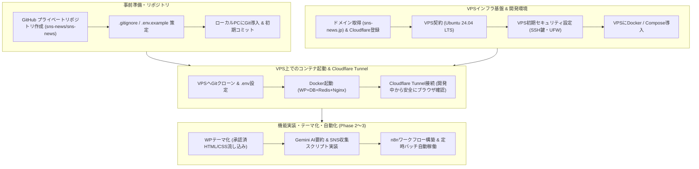

# 『SNSにゅーす』実装ロードマップ・環境構築＆デプロイ詳細手順書

> [!NOTE] 採用方針：プランB（VPS先行・クラウド開発）
> ローカルPCに重いDocker Desktopを導入せず、**最初からVPS上に本番同等のDocker環境（Ubuntu 24.04 LTS）を構築**します。
> ローカルPCはGitとコード編集のみを担当し、Windows特有の権限エラーや環境差異を完全に排除した高効率な開発フローを採用します。

---

## 1. 全体実装フロー（来週のロードマップ：プランB最適化版）



---

## 2. 詳細ステップ＆チェックリスト

### Step 1: Gitリポジトリ準備（GitHub）

安全なコード管理とVPS自動デプロイの基盤を作ります。

- [ ] **1-1. GitHub上にプライベートリポジトリを作成**
  - リポジトリ名: `sns-news` (または `sns-news-core`)
  - 公開範囲: **Private**（APIキーやプロンプトの流出を防ぐため必須）
- [ ] **1-2. ローカルPCのSSH接続確認**
  - `ssh -T git@github.com` で認証が通ることを確認。
- [ ] **1-3. `.gitignore` の策定（重要保安対策）**
  - 以下のファイルは絶対にGitへコミットしない設定にします：
    ```gitignore
    # 秘匿情報・環境変数
    .env
    .env.local
    *.pem
    *.key

    # WordPress アップロード画像・コアファイル・DBダンプ
    wp-content/uploads/
    *.sql
    *.sql.gz

    # Python / Node 一時ファイル
    __pycache__/
    *.pyc
    venv/
    node_modules/
    .DS_Store
    Thumbs.db
    ```
- [ ] **1-4. VPS専用デプロイキー（Deploy Key）の準備**
  - VPS側からGitHubへ安全にアクセスするため、VPS上で生成した公開鍵をGitHubリポジトリの「Settings > Deploy keys」（Read-only権限）に登録します。

---

### Step 2: ドメイン取得 & DNS・セキュリティ（Cloudflare）

- [x] **2-1. ドメイン取得完了**
  - 対象ドメイン: `sns-news.jp`（スタードメインにて取得完了）
- [ ] **2-2. Cloudflareへネームサーバー切り替え**
  - Cloudflare（無料プラン）にドメインを登録し、レジストラ側のネームサーバーをCloudflare指定のものに変更。
  - **メリット**: DDoS防御、WAF、静的アセット（画像/CSS）の世界規模CDNキャッシュ、無償SSL証明書。
- [ ] **2-3. Cloudflare Tunnel (`cloudflared`) の採用**
  - **超重要**: VPS側のポート（80 / 443）をインターネットに一切開けず、Cloudflare Tunnel経由でのみ通信を通す方式を採用します。
  - これにより、VPSのIPアドレスが外部から完全に見えなくなり、総当たり攻撃やポートスキャンを100%遮断できます。

---

### Step 3: VPS選定 & 初期セキュリティ設定

- [ ] **3-1. VPSスペック選定**
  - **推奨OS**: Ubuntu 22.04 LTS または 24.04 LTS (64bit)
  - **推奨スペック**: メモリ 2GB〜4GB / 2コア以上 / SSD 50GB以上
    - *理由*: WordPress + MariaDB + Redis + n8n + Python実行コンテナを同時稼働させるため、2GB以上が安定動作の目安です。
  - **おすすめ事業者**:
    - ConoHa VPS（国内・SSD高速・コスパ良好）
    - さくらのVPS / Xserver VPS（国内老舗・安定）
    - Linode (Akamai) / DigitalOcean（海外系・開発者向け標準）
- [ ] **3-2. VPS初期セキュリティ設定コマンド**
  ```bash
  # 1. パッケージ更新
  sudo apt update && sudo apt upgrade -y

  # 2. 作業用一般ユーザー作成 (例: deployer)
  sudo adduser deployer
  sudo usermod -aG sudo deployer

  # 3. SSH公開鍵認証の設定（ローカルの公開鍵を配置）
  mkdir -p /home/deployer/.ssh
  chmod 700 /home/deployer/.ssh
  # (ローカルの id_ed25519.pub 内容を authorized_keys に書き込み)
  chmod 600 /home/deployer/.ssh/authorized_keys
  chown -R deployer:deployer /home/deployer/.ssh

  # 4. SSH設定の堅牢化 (/etc/ssh/sshd_config)
  # - PermitRootLogin no (rootログイン禁止)
  # - PasswordAuthentication no (パスワード認証禁止・鍵のみ)
  sudo systemctl restart ssh

  # 5. UFWファイアウォール有効化 (SSHポートのみ許可、WebはTunnel経由)
  sudo ufw default deny incoming
  sudo ufw default allow outgoing
  sudo ufw allow 22/tcp  # (SSHポート変更時はその番号)
  sudo ufw enable
  ```
- [ ] **3-3. Docker & Docker Compose インストール**
  ```bash
  curl -fsSL https://get.docker.com -o get-docker.sh
  sudo sh get-docker.sh
  sudo usermod -aG docker deployer
  # compose plugin確認
  docker compose version
  ```

---

### Step 4: ローカル開発環境の構築（来週の作業第1弾）

ローカルPC（Windows）上で、まずはコンテナ環境を組み上げます。

- [ ] **4-1. プロジェクトディレクトリ作成**
  - パス: `C:\Users\user\.gemini\antigravity\scratch\sns-news`
- [ ] **4-2. `.env` 設定ファイルの準備**
  - DB名、DBユーザー、パスワード、Gemini APIキー、WordPressソルト値などを生成。
- [ ] **4-3. `docker-compose.yml` 起動テスト**
  - `docker compose up -d` で WordPress、MariaDB、Redis が一発起動することを確認。
- [ ] **4-4. テーマ資材の配置**
  - 承認済みのプロトタイプ（`top_page_prototype.html`, `article_detail_prototype.html`）をベースに、ヘッダー・フッター・各テンプレートパーツへPHP分割配置。

---

### Step 5: VPSへの初回デプロイ＆自動化設定

- [ ] **5-1. VPS上でリポジトリクローン**
  ```bash
  cd /var/www
  git clone git@github.com:sns-news/sns-news.git
  cd sns-news
  ```
- [ ] **5-2. VPS用 `.env` の配置**
  - 本番用の強固なパスワードおよび本番ドメイン設定を書き込み。
- [ ] **5-3. Cloudflare Tunnel コンテナ起動**
  - Cloudflareダッシュボードで発行したトンネルトークンを `.env` に設定し、コンテナを起動。世界中から `https://sns-news.jp` で安全にアクセス可能になります。
- [ ] **5-4. デプロイスクリプト動作確認 (`scripts/deploy.sh`)**
  - コード変更時は `git push` 後、VPS側で `./scripts/deploy.sh` を叩くだけで自動反映される仕組みをテスト。

---

## 3. 事前確認・ユーザー判断事項

来週スタートするまでに決めておくとスムーズな事項です：

1. **GitHubアカウント**:
   - すでにお持ちのアカウントを使用されるか、新規作成されるか。
2. **ドメインの取得時期**:
   - `sns-news.jp` などの本番ドメインは、来週の実装と同時に取得するか、事前に取得しておくか。
3. **VPSの契約先**:
   - ご希望の事業者（ConoHa、さくら、Xserver等）があるか。
