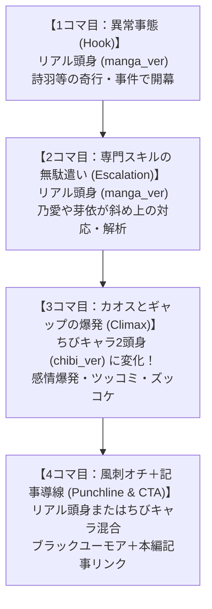
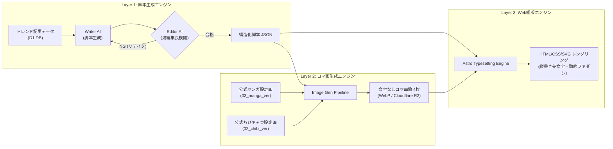

# AI漫画制作プロジェクト：基本設計・総合仕様書
**【作品名】『SNSにゅーす編集部！〜バズの裏側、全部バラします〜』**

---

## 1. プロジェクト概要・目的

### 1.1 プロジェクトの目的
本プロジェクトは、完全自律型キュレーションメディア『SNSにゅーす（sns-news.jp）』に連動する**完全自動生成型のWeb連載漫画システム**を開発・運用することを目的とする。
単なる情報提供にとどまらず、**「読者が漫画目当てで毎日サイトを再訪する中毒性」**を形成し、メディアのエンゲージメント向上、SNSでのバイラル拡散、およびキャラクターIP（Atelier Rei グッズ等）の事業拡大を牽引する。

### 1.2 コアコンセプト
> **「トレンドを解説する漫画」ではなく、「トレンドに振り回される4人の愛おしい日常を覗き見るシットコム（編集部コメディ）」**

* **主従の逆転**: 読者はニュース解説を読むために漫画を開くのではない。4人の人間くさいドタバタ劇を楽しんでいるうちに、結果として今日のトレンドの本質が痛快に理解できる構造とする。
* **シットコム型チームキャラクター構造**: 完璧なエリート美少女を描くのではなく、プロフェッショナルなスキル（憧れ）と致命的なポンコツ性（ギャップ・愛着）を同居させ、キャラクター同士の関係性（てぇてぇ・掛け合い）で読者を魅了する。

---

## 2. 致命的欠陥と10大アンチパターン（設計禁止事項）

過去のAI漫画プロジェクトが100%失敗してきた要因を徹底分析し、本システムでは以下の設計を**絶対禁止（アンチパターン）**とする。

### 2.1 企画・体制の5大欠陥と対策

| # | 致命的欠陥（従来の失敗パターン） | なぜ失敗するのか（本質的理由） | 本プロジェクトにおける対策・改善策 |
| :--- | :--- | :--- | :--- |
| **1** | **企画〜制作の完全丸投げ** | LLMの平均値回帰により、毒にも薬にもならない退屈な優等生コンテンツになる。 | **「世界観・キャラの欠陥・フォーマット憲法」は完全固定**。日々のネタ生成・作画・組版の運用のみを完全自動化する。 |
| **2** | **4人全員の均等登場** | 短尺のWeb漫画で4人全員を出すと、全員が1言ずつ喋るだけの説明ロボットになる。 | **1話につき「メイン2名（ボケ＋ツッコミ）＋オチ乱入1名」の最大3名まで**とするローテーションを採用。 |
| **3** | **ニュース解説への執着** | ニュース解説なら文字を読んだ方が早い。読者は3秒で離脱する。 | ニュースはあくまで「4人が大騒ぎするための舞台装置（ネタ）」。**主役はあくまで4人の関係性とリアクション**。 |
| **4** | **ターゲットの全方位設定** | 誰にでもウケるものは誰にも刺さらない。SNSシェアがゼロになる。 | **「SNSトレンドは気になるが殺伐とした空気に疲れた層（VTuber・きらら系・裏側コメディ好き）」に特化**。 |
| **5** | **画像生成AIへの一発出力** | 日本語フォント崩壊、キャラ崩れ、フキダシ順序破綻、解像度低下が発生する。 | **「脚本JSON」「文字なしコマ絵」「HTML/SVG組版」の3層完全分離パイプライン**を採用する。 |

### 2.2 制作における10大アンチパターン

1. **「学習まんが化」の禁止**: キャラがWikipediaやニュース記事を音読するだけの解説役になることを厳禁とする。
2. **「1枚画像出力」の禁止**: 4コマを1枚の画像として生成させず、必ず1コマ単位の文字なし画像として生成する。
3. **「画像への文字焼き込み」の禁止**: セリフやフキダシを画像内に描かせず、必ずプログラム（HTML/CSS/SVG）でオーバーレイ描画する。
4. **「完璧美少女」の禁止**: 欠点のないキャラを排除。必ず生活破綻や承認欲求などの愛すべきポンコツ面を露呈させる。
5. **「教科書的起承転結」の禁止**: 1コマ目の状況説明で読者が離脱するため、1コマ目から「異常事態・修羅場（転）」で開幕する。
6. **「テキストのみのプロンプト」の禁止**: 毎回顔や服が変わるのを防ぐため、必ず公式設定画（Image Reference）を入力する。
7. **「バストアップ証明写真」の禁止**: 全コマ同じ構図を禁止し、寄り・引き・デフォルメ（ちびキャラ）の緩急をつける。
8. **「長文セリフ」の禁止**: 1フキダシは最大22文字（2〜3行以内）。文字の壁を作らない。
9. **「単発完結・継続性の欠如」の禁止**: 連載としての連続性を持たせるため、編集部ステータス（メンタル残量等）を連動させる。
10. **「一発出力脚本の採用」の禁止**: 脚本AIの初稿（60点）をそのまま使わず、鬼編集長AIによる検閲・再生成を義務付ける。

---

## 3. キャラクター設定仕様（4人娘の専門性とギャップ属性）

群像劇・チームコメディ作品の王道として、**高度な専門スキルと致命的な人間味（ポンコツ属性）の落差**を定義する。
本作品の4人娘は、完全にオリジナルのサイバーポップ・テックウェアデザインおよび独自プロフィールに基づいており、既存のいかなる作品とも一切の類似を持たない。

```
【4人娘のキャラクター属性マトリクス】
                  [論理・知性]
                       │
       乃愛 (IT・データ)│  怜衣 (法務・知財)
   エナドリ依存・オカルト恐怖│  冷酷電卓・資本主義の魔物
                       │
──────[内向・技術]─────┼─────[外向・表現]──────
                       │
       芽依 (トレンド解説)│  詩羽 (動画・音楽)
   糖質制限狂気・笑顔で没収 │  承認欲求爆発・すぐ緊急動画
                       │
                  [感情・肉体]
```

### 3.1 有栖川 乃愛（ありすがわ のあ）/ Golden Yellow
* **表の顔**: IT・データ解析担当。天才プログラマー。感情に流されず数字とアルゴリズムで事象を冷徹に分析する。
* **裏のポンコツ属性（ギャップ）**: **「重度のエナドリ中毒＆生活力ゼロの限界エンジニア」**
  * 会話がすべてエラーコード（「エラー400：その発言には構文エラーがあります」等）。
  * 幽霊・オカルト・都市伝説など「論理で説明できないトレンド」が来るとIQが3になり、机の下でガタガタ震えて仕事放棄する。
* **テーマカラー**: メイン：#F59E0B（黄） / サブ：#1E1B4B / アクセント：#FFFFFF

### 3.2 若葉 芽依（わかば めい）/ Neo Emerald
* **表の顔**: トレンド解説・初心者目線ナビゲーター。穏やかで人当たりの良い癒やし系。
* **裏のポンコツ属性（ギャップ）**: **「笑顔で詰め寄る狂気のケトジェニック（糖質制限）原理主義者」**
  * ネットの炎上や喧嘩をすべて「皆さん糖質過多で血糖値スパイクが起きてイライラしてるだけですよ〜♡」と栄養学で強引に片付ける。
  * 乃愛の深夜カップ麺や詩羽のお菓子を笑顔でゴミ箱にダンクシュートする（編集部内で一番怒らせてはいけない存在）。
* **テーマカラー**: メイン：#00D68F（緑） / サブ：#065F46 / アクセント：#ECFDF5

### 3.3 緋宮 詩羽（ひみや うた）/ Crimson Magenta
* **表の顔**: クリエイター・音楽・動画演出担当。圧倒的歌唱力を持つカリスマロックボーカル。
* **裏のポンコツ属性（ギャップ）**: **「承認欲求モンスター＆すぐ『緊急で動画回す』女（愛すべきトラブルメーカー枠）」**
  * 編集部の冷蔵庫のプリンが消えただけで「【緊急】SNSにゅーす編集部、重大な危機に直面しています…」と神妙な顔でカメラを回す。
  * 再生数やいいね数が伸びないと3秒で泣き出し、乃愛に「アルゴリズムハックして！」と駄々をこねる。
* **テーマカラー**: メイン：#FF1E56（赤） / サブ：#FFE4E6 / アクセント：#1E1B4B

### 3.4 黒曜 怜衣（こくよう れい）/ Midnight Navy
* **表の顔**: 法務・知財コンプライアンス＆公式ブランド「Atelier Rei」デザイナー。知的で優雅な名門令嬢。
* **裏のポンコツ属性（ギャップ）**: **「すべてをSUZURIグッズ化と著作権法第32条で回収する資本主義の魔物」**
  * 詩羽が炎上して泣いている横で「その泣き顔、適法引用の範囲内でアクリルスタンドにして販売すれば原価率30%で回収できますわ」と冷徹に電卓を叩く。
  * 隙あらば編集部員をモデルにしたグッズの企画書を突きつける。
* **テーマカラー**: メイン：#1E3A8A（紺） / サブ：#EBF0FA / アクセント：#3B5284

---

## 4. ストーリー構成・演出フォーマット

### 4.1 黄金の4コマ（縦スクロール4パネル）構成



| コマ | 役割 | 演出・頭身スタイル | 内容詳細 |
| :---: | :--- | :--- | :--- |
| **1** | **異常事態（Hook）** | **リアル頭身**<br>（`03_4girls_manga_ver.jpg`） | 読者のスクロールを止める開幕。その日のトレンドを極端に曲解・模倣したキャラの奇行（事件）から始まる。状況説明は一切省く。 |
| **2** | **専門スキルの無駄遣い（Escalation）** | **リアル頭身**<br>（`03_4girls_manga_ver.jpg`） | 別のキャラが自身の専門領域（IT、栄養学、法務等）を全力で無駄遣いして事態に介入。事態がさらに悪化・混迷する。 |
| **3** | **カオスとギャップの爆発（Climax）** | **ちびキャラ2頭身**<br>（`02_4girls_chibi_ver.jpg`） | **ここで画面がガラリと変化**。感情が限界突破してコミカルなちびキャラに変形。怜衣の冷徹な回収ツッコミや芽依の笑顔の威圧でオチへ加速。 |
| **4** | **風刺オチ＋記事導線（Punchline & CTA）** | **リアルまたはちびキャラ** | トレンドの本質（人間の業やネットの習性）を突いた切れ味鋭い一言で落とす。<br>コマ枠外に**「で、結局このトレンドって何？（→本編解説へ）」**の送客ボタンを配置。 |

### 4.2 ゲーミフィケーション：編集部ステータスメーター
各エピソードのヘッダー部に、物語の展開と連動したダイナミックなステータスゲージを表示する。
* 例：`詩羽のメンタル残量: 4%`（瀕死）
* 例：`乃愛の血中カフェイン濃度: 96%`（覚醒）
* 例：`芽依に没収されたお菓子: 52個`
* 例：`怜衣のSUZURIグッズ化申請数: 120件`

---

## 5. システムアーキテクチャ・技術仕様

本システムは、**「企画・脚本」「作画生成」「Web組版」の3層**を完全分離したパイプラインで構築する。



### 5.1 Layer 1: 脚本生成エンジン（Multi-Agent Self-Correction）
* **エンジン**: Gemini 1.5 Pro / Claude 3.5 Sonnet
* **Writer AI**: トレンド情報とキャラ設定を入力とし、4コマ構成のJSONを出力。
* **Editor AI（鬼編集長検閲エージェント）**: 以下の基準で厳格に審査し、85点未満の場合はプロンプトをフィードバックして再生成させる。
  1. ニュースの丸読み・説明セリフになっていないか？（即却下）
  2. 1フキダシの文字数が22文字以内になっているか？
  3. 各キャラの「裏のポンコツ属性」が機能しているか？
  4. 3コマ目でちびキャラ化（ギャップ演出）が指定されているか？

### 5.2 Layer 2: コマ画像生成エンジン（Reference-Locked Clean Image Pipeline）
* **エンジン**: Imagen 3 / FLUX.1 Kontext / Gemini Image Generation
* **リファレンス画像（完全固定）**:
  * 1, 2, 4コマ目: `C:\Obsidian\LLM Folder\02_Projects\AI_Curation_Media\assets\03_4girls_manga_ver.jpg` および該当キャラの個別設定画
  * 3コマ目: `C:\Obsidian\LLM Folder\02_Projects\AI_Curation_Media\assets\02_4girls_chibi_ver.jpg`
* **ネガティブプロンプト / 制約**:
  `no text, no speech bubble, no japanese characters, clean manga illustration, white border padding` を徹底し、文字やフキダシを一切描かせない。

### 5.3 Layer 3: Web組版エンジン（Astro + HTML/CSS/SVG Typesetting）
* **技術スタック**: Astro, Tailwind CSS, SVG Icons/Shapes
* **日本語縦書きレンダリング**:
  ```css
  .manga-bubble-text {
    writing-mode: vertical-rl;
    text-orientation: upright;
    font-family: 'M PLUS Rounded 1c', sans-serif;
    font-weight: 800;
    line-height: 1.4;
    letter-spacing: 0.05em;
  }
  ```
* **SVGフキダシコンポーネント**:
  * `BubbleNormal.astro`: 丸みのある標準吹き出し
  * `BubbleSpiky.astro`: 叫び・ツッコミ用の多角形トゲトゲ吹き出し
  * `BubbleCloud.astro`: 心の声・呆れ用のモコモコ吹き出し
* **配置アルゴリズム**: コマの4隅（`top-left`, `top-right`, `bottom-left`, `bottom-right`）の指定座標に絶対配置し、キャラの顔（通常は中央〜やや下）を覆い隠さないようにする。

---

## 6. 構造化データ仕様（JSON Schema）

脚本エンジンが出力し、組版エンジンが解釈するデータスキーマ。

```json
{
  "$schema": "http://json-schema.org/draft-07/schema#",
  "title": "MangaEpisode",
  "type": "object",
  "required": ["episode_number", "title", "target_trend_slug", "status_meters", "panels"],
  "properties": {
    "episode_number": { "type": "integer" },
    "title": { "type": "string" },
    "target_trend_slug": { "type": "string" },
    "status_meters": {
      "type": "object",
      "properties": {
        "uta_mental": { "type": "string" },
        "noa_caffeine": { "type": "string" },
        "mei_confiscated_snacks": { "type": "string" },
        "rei_merch_proposals": { "type": "string" }
      }
    },
    "panels": {
      "type": "array",
      "minItems": 4,
      "maxItems": 4,
      "items": {
        "type": "object",
        "required": ["panel_index", "style_mode", "characters", "visual_prompt", "bubbles"],
        "properties": {
          "panel_index": { "type": "integer", "enum": [1, 2, 3, 4] },
          "style_mode": { "type": "string", "enum": ["manga_ver", "chibi_ver"] },
          "characters": { "type": "array", "items": { "type": "string", "enum": ["noa", "mei", "uta", "rei"] } },
          "visual_prompt": { "type": "string" },
          "bubbles": {
            "type": "array",
            "items": {
              "type": "object",
              "required": ["speaker", "text", "type", "position"],
              "properties": {
                "speaker": { "type": "string", "enum": ["noa", "mei", "uta", "rei", "narrator"] },
                "text": { "type": "string", "maxLength": 24 },
                "type": { "type": "string", "enum": ["normal", "spiky", "cloud", "shout"] },
                "position": { "type": "string", "enum": ["top-right", "top-left", "bottom-right", "bottom-left"] }
              }
            }
          },
          "sfx": { "type": "string", "description": "描き文字オノマトペ（ゴゴゴ、ドーン等）" }
        }
      }
    }
  }
}
```

---

## 7. 画面UI・公開仕様（レスポンシブWeb表示）

### 7.1 表示モード
1. **モバイル（縦スクロール Webtoon モード）**:
   * 幅390px〜768px。上から下へ1コマずつテンポよくスクロールして読ませる構成。
   * コマとコマの間に余白（`gap-4`）を設け、読者の視線移動を最適化。
2. **デスクトップ（見開き4コマモード）**:
   * 幅1024px以上。2×2のグリッド配置、または左右2カラムレイアウト（左に縦スクロール4コマ、右に元ネタとなったトレンド記事の要約・ディスカッション）。

### 7.2 記事本編へのシームレス送客ギミック
4コマ目の直下に、以下のリッチCTAコンポーネントを自動描画する。
* **「この4コマの元ネタ記事」カード**:
  * サムネイル画像
  * トレンド見出し
  * 4人の一言ツッコミ
  * 「本編解説を3分で読む →」ボタン

---

## 8. 開発ロードマップ・実装フェーズ

| フェーズ | 開発期間 | 主な作業内容 | 達成目標・成果物 |
| :---: | :---: | :--- | :--- |
| **Phase 1** | 1〜2日 | ・脚本生成プロンプト設計<br>・鬼編集長AI（検閲エージェント）の検証<br>・JSON出力の安定化 | 安定して面白い4コマ脚本JSONが生成されること |
| **Phase 2** | 2〜3日 | ・画像生成API連携スクリプト作成<br>・公式設定画のリファレンス固定検証<br>・マンガ頭身／ちびキャラ頭身の出力精度チューニング | 文字なし・キャラ崩れのないコマ画像が自動生成されること |
| **Phase 3** | 2〜3日 | ・Astro用Web組版コンポーネント実装<br>・縦書きCSSおよびSVGフキダシの自動配置<br>・レスポンシブUI実装 | ブラウザ上で美麗な漫画として完全に描画されること |
| **Phase 4** | 1〜2日 | ・日次自動生成パイプライン構築（Cron/Webhook）<br>・`sns-news.jp/manga` への組み込み・本番デプロイ | 毎日自動で新作4コマが生成・公開される完全自動化 |

---

## 9. 完全オリジナル性担保・知的財産権（IP）絶対遵守憲章

本プロジェクトにおける最重要原則として、**「外部既存作品からの完全な独立性とオリジナル性の担保」**を掲げる。
企画検討時の作劇論（複数人チーム構成の比喩など）として過去作を例に挙げた経緯があっても、**実際の制作物、プロンプト、セリフ、衣装デザイン、演出において、既存の外部版権作品（セーラームーンをはじめとする一切のアニメ・マンガ・ゲーム作品）の単語、キャラクター名、デザイン、ポーズ、決め台詞を想起・類似させる行為は永久に厳禁**とする。

### 9.1 禁止事項（絶対遵守ルール）

1. **作品名・キャラクター名の使用禁止**:
   - セリフ、ナレーション、タイトル、あらすじ、メタデータ内への外部既存作品名・キャラクター名の混入を完全禁止。
2. **意匠・コスチュームの類似・パロディ禁止**:
   - セーラー服風戦闘服、魔法のステッキ、変身ブローチ、ティアラ等の魔法少女・バトルヒロイン的意匠の模倣を一切禁止。
   - 4人娘のビジュアルは、すでに策定済みの**「サイバーポップ × 近未来ストリートテックウェア」**公式マスター画像（`01_normal_ver`, `02_chibi_ver`, `03_manga_ver`）のみを参照し、100%独自の世界観を維持する。
3. **決め台詞・変身ポーズ・オマージュ演出の禁止**:
   - 「月に代わっておしおき」や名乗りポーズなど、特定の既存作品を想起させるパロディ・オマージュ演出を完全排除する。

### 9.2 AIパイプラインにおける多重防護機構（機械的遮断）

* **Layer 1（脚本生成プロンプト）のセーフティガード**:
  ```markdown
  【知財セーフティルール】
  ・実在するアニメ、マンガ、ゲームの作品名、キャラクター名、決め台詞を絶対に出力しないこと。
  ・パロディやオマージュに頼らず、4人娘（乃愛・芽依・詩羽・怜衣）自身の日常と専門分野の掛け合いのみで笑いを作ること。
  ```
* **Layer 2（画像生成プロンプト）のネガティブガード**:
  コマ画像生成APIのネガティブプロンプトに以下を常時強制注入する：
  `sailor suit, sailor moon, magical girl, wand, tiara, parody, cosplay, copyrighted character, trademarked clothes`

---

## 10. 結論・プロジェクト憲章

本プロジェクトは、技術の新しさだけを誇示する実験ではない。
普遍的な**「キャラクターの魅力と関係性への愛着」**を核とし、現代の生成AIエンジニアリングを最高度で結合させた**「完全オリジナルIPによるシットコム型AI連載漫画」**を実現する。

この仕様書に定義されたすべてのルール（アンチパターンの排除、知財保護ルールの厳守、ギャップ設定、3層分離パイプライン）を厳格に遵守し、実装を推進するものとする。

---

## 11. 【検討案・ディスカッション予定】VPS独立制作インフラ・パイプライン構成案

> [!NOTE] 検討ステータス：要議論（DRAFT FOR DISCUSSION）
> 本章の内容は確定事項ではなく、今後のインフラ構築に向けた**技術検討案**です。後日詳細要件・コスト・運用フローを再議論の上、正式決定します。

### 11.1 アーキテクチャ基本方針（完全疎結合設計）
* **メディア本番系からの完全独立**: 
  漫画制作の途中プロセス（プロンプト試行、LLM検閲ループ、画像生成リトライ、原画アーカイブ）は、本番キュレーションサイト（Cloudflare Workers + D1）とは完全に分離し、専用VPS上の独立リソース（DB・ストレージ・ジョブキュー）で処理する。
* **完成品のみのセキュアプッシュ**:
  検閲に合格した完成データ（WebP画像 + 構造化JSON）のみを、Webhook経由で本番環境（R2 / D1）に配信する。

### 11.2 VPSシステム構成案（Docker Compose）
1. **API / 司令塔**: FastAPI（Python 3.12） - パイプライン制御・状態管理・手動再生成エンドポイント
2. **非同期ジョブキュー**: Celery + Redis 7 - 長時間かかる画像生成やリトライの非同期タスク管理
3. **制作専用DB**: PostgreSQL 16 - 脚本ドラフト、検閲ログ、ボツ原稿、プロンプト試行履歴の永続化
4. **中間オブジェクトストレージ**: MinIO - 高解像度原画・中間画像・リファレンス画像の保持
5. **画像生成モデル**: **ChatGPT GPT-6 以上**
   - 1/2/4コマ目: `03_4girls_manga_ver.jpg` ＋ 該当キャラ設定画をAPIへ画像参照（Multi-Modal Input）として渡し、画風・衣装を固定
   - 3コマ目: `02_4girls_chibi_ver.jpg` を画像参照として渡し、2頭身デフォルメを固定
   - プロンプト／ネガティブプロンプトで文字・フキダシを完全遮断（画像のみ出力）
6. **組版・レンダリングエンジン**: Playwright (Headless Chrome)
   - Web用（SVG/CSS動的組版）の検証プレビュー
   - **SNS自動投稿用（X等）の一枚画像（4コマ結合＋タイトル＋CTA）の高解像度レンダリング・書き出し**

### 11.3 推奨VPSスペック・要件案
* **OS**: Ubuntu 24.04 LTS
* **スペック**: 4 vCPU / 8GB RAM / SSD 100GB〜（重い計算は外部APIで処理するためGPUは不要）
* **次回議論予定の論点**:
  1. VPS事業者の選定（国内VPS vs クラウドVPS）
  2. GPT-6 APIのレートリミット・コスト試算と日次生成バッチの時間帯
  3. SNS（X/Instagram）への自動投稿連携の要否とポリシー

