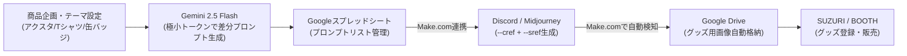

# Atelier Rei グッズ制作・自動化プロジェクト 基本計画書

## 1. プロジェクト概要
* **プロジェクト名**：Atelier Rei（アトリエ・レイ）グッズ制作＆画像生成自動化プロジェクト
* **ブランドコンセプト**：
  『SNSにゅーす』の黒曜 怜衣（Rei）がディレクションする公式グッズブランド。
  サイバーパンク、ネオン、ストリートカルチャーを融合させたハイセンスなアパレル・雑貨・アクリルグッズを展開。
* **展開プラットフォーム候補**：SUZURI / BOOTH（無在庫オンデマンド製造・受注生産）
* **連携メディア**：『SNSにゅーす』（`https://sns-news.jp`）ヘッダー「Atelier Rei」導線

---

## 2. 目的とゴール
1. **4人娘（乃愛・芽依・詩羽・怜衣）の魅力を最大化したグッズ展開**
   * アクリルスタンド、Tシャツ、パーカー、ステッカー、缶バッジ、スマホケース等の商品ラインナップ化。
2. **トークン・コスト最小化 × 高品質画像生成パイプラインの確立**
   * Gemini 2.5 Flashでプロンプトの差分キーワードのみを高速生成（消費トークン最小化）。
   * Midjourney v6.1の `--cref`（キャラ参照）と `--sref`（画風参照）により、キャラ崩れゼロの超高品質イラストを出力。
3. **Make.comを活用したノーコード自動化**
   * サーバー不要のクラウド連携（Make.com無料枠）で、プロンプト投入から画像回収・整理を省力化。

---

## 3. システム・技術構成

* **プロンプト生成AI**：Google Gemini 2.5 Flash（無料枠 / 超低コスト）
* **画像生成エンジン**：Midjourney v6.1（`--cref` キャラクター参照、`--sref` スタイル参照）
* **ワークフロー自動化 (iPaaS)**：Make.com（クラウドノーコード、月1,000オペレーション無料）
* **画像保管・共有**：Google Drive（専用Gmailアカウント）
* **キャラクター原画・参照元**：
  * メインキャラ仕様：`C:\Obsidian\LLM Folder\02_Projects\AI_Curation_Media\02_超ド派手4人娘キャラクター_仕様書.md`
  * マスター設定画（4人）：
    * 有栖川 乃愛: `profile_01_arisugawa_noa.jpg`
    * 若葉 芽依: `profile_02_wakaba_mei.jpg`
    * 緋宮 詩羽: `profile_03_himiya_uta.jpg`
    * 黒曜 怜衣: `profile_04_kokuyo_rei.jpg`

---

## 4. プロジェクトロードマップ

### Phase 1: プロンプト生成エンジン＆リファレンス設計
- [ ] 4人の公式設定画からMidjourney用リファレンスURL（`--cref`）の整備
- [ ] グッズ種別（アクスタ・Tシャツ・缶バッジ）ごとのベースプロンプトテンプレート策定
- [ ] Gemini 2.5 Flashによる差分キーワード生成テスト（低トークン化検証）

### Phase 2: Make.comによる自動化検証
- [ ] Make.comのアカウント作成（専用Gmail）
- [ ] スプレッドシート ⇄ Discord ⇄ Google Drive の連携シナリオ構築
- [ ] 画像の自動保存・解像度確認

### Phase 3: ショップ開設＆商品化
- [ ] SUZURI / BOOTH公式ショップ「Atelier Rei」の開設
- [ ] 第1弾グッズ（怜衣モデル・4人集合モデル）の登録・プレビュー検証
- [ ] 『SNSにゅーす』Webサイトとのリンク疎通確認
