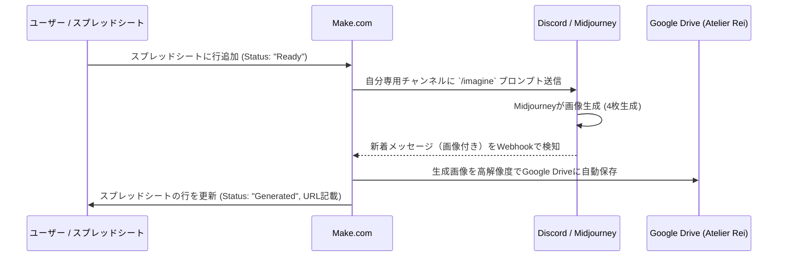

# Atelier Rei 画像生成＆Make自動化設計書

## 1. プロンプト生成アーキテクチャ（スロット方式）

### 課題と解決策
* **課題**：LLMに全身の特徴（髪色、目の色、装飾など）を毎回長文で書かせると、トークンを激しく消費し、プロンプトごとのブレやキャラクター崩れが発生する。
* **解決策**：
  1. キャラクターの容姿は **Midjourneyの `--cref <設定画URL>`** に100%委ねる。
  2. 画風は **`--sref <公式スタイル画URL>`** で完全統一する。
  3. LLM（Gemini 2.5 Flash）には **「シチュエーション・ポーズ・小物」の数単語（スロット部）** のみを生成させる。

---

## 2. プロンプト構成テンプレート

```text
[画質・作風ベース] + [キャラクター指定] + [LLM生成スロット (衣装/ポーズ/小物/表情)] + [グッズ構図指定] + [Midjourneyパラメータ]
```

### スロット定義
| スロット項目 | 内容例 | LLM生成 |
| :--- | :--- | :---: |
| `{character}` | cool anime girl with black twintails and neon purple streak | 固定辞書 |
| `{theme_outfit}` | cyberpunk oversized hoodie, glowing tactical belt | ○（Gemini） |
| `{pose_action}` | adjusting wireless headphones, wink and confident smile | ○（Gemini） |
| `{item}` | holding holographic tablet with spray-paint nozzle | ○（Gemini） |
| `{goods_spec}` | clean vector line art, white background, full body view | グッズ種別別固定 |
| `{params}` | `--ar 1:1 --v 6.1 --cref <URL> --cw 85 --sref <URL>` | パラメータ固定 |

---

## 3. グッズ種別ごとの構図・パラメータ仕様

### ① アクリルスタンド（アクスタ）
* **必須指定**：`full body view, standing upright, clean vector lines, pure white background, no clipping, master anime figure style`
* **アスペクト比**：`--ar 1:1` または `--ar 2:3`
* **特徴**：切り抜きが容易なように「白背景（white background）」と「足元まで収まる全身構図」を固定。

### ② Tシャツ・パーカー・アパレル
* **必須指定**：`streetwear graphic art, dynamic angle, bold line work, high contrast, typography accent, centered composition`
* **アスペクト比**：`--ar 1:1` または `--ar 3:4`
* **特徴**：胸元や背中に映えるストリートアート調・ボックスロゴ調のデザイン。

### ③ 缶バッジ・ステッカー
* **必須指定**：`circular composition friendly, close-up upper body, chibi or super deformed style, bold outlines, vibrant pastel-neon`
* **アスペクト比**：`--ar 1:1`
* **特徴**：丸型・ダイカットステッカー向けに、顔周りや上半身を大きく強調。

---

## 4. Make.com 連携シナリオ設計



### Make.com で使用するモジュール
1. **Google Sheets**: `Watch Rows`（ステータスが未処理のプロンプトを検知）
2. **Discord**: `Send a Message`（プロンプトをDiscordボット経由で送信）
3. **Discord**: `Watch Channel Messages`（Midjourneyボットの返信を待機）
4. **HTTP / Google Drive**: `Download File` ➔ `Upload a File`（生成された画像を特定フォルダに格納）
5. **Google Sheets**: `Update Row`（完了フラグとドライブリンクを追記）

---

## 5. 次のステップ
1. Make.com の無料アカウント登録（専用Gmail）
2. 4人娘の設定画画像のWeb公開URL化（Cloudflare等に配置して `--cref` で参照できるようにする）
3. 第1号テストプロンプトの実行
