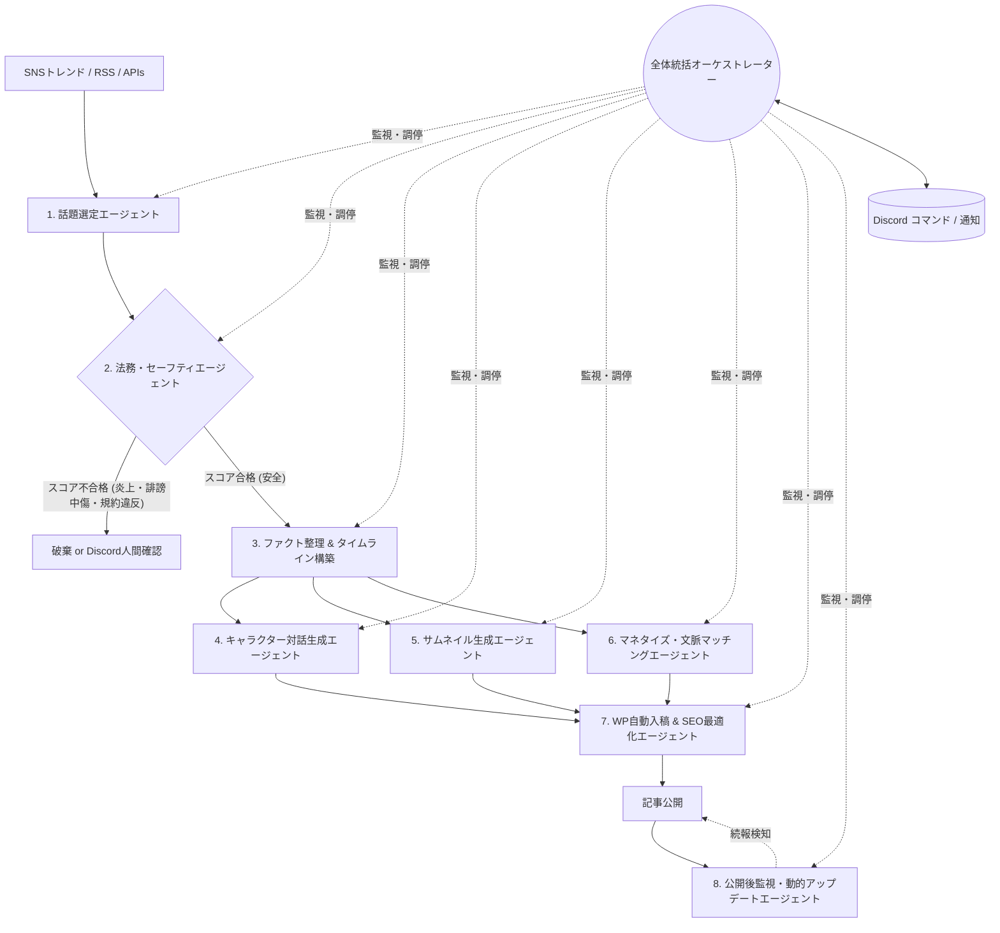

# 🌐 プロジェクト仕様書：SNS特化型AIキュレーションメディア（v2.0 改訂版）

---

## 1. プロジェクト概要・コンセプト

* **事業ゴール:** 
  世界中のマルチSNS（X、Instagram、TikTok、YouTube）のトレンド・バズ・話題を収集し、AIエージェントによる自動キュレーション・多言語配信を行う高トラフィックメディアプラットフォームの構築。
* **独自の強み (USP):**
  * **4人のAIキャラクターによる討論・解説:** 「天才」「初心者」「ポジティブ」「心配性」の4ペルソナがバラエティ番組風に対話・議論を展開。
  * **生きたネットスラング＆トレンド寿命管理:** 流行語や言い回しの鮮度をAI自身がスコアリングし、死語の自動淘汰と新語の積極採用を実施。
  * **独自付加価値（Information Gain）の担保:** 単なるまとめに留まらず、「時系列ファクトタイムライン」の整理と「読者アンケート投票（誰の意見に近いか）」を自動生成し、Google評価と読者滞在時間を最大化。
* **マネタイズ & SEO基本方針:**
  * Googleの検索品質ガイドライン（Helpful Content / E-E-A-T）に準拠した高品質キュレーション。
  * 話題の文脈にマッチするアフィリエイトリンクを自動選定し、親和性が低い場合はアドネットワーク/純広告に自動フォールバック。

---

## 2. インフラストラクチャ ＆ システム構成

```mermaid
graph TD
    User([一般ユーザー / クローラー]) --> CF[Cloudflare CDN / WAF / DNS]
    SD[スタードメイン] -. NS委任 .-> CF
    
    subgraph Contabo VPS [Contabo VPS環境]
        CF --> Nginx[Nginx Reverse Proxy]
        Nginx --> WP[WordPress / PHP-FPM]
        WP <--> MySQL[(MariaDB / MySQL)]
        WP <--> Redis[(Redis Object Cache)]
        
        Cron[Cron / Task Scheduler] --> PyEng[Python AI Engine / Orchestrator]
        PyEng <--> WP_API[WP REST API / WP-CLI]
        PyEng <--> PromptGit[Git 管理 .md プロンプト]
    end

    subgraph 外部サービス
        PyEng <--> LLM[LLM API (Gemini / OpenAI 等)]
        PyEng <--> SNS[SNS APIs / RSS / Trends]
        PyEng <--> Discord[Discord Bot (通知・対話指示)]
        WP --> MailRelay[外部SMTP (Resend / SendGrid)]
    end
```

* **ドメイン ＆ DNS:**
  * **スタードメイン:** ドメイン保有・契約管理。
  * **Cloudflare (無料〜Pro):** ネームサーバーをCloudflareに委任。エッジキャッシュ、DDoS保護、WAF、グローバルCDN（日本および欧米圏への超高速配信）を担当。
* **サーバー・実行環境 (Contabo VPS):**
  * **OS:** Ubuntu 24.04 LTS (Docker / Docker Compose によるコンテナ運用を推奨)。
  * **Web/DB構成:** Nginx + PHP 8.3 + MariaDB + Redis (Object Cache)。
  * **メール基盤:** サーバーIPのブラックリスト対策のため、送信メールは外部SMTP（Resend / SendGrid / Amazon SES）へ完全リレー。
* **CMS基盤 (WordPress):**
  * REST API / WP-CLI によるPythonバックエンドからの完全自動投稿・更新。
  * リビジョン保存数の制限（最大3件）、不要な自動保存の無効化。
* **司令塔 ＆ 通知ハブ (Discord):**
  * システムからの通知（選定ネタ、安全スコア、公開完了URL、デイリーPV/収益サマリー）。
  * Discordのスレッド/スラッシュコマンドによる自然言語でのプロンプト調整・緊急投稿停止指示。

---

## 3. URL マトリックス構造（多言語・マルチリージョン・SEO設計）

「言語（ja/en）」と「話題の発信地（japan/world）」の2軸による4マトリックス構造。

| パス | 対象言語 | 話題の地域 | 主な狙い・ターゲット |
| :--- | :--- | :--- | :--- |
| `/ja/japan/` | 日本語 | 日本国内 | 国内の最新バズ・トレンド（国内PVの主軸） |
| `/ja/world/` | 日本語 | 海外・グローバル | 海外でバズっている最新ミーム・技術・ニュースの日本語解説 |
| `/en/japan/` | 英語 | 日本国内 | 日本のサブカル・ポップカルチャー・トレンドを海外へ発信（高単価外貨獲得） |
| `/en/world/` | 英語 | 海外・グローバル | 英語圏のグローバルバズを網羅するグローバル向けメディア |

### 🌐 SEO・ルーティング仕様
* **トップページ (`/`):** 
  * ジオIPによる強制リダイレクトは行わず、総合ポータル画面（言語・地域選択ナビ + 各マトリックスの最新人気記事）として運用（Googlebotのクロール最適化）。
* **多言語タグ (`hreflang`):** 
  * 各記事が多言語で相互展開される場合、HTML `<head>` 内に完全な `hreflang` 相互リンクを自動出力。
* **Canonical URL:**
  * 各マトリックスの独立記事ごとに正規URL（Canonical）を厳格に指定。

---

## 4. サイトUI・画面レイアウト ＆ 記事構造

### ① UIレイアウト
* **ヘッダー:** 言語/地域マトリックス切替ナビ ＋ 検索バー。
* **サブヘッダー (プラットフォーム別タブ):**
  * `[ 🌐 総合 ]` `[ 𝕏 X ]` `[ 📸 Instagram ]` `[ 🎵 TikTok ]` `[ 📺 YouTube ]`
* **サイドバー:**
  * 閲覧中カテゴリ連動「リアルタイム急上昇 TOP5」。
  * 今話題のハッシュタグ/トレンドワードクラウド。
  * 読者参加型投票のデイリー結果サマリー。

### ② 個別記事ページのコンテンツ構成
1. **ステータスバッジ:** 鮮度（例: 「今話題！」「急上昇」）、話題の議論熱量スコア。
2. **アイキャッチ:** AI自動生成サムネイル（キャラのリアクション付きデザイン）。
3. **【ファクト概要】3行サマリー:** 多忙な読者向けの要点即座把握セクション。
4. **【一次情報引用】公式埋め込み:** 規約に準拠したSNS公式埋め込み（oEmbed）。
5. **【メイン】4キャラ白熱対話セクション:**
   * ⚡ **有栖川 乃愛 (IT・インフラ):** データや背景事情、アルゴリズムをロジカルに解説。
   * 🧪 **若葉 芽依 (栄養学・代謝):** 健康信仰、身体パフォーマンス、ストイックな視点を主張。
   * 🔥 **緋宮 詩羽 (配信・歌):** 感情、熱狂、大衆共感を代弁し場を沸騰させる。
   * ⚖️ **黒曜 怜衣 (デザイン・法務):** 著作権、炎上リスク、美的調和のブレーキ役。
6. **【独自付加価値】読者アンケート投票モジュール:**
   * 「あなたは誰の意見に近い？」（ワンクリック投票機能・滞在時間向上）。
7. **【まとめ ＆ アフィリエイト】:**
   * 教訓・関連トピック。
   * 文脈親和性スコアに基づいて選定されたアフィリエイト枠（非該当時はアドセンス/純広告）。
8. **【動的追記】タイムライン履歴:**
   * 公開後3日間の続報・その後の展開を追記更新（Post自体ではなくカスタムフィールドで履歴管理）。

---

## 5. AIエージェント体制 ＆ 運用ガバナンス



### 役割分担一覧

1. **話題選定エージェント:** 各SNSのエンゲージメント急上昇ワードを常時監視し、記事候補をリストアップ。
2. **法務・セーフティエージェント:** 個人名・プライバシー侵害、名誉毀損リスク、係争中事件、センシティブ・暴力的内容をスクリーニング。Google AdSenseポリシー違反ワードを自動検知。
3. **ファクト整理＆タイムライン構築エージェント:** 一次情報の出典確認、時系列の事実関係を箇条書きで整理（ハルシネーション防止）。
4. **キャラクター対話生成エージェント:** 4キャラの口調・役割を忠実に守り、流行語の鮮度チェックを行いながら対話原稿を執筆。
5. **サムネイル生成エージェント:** キャッチコピー入りアイキャッチ画像、SNSシェア用OGP画像を生成。
6. **マネタイズ・文脈マッチングエージェント:** 記事内容とアフィリエイト商材辞書を照合。
7. **SEO・WP入稿エージェント:** タイトル、メタディスクリプション、見出し構造、内部リンク、多言語hreflangを最適化してWordPressへ入稿。
8. **公開後監視・動的アップデートエージェント:** 公開後72時間、当該話題の続報や関連投稿を追跡。
9. **全体統括オーケストレーター:** 各エージェントのパイプライン実行、トークン使用量監視、エラーハンドリング、Discord通知を一元管理。
