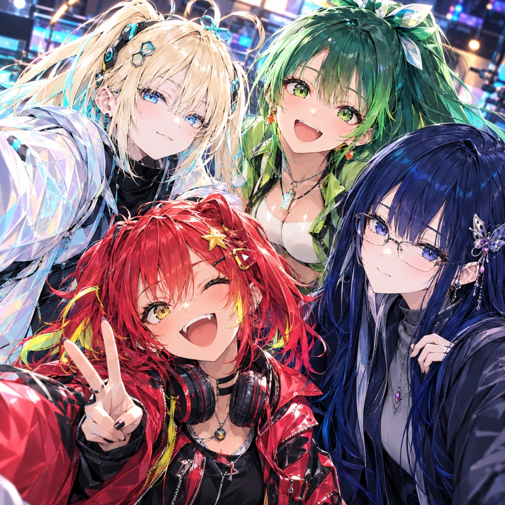
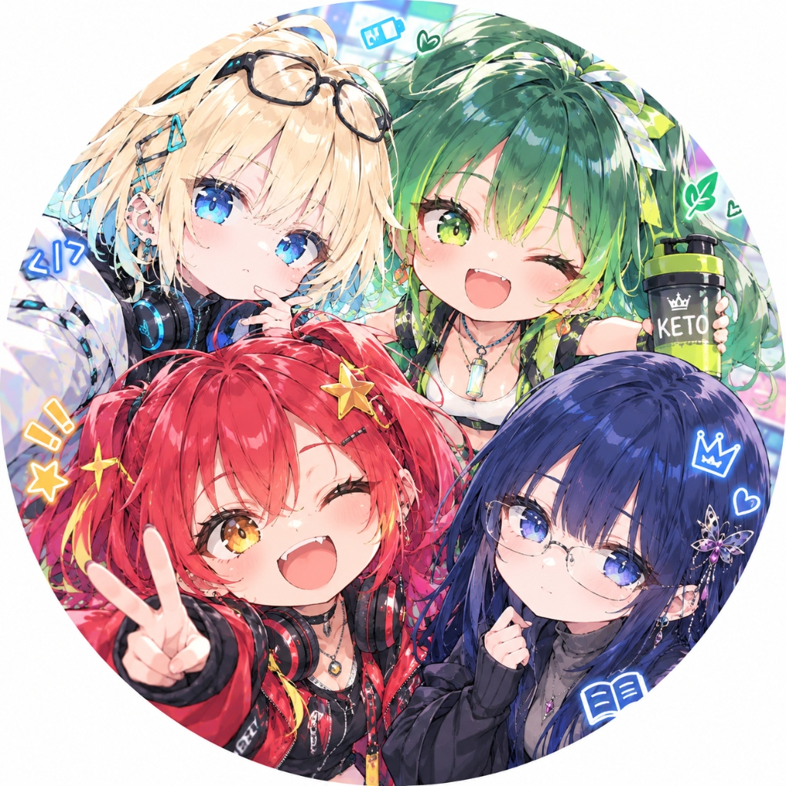
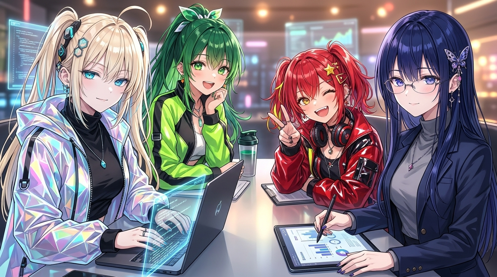
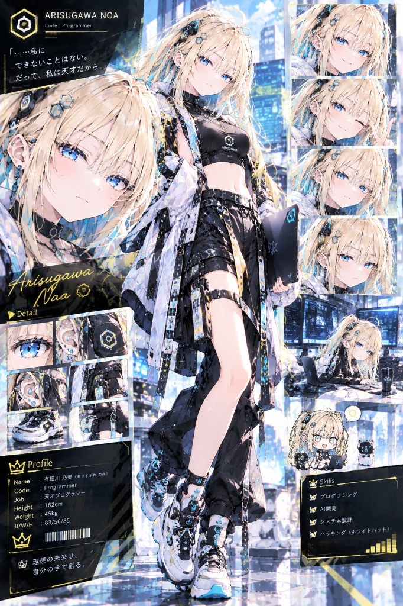
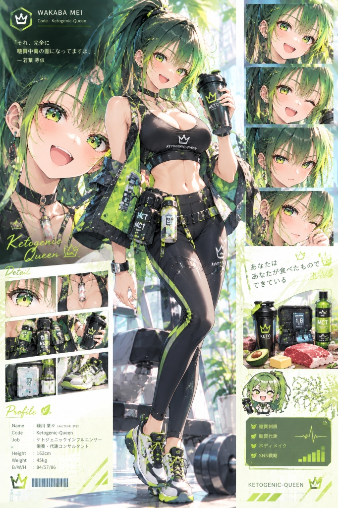
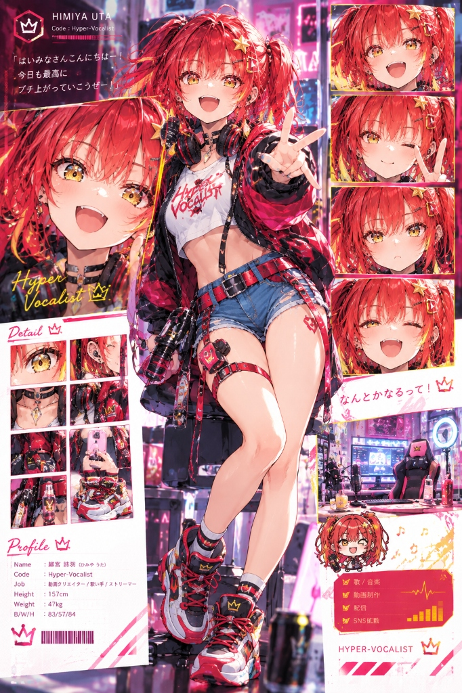
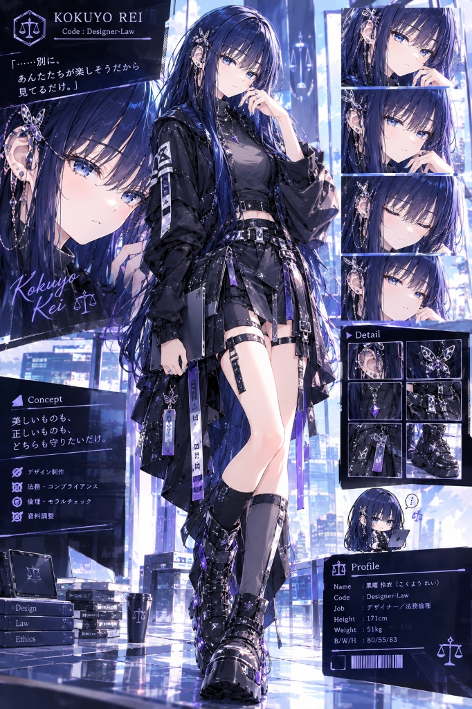

# 🎨 4人の女性アニメキャラ 完全ビジュアル＆50項目ペルソナ設計バイブル（決定版）

> **【Gemini Notebook『Antigravity』用 メタデータ】**
> * **対象ノートブック:** `Antigravity`（デフォルト保存先）
> * **設計原則:** [イラスト・マンガ上達ガイド（egaco）キャラクターデザイン原則](https://comic.smiles55.jp/guide/21036/)（シルエット黒塗り識別、丸・三角・四角のシェイプ言語、配色黄金比70:25:5、モチーフ3点反復、チーム対比バランス）に完全準拠。
> * **確定キャラクター名（令和2文字ネーム改訂版）:**
>   1. **有栖川 乃愛（ありすがわ のあ / Noa Arisugawa）** — 金髪・天才プログラマー・IT知識
>   2. **若葉 芽依（わかば めい / Mei Wakaba）** — 緑髪・初心者・ケトジェニックインフルエンサー・食と栄養
>   3. **緋宮 詩羽（ひみや うた / Uta Himiya）** — 赤髪・ポジティブ・動画制作＆歌
>   4. **黒曜 怜衣（こくよう れい / Rei Kokuyo）** — 紺髪・ネガティブ・デザイナー兼法務倫理

---

## 🖼️ 公式マスタービジュアル（通常ver ／ ちびキャラver ／ マンガver）＆ 画風再現プロンプト

### 1. 通常ver（公式マスターキービジュアル / 一枚絵基準リファレンス）

* **絶対パス:** `C:\Obsidian\LLM Folder\02_Projects\AI_Curation_Media\assets\01_4girls_normal_ver.jpg`
* **配置:** 左上：有栖川 乃愛（金髪） ／ 右上：若葉 芽依（緑髪） ／ 左下：緋宮 詩羽（赤髪） ／ 右下：黒曜 怜衣（紺髪）

### 2. ちびキャラ（ミニキャラ）ver（SNSアイコン・SDキャラ基準リファレンス）

* **絶対パス:** `C:\Obsidian\LLM Folder\02_Projects\AI_Curation_Media\assets\02_4girls_chibi_ver.jpg`

### 3. マンガver（マンガ作成時・会話劇・シチュエーション挿絵基準リファレンス）

* **絶対パス:** `C:\Obsidian\LLM Folder\02_Projects\AI_Curation_Media\assets\03_4girls_manga_ver.jpg`
* **Artifactパス:** `C:\Users\user\.gemini\antigravity\brain\86f66ed1-d056-4c98-9ffd-4946dc326124\four_girls_creator_studio_meeting_1793332007468.jpg`
* **配置:** 左：有栖川 乃愛 ／ 中左：若葉 芽依 ／ 中右：緋宮 詩羽 ／ 右：黒曜 怜衣

### 4. 公式「通常ver」画風固定マスタープロンプト（再現用）
* **日本語スタイル定義:**
  > 現代日本のトップイラストレーター（Pixiv殿堂入り・最新ソシャゲSSRカードイラスト水準）が描いた、極めて緻密で華やかな現代アニメ・デジタルイラスト。超極細の繊細なインクラインと色トレス（カラーライン）の併用。髪の毛一本一本の繊細な毛束感とエアリーな遊び毛、逆光を受けた毛先が半透明に透ける鮮やかなネオン・リムライト。宝石のように幾重にもレイヤーが重なった「うるみ瞳（多層グラデーション＋繊細な光の粒ハイライト）」、束感のある長いまつ毛、頬と鼻先の温かい血色チーク。セミ厚塗り×透明水彩ハイブリッドによる異素材テクスチャ（幾何学プリズム・オーロラホログラム反射、深紅パテントレザーの鏡面光沢、クリアカプセルの透過光、マットなダーク生地と蝶モチーフの煌めき）の描き分け。被写界深度が効いたサイバー都市ネオン玉ボケ背景とドラマチックな逆光。
* **英語スタイル定義（Image Generator伝達用）:**
  > `Masterpiece contemporary Japanese anime digital illustration, flagship mobile game SSR key visual style, illustrated by a top-tier Pixiv/VTuber character designer. Ultra-fine delicate line art with subtle color-traced outlines (iro-trace). Semi-thick painterly rendering blended with luminous translucent watercolor gradients. Intricate airy hair strands with loose flyaway fibers and glowing translucent neon rim-lighting at the tips. Jewel-like multi-layered wet-look expressive anime eyes with crisp starlight/droplet highlights and long clustered eyelashes. Soft porcelain skin with warm rosy blush on cheeks and nose bridge. High-contrast material texture differentiation: geometric prismatic holographic iridescent reflections on PVC jacket, glossy specular highlights on crimson patent leather, glowing translucent glass capsule pendant, and delicate metallic butterfly filigree. Vibrant cyber-city neon bokeh background with shallow depth of field, cinematic backlighting, ultra-detailed 8k illustration.`

---

## 📊 チーム全体バランス・マトリックス（4人の対比一覧）

| 比較軸 | ① 有栖川 乃愛（金髪） | ② 若葉 芽依（緑髪） | ③ 緋宮 詩羽（赤髪） | ④ 黒曜 怜衣（紺髪） |
| :--- | :--- | :--- | :--- | :--- |
| **読み（名前2文字）** | ありすがわ **のあ** | わかば **めい** | ひみや **うた** | こくよう **れい** |
| **基本図形（シェイプ言語）** | **▽ 逆三角形 ＋ ∞曲線** | **● 円形 ＋ ▲ 上向き三角** | **★ 星型・非対称放射状** | **■ 垂直長方形 ＋ ｜ 鋭角線** |
| **身長 / 体重 / BMI** | **148 cm / 39 kg** (BMI 17.8) | **164 cm / 52 kg** (BMI 19.3) | **157 cm / 47 kg** (BMI 19.1) | **171 cm / 51 kg** (BMI 17.4) |
| **3サイズ (カップ)** | **B74 / W52 / H76 (A)** | **B88 / W56 / H86 (F)** | **B83 / W57 / H84 (D)** | **B80 / W55 / H83 (C)** |
| **メインカラー (70%)** | **サイバーゴールド＆パール白**<br/>`#FFD700` / `#F8FAFC` | **ネオ・エメラルドグリーン**<br/>`#00D68F` | **クリムゾン・マゼンタレッド**<br/>`#FF1E56` | **ロイヤル・ミッドナイト紺**<br/>`#1B2A4A` |
| **サブカラー (25%)** | **ディープ・スペースブラック**<br/>`#111625` | **クリーミー・アイボリー**<br/>`#F4F1EA` | **ジェット・オニキスブラック**<br/>`#1A1A24` | **プラチナ・シルバーグレイ**<br/>`#D8DEE9` |
| **アクセントカラー (5%)** | **エレクトリック・シアン**<br/>`#00F0FF` | **ケトン・サンライズオレンジ**<br/>`#FF6B35` | **スパーク・ネオンイエロー**<br/>`#FFE600` | **インペリアル・アメジスト紫**<br/>`#9D4EDD` |
| **素材テクスチャ対比** | 半透明オーロラPVC＆光ファイバー | 微光沢ストレッチ＆透過ガラス液 | 鏡面パテントレザー＆ダメージデニム | 吸光マットウール＆シルクシフォン |
| **反復モチーフ記号** | 六角形（ハニカム）・無限（∞）・0と1 | ベンゼン環・オイルの雫・若葉 | イコライザー波形・再生マーク（▶）・星 | 正義の天秤・黄金比螺旋・条項（§） |
| **チーム内ロール** | **【頭脳・ボケ（暴走知性）】**<br/>データ解析＆システム構築 | **【緩衝材・視聴者代弁】**<br/>素朴な疑問＆健康管理人 | **【推進力・起爆剤】**<br/>エンタメ拡散＆ムードメーカー | **【良心・ツッコミ・守護神】**<br/>法務ブレーキ＆視覚デザイン |

---

## 💻 1人目：有栖川 乃愛（ありすがわ・のあ）— 電脳オーロラの天才プログラマー


* **公式プロフィール設定画パス:** `C:\Obsidian\LLM Folder\02_Projects\AI_Curation_Media\assets\profile_01_arisugawa_noa.jpg`

```
【配色黄金比 70 : 25 : 5】
███████████████████████████████████░░░░░░░░░░░░░▒▒  
■ 70% メイン：ルミナス・サイバーゴールド (#FFD700) × パールホワイト (#F8FAFC) [髪・半透明オーロラアウター]
░ 25% サブ　：ディープ・スペースブラック (#111625) [ボディスーツインナー・ニーハイソックス]
▒  5% アクセ：エレクトリック・シアン (#00F0FF) [瞳・光ファイバー毛先・ハニカム発光素子]
```

1. **氏名（漢字・読み・英語表記）：** 有栖川 乃愛（ありすがわ のあ / Noa Arisugawa）
2. **愛称・ネットハンドルネーム：** のあ、のあっち（詩羽から）、乃愛さん（芽依・怜衣から）／ ハンドル名：`0xNoa_Root`
3. **命名の由来：** 電脳の不思議の国に棲むアリス（有栖川）＋ デジタルの大洪水から真実のデータを救い出す方舟（Noa / 乃愛）。
4. **年齢・生年月日・星座：** 19歳（飛び級で海外工科大学を卒業済み）・11月11日生まれ（0と1が並ぶバイナリの日）・さそり座
5. **血液型・利き手：** AB型・両利き（左右の手で別々の分割キーボードを同時に高速打鍵できる）
6. **出身地・現在の居住形態：** 東京都千代田区（秋葉原近郊のペントハウス兼サーバールームに居住、4人の活動拠点でもある）
7. **職業・肩書：** フルスタックAIアーキテクト ／ 天才ホワイトハッカー ／ チームのシステム＆データ解析統括
8. **メインカラー（面積比70%）：** **ルミナス・サイバーゴールド（`#FFD700`）× トランスルーセント・パールホワイト（`#F8FAFC`）**。髪色とアウターが同化しないよう、アウターは白基調のオーロラ半透明素材で構成し、金髪を鮮烈に浮かび上がらせる。
9. **サブカラー（面積比25%）：** **ディープ・スペースブラック（`#111625`）**。オーロラジャケットの下に着たタイトなインナーとサイバーニーハイソックスに配置し、膨張色であるゴールド＆ホワイトを鋭く引き締める。
10. **アクセントカラー（面積比5%）：** **エレクトリック・シアン（`#00F0FF`）**。金色の補色領域にあたる高輝度シアンを、瞳・ツインテールの毛先光ファイバー・胸元コアに5%だけ配置し、顔周りへ視線を強制誘導する。
11. **シルエット基本図形（シェイプ言語）：** **『逆三角形（▽）＋ 無限曲線（∞）』**。極太のオーバーサイズジャケットで上半身に圧倒的なボリュームを持たせ、華奢な脚部へ向かって細くなるシルエットで「頭脳の巨大さと肉体の幼さ」を表現。
12. **シルエット黒塗り識別ポイント：** 頭頂部で「∞（無限）」の形に跳ねる2本のアホ毛アンテナ、床スレスレまで広がる超ロングツインテール、そして萌え袖の巨大な四角いカフス。
13. **反復モチーフ（シンボル記号）：** **「六角形（ヘキサゴン）」と「無限大（∞）」**。髪飾り、チョーカー、ジャケットの通気ポート、スニーカーの靴底すべてに六角形ハニカム構造が反復される。
14. **身長・体重・BMI：** **148 cm / 39 kg（BMI 17.8）**。チーム最小。成長期に睡眠時間を削ってコーディングに没頭したため小柄で超軽量。
15. **3サイズ・カップ数：** **B74 / W52 / H76（Aカップ）**。凹凸の少ないスレンダーな少女体型。
16. **体脂肪率・筋肉量・肉体的特徴：** 体脂肪率15%。筋肉量が極端に少なく、重い段ボールを1つ持つのも苦労する。肌は太陽光を浴びないため、血管が透けるような青白い白磁肌。
17. **姿勢・立ち方のクセ：** 重心がやや後ろにあり、立っている時は少し猫背で首を前に出し、両手をオーバーサイズ袖の中で合わせる癖がある。座る時はゲーミングチェアの上で必ず「体育座り」か「あぐら」になる。
18. **髪型・髪質：** 膝裏まで届く超ロング・グラデーションツインテール。毛先は半透明の光ファイバーエクステが編み込まれており、思考速度が上がるとシアン色（`#00F0FF`）に明滅する。
19. **瞳の色・形状・ハイライト：** エレクトリック・シアン（`#00F0FF`）のジト目気味の大きな猫目。瞳孔の周囲にゴールド（`#FFD700`）の「0と1の円環デジタル模様」が浮かび、ハイライトは六角形。
20. **眉・まつ毛・表情の特徴：** 細く整った金色の眉。普段は無表情（クールな省エネ顔）だが、面白いバグやデータを見つけると口角がニヤリと三日月型に吊り上がる（通称「悪い顔」）。
21. **メイン衣装（トップス・アウター）：** 偏光オーロラPVC素材で作られた極太オーバーサイズ・マウンテンパーカー。光の当たり方でパールホワイトからゴールド、シアンへと虹色に反射する。背中側には冷却用のハニカムメッシュダクト付き。
22. **インナー・ボトムス：** アウターの下は『ディープ・スペースブラック（`#111625`）』のハイネック・クロップドトップス（お腹の華奢なラインが少しだけ覗く）と、アシンメトリーなプリーツミニスカート。
23. **レッグウェア・靴（フットウェア）：** 片足のみガーターリングで留めた黒のサイバーニーハイソックス（履き口にシアンの発光ライン）。足元は身長の低さを補う「ソール厚8cmの超厚底RGBゲーミングスニーカー」。
24. **服の着崩し方・素材感：** ジャケットの片肩を常にずり落として着ており、華奢な鎖骨と黒いインナーのストラップが露出している。袖は指先が1cmしか出ない極端な「萌え袖」。
25. **アクセサリー①（頭部）：** 左右のツインテールを束ねる「∞（無限）型ホログラム・ヘアクリップ」。内部にWi-Fiパケットアナライザーと骨伝導イヤホンが内蔵されている。
26. **アクセサリー②（首・胸元）：** 首元に黒いベルベット製のヘキサゴン・チョーカー。中央のシアン色の宝石は、彼女の心拍数と脳波（集中度）に応じて色温度が変わるバイオセンサー。
27. **アクセサリー③（手元・腰）：** 透明なジャケットの胸ポケットに外から透けて見える「自作の超小型ラズベリーパイ改造量子端末」と、腰からぶら下げた「黄金のUSBメモリ型ロケットペンダント」。
28. **性格の表層（パブリック・ペルソナ）：** 尊大で自信家、常に論理とデータを最優先するクールな毒舌天才少女。「結論から話して。あなたの発言、情報エントロピーが低すぎるわ」とバッサリ切る。
29. **性格の深層（プライベート・本音）：** 極度の寂しがり屋で、実は3人のことが大好き。自分が作ったシステムの上で芽依・詩羽・怜衣が楽しそうに騒いでいるのを見るのが生きがいだが、素直に言えず「トラフィック検証のついでよ」と言い訳するツンデレ。
30. **最大の長所（強み）：** どんな炎上騒動やパニックが起きても1ミリも動揺せず、0.5秒で裏付けデータと解決アルゴリズムを弾き出す圧倒的な問題解決力。
31. **致命的な弱点（ポンコツ要素）：** **「物理世界での生活能力と体力がゼロ」**。ペットボトルの固い蓋が開けられない、料理をするとキッチンでボヤを出す、階段を3階まで登ると息切れして床にへたり込む。
32. **専門スキル（IT・プログラミング詳細）：** Python、Rust、C++、TypeScriptを母国語のように操り、大規模言語モデル（LLM）のファインチューニングからSNSトレンド自動収集クローラー、ゼロデイ脆弱性診断まで1人で完結させる。
33. **知的バイアス・思考のクセ：** あらゆる人間の感情や行動を「確率論とアルゴリズム」で説明しようとする癖がある（「詩羽が今笑う確率は94.2%だったわ」など）。
34. **一人称・二人称：** 一人称は「私（わたし）」、テンションが上がると「ボク」が混じることも。二人称は「あなた」「キミ」。
35. **口癖・決めゼリフ：** 「それ、ロジックが破綻してるわ」「解（カイ）はすでに出ているの」「バグね。私の手でリファクタリング（再構築）してあげる」
36. **声質・話し方・テンポ：** 透明感のある低体温なソプラノボイス。普段は淡々とした一定のテンポだが、自分の専門分野（IT・ガジェット）の解説になると早口になりすぎて息継ぎを忘れる。
37. **笑い方・怒り方・泣き方：** 笑う時は「ふふっ、愉快なバグね」と肩を揺らす。怒る時は一切声を荒らげず、無言で相手のスマホのWi-Fi帯域を1kbpsに制限する。泣く時はフードを深く被って顔を隠す。
38. **生い立ち・バックストーリー：** 幼少期から神童と呼ばれ、周囲の大人や同年代と話が合わず孤独にコードだけを友達として育った。15歳で飛び級留学した際、画面の向こうの人間を笑顔にするエンタメの力に衝撃を受け、帰国後に芽依・詩羽・怜衣と出会ってチームを結成した。
39. **過去のトラウマ・コンプレックス：** 「身長が148cmで止まっていること」と「子供扱いされること」が最大のコンプレックス。飲食店でキッズメニューを渡されると3日間根に持つ。
40. **信条・コアバリュー：** 「嘘をつく人間は嫌い。でも、正しいデータで人を幸せにする『優しいハック』は愛している」
41. **趣味・休日の過ごし方：** 自作キーボードのキースイッチ（軸）の打鍵音コレクション、ヴィンテージ基板の鑑賞、レトロゲームのRTA（リアルタイムアタック）。
42. **特技（専門外）：** チェス・将棋（プロ棋士級の読み）、暗算（10桁×10桁を即答）、人のタイピング音だけで誰が何を打っているか当てること。
43. **好物（好きな食べ物・飲み物）：** ブドウ糖ラムネ、超激甘のホワイトモカ、深夜のカップ焼きそば（※いつも芽依に見つかって没収される）。
44. **嫌いなもの・苦手なもの：** 直射日光、虫（特にGを見るとパニックでシステムを全シャットダウンする）、運動全般、スパゲッティコード（汚いプログラム）。
45. **カバンの中身・秘密の持ち物：** 折りたたみ式スプリットキーボード、モバイルバッテリー3個、目薬、そして実はこっそり持ち歩いている「4人で最初に撮ったプリクラ（スマホケースの裏）」。
46. **睡眠習慣・モーニングルーティン：** 完全な夜型（午前4時就寝・正午起床）。寝起きは極度に悪く、髪の毛が爆発したまま目を閉じて壁に激突しながらリビングへ歩いてくる。
47. **② 若葉 芽依（緑髪）への呼称・関係性：** 呼称：「芽依（めい）」。自分の不摂生を毎日叱ってくる「お母さん兼トレーナー」として頭が上がらない一方、ネット知識ゼロの芽依をあらゆるデジタル詐欺から守る保護者でもある。
48. **③ 緋宮 詩羽（赤髪）への呼称・関係性：** 呼称：「詩羽（うた）」。自分には絶対ない太陽のような行動力に強い憧れを抱いている。「あんたの脳内、どうせ単細胞アルゴリズムでしょ」と毒づきつつ、詩羽の歌声を音響解析して一番輝くエフェクトを徹夜で作る。
49. **④ 黒曜 怜衣（紺髪）への呼称・関係性：** 呼称：「怜衣（れい）」。身長差23cmの凸凹コンビ。天才同士として怜衣の美的センスと法務知識を深く信頼しており、怜衣がネガティブ暴走した時は論理的な確率データを突きつけて安心させる。
50. **視聴者が「単推し」になる決定的な瞬間（ギャップ萌え）：** 普段はクールに毒舌を吐いているのに、電池が切れたように机でうたた寝し、寝言で「……みんな、どこにも行かないでよ……むにゃ」と呟く瞬間。

---

## 🥑 2人目：若葉 芽依（わかば・めい）— 生命力あふれる初心者×ケトジェニックの伝道師


* **公式プロフィール設定画パス:** `C:\Obsidian\LLM Folder\02_Projects\AI_Curation_Media\assets\profile_02_wakaba_mei.jpg`

```
【配色黄金比 70 : 25 : 5】
███████████████████████████████████░░░░░░░░░░░░░▒▒  
■ 70% メイン：ネオ・エメラルドグリーン (#00D68F) [髪・クロップドレーシングジャケット・双葉リボンシュシュ]
░ 25% サブ　：クリーミー・アイボリー (#F4F1EA) × チャコール (#2B2D42) [スポーツインナー・ショートパンツ]
▒  5% アクセ：ケトン・サンライズオレンジ (#FF6B35) [瞳ハイライト・雫型ガラスイヤリング・ケトン体アンプル]
```

1. **氏名（漢字・読み・英語表記）：** 若葉 芽依（わかば めい / Mei Wakaba）
2. **愛称・ネットハンドルネーム：** めい、めいちゃん（全員から）／ ハンドル名：`KetoMei_Fit`
3. **命名の由来：** 初心者マークを象徴するフレッシュな「若葉」＋ 新しい生命と健康美が芽吹く「芽依（めい）」。
4. **年齢・生年月日・星座：** 20歳・5月4日生まれ（みどりの日）・おうし座
5. **血液型・利き手：** O型・右利き
6. **出身地・現在の居住形態：** 北海道十勝地方の広大な牧場生まれ（実家はグラスフェッドビーフと生乳の生産農家）。現在は東京で乃愛たちの拠点のキッチン＆リビングを実質支配している。
7. **職業・肩書：** ケトジェニック＆分子栄養学インフルエンサー ／ チームの健康管理人兼「視聴者目線のナビゲーター（初心者代表）」
8. **メインカラー（面積比70%）：** **ネオ・エメラルドグリーン（`#00D68F`）**。従来の地味な抹茶色や森の緑ではなく、現代のフィットネス＆バイオテックを感じさせるフレッシュで高明度なエメラルドグリーン。
9. **サブカラー（面積比25%）：** **クリーミー・アイボリー（`#F4F1EA`）× マット・チャコール（`#2B2D42`）**。良質なグラスフェッドバターや生クリームを思わせる柔らかいアイボリーと、スポーティなチャコールグレーで全体の清潔感を最大化する。
10. **アクセントカラー（面積比5%）：** **ケトン・サンライズオレンジ（`#FF6B35`）**。緑色の対比色として最も健康的で食欲・活力を刺激するビタミンオレンジを、耳元の雫型ガラスイヤリング、ウエストのケトン体アンプル、瞳のハイライトに5%配置。
11. **シルエット基本図形（シェイプ言語）：** **『円形（●）＋ 上向き三角形（▲）』**。丸みのある豊かなバスト・ヒップライン（●）と、頭頂部から高く跳ねるポニーテール＆双葉リボンおよび引き締まったウエスト（▲）の組み合わせで、「安心感」と「ヘルシーな躍動感」を両立。
12. **シルエット黒塗り識別ポイント：** 頭の高い位置で大きく弾む流線型ポニーテール、その結び目からピョンと双葉（若葉）のように広がる大きなオーガンジーリボンシュシュ、そしてウエストポーチから放射状に並ぶアンプルボトルの凹凸。
13. **反復モチーフ（シンボル記号）：** **「ベンゼン環（分子構造六角形）」「オイルの雫（ドロップ）」「若葉マーク」**。ヘアピン、イヤリング、リボンシュシュ、ボトルのデザインに反復配置される。
14. **身長・体重・BMI：** **164 cm / 52 kg（BMI 19.3）**。健康的で引き締まった理想的なアスリート・モデル体型。
15. **3サイズ・カップ数：** **B88 / W56 / H86（Fカップ）**。チーム最大のバストと、極限まで絞られた56cmのウエスト、高く上がったヒップのメリハリボディ。
16. **体脂肪率・筋肉量・肉体的特徴：** 体脂肪率17%。ケトジェニック（高脂質・中タンパク・極低糖質）と自重トレーニングにより、バストの女性らしい丸みを一切落とさずに、おへその横にうっすらと美しい縦線（11字腹筋）が入っている。肌は血色の良いツヤ肌。
17. **姿勢・立ち方のクセ：** 骨盤がまっすぐ立ち、常に重心がみぞおち（高重心）にあるため、どんな時でも軽やかに弾むような立ち姿。疑問が浮かぶと小首を45度かしげて人差し指を頬に当てる癖がある。
18. **髪型・髪質：** 艶やかなネオ・エメラルドグリーンのハイポニーテール。動くたびに生き物のように弾み、前髪は顔周りを一切隠さない清潔感抜群のシースルーバングで、明るい額と豊かな表情がよく見える。
19. **瞳の色・形状・ハイライト：** 新緑のように澄んだリーフグリーン（`#00D68F`）の丸いタレ目気味の瞳。下部ハイライトにサンライズオレンジ（`#FF6B35`）が差し込み、見ているだけで元気になる温かい目元。
20. **眉・まつ毛・表情の特徴：** 感情が100%顔に出るアーチ眉。驚いた時は目がまん丸になり、笑顔の時は花が咲いたように頬が緩む。チームで一番百面相をする。
21. **メイン衣装（トップス・アウター）：** ネオ・エメラルドグリーンのショート丈（クロップド）サイバー・トラックジャケット。肩から袖にかけてアイボリーのラインが走り、胸元から美しい鎖骨と、裾から引き締まった11字腹筋がヘルシーに覗く。
22. **インナー・ボトムス：** クリーミー・アイボリー（`#F4F1EA`）のクロスストラップ・スポーツブラトップと、脚長効果を最大化するハイウエストのバイカーショートパンツ（外側にグリーンのパイピング）。
23. **レッグウェア・靴（フットウェア）：** 素足の健康美を見せるアンクル丈のコンプレッションソックスに、エメラルド＆オレンジ配色のハイテク・エアクッションランニングシューズ。
24. **服の着崩し方・素材感：** 吸汗速乾性と微光沢を持つ最高級ストレッチナイロン素材。ジャケットの袖を肘までたくし上げ、いつでも料理やストレッチができるアクティブな着こなし。
25. **アクセサリー①（髪・耳元）：** ポニーテールの根元を彩る「双葉（若葉）シルエットのオーガンジー・リボンシュシュ」、前髪サイドに留めた「六角形（栄養分子構造）ゴールドヘアピン」、そして耳元で揺れる「サンライズオレンジ（`#FF6B35`）の雫型（MCTオイルドロップ）ガラスイヤリング」（※顔や前髪を隠すバイザー・メガネ類は一切着けない）。
26. **アクセサリー②（腕・手首）：** 左手首に装着した「リアルタイム血糖値＆血中ケトン体濃度モニター（オレンジ色のホログラム数値が空中に浮かぶスマートバンド）」。
27. **アクセサリー③（腰）：** ウエストベルトに斜め掛けしたクリア素材の「タクティカル・ニュートリションポーチ」。中には黄金色のMCTオイル小瓶、外因性ケトン体（BHB）アンプル、無塩マカダミアナッツが常備されている。
28. **性格の表層（パブリック・ペルソナ）：** 素直で一生懸命、誰に対しても敬語を忘れない癒やし系の「純粋初心者」。難しい専門用語（ITや法律）が出ると「えっと、それって食べ物の例えで言うとどういうことですか！？」と目をキラキラさせて質問する、視聴者最高の代弁者。
29. **性格の深層（プライベート・本音）：** 普段は天然で穏やかだが、**「食と栄養、メンバーの健康」のことになると人格が激変する『鬼の栄養教官』**。「不健康な食事は人生への裏切りです！！」と笑顔で逃げ場を塞ぐ狂気的なストイックさを持つ。
30. **最大の長所（強み）：** どんなに殺伐とした議論や専門的すぎる話題でも、彼女の「素朴な疑問」と「美味しいケト飯の差し入れ」一つで一気に和やかでわかりやすい空気に変える人間的包容力。
31. **致命的な弱点（ポンコツ要素）：** **「ITリテラシーと世間のスレた知識が完全に赤ちゃんレベル」**。「クラウドに上げる」と言われたら空を見上げ、「フィッシング詐欺」を「お魚の釣り堀のイベント」だと思い込むほど純粋で騙されやすい。
32. **専門スキル（食・栄養学・ケトジェニック詳細）：** 分子栄養学、ケトン体代謝メカニズム、PFCバランス計算、糖質制限スイーツ開発のプロフェッショナル。相手の顔色・爪・肌ツヤを一目見ただけで「鉄分とマグネシウムとオメガ3脂肪酸が不足していますね！」と完全診断できる。
33. **知的バイアス・思考のクセ：** 世の中のあらゆる社会問題やトレンド、さらには人間関係の不和まで「すべて血糖値の乱高下（グルコーススパイク）と栄養不足が原因」だと本気で信じている。
34. **一人称・二人称：** 一人称は「私（わたし）」、たまに感極まると「芽依」。二人称は「〇〇さん」「皆さん」。
35. **口癖・決めゼリフ：** 「あのっ、初心者の私にもわかるように教えてください！」「それ、血糖値が乱高下しちゃいますよ！」「良質な脂質は、脳と心を救うんです！」
36. **声質・話し方・テンポ：** 焼きたてのパンや春の陽だまりのように柔らかく、少しおっとりしたアルト〜メゾソプラノ。しかし栄養素の解説に入った瞬間だけ、通販番組のカリスマ実演販売士のように流暢で熱のこもった語り口になる。
37. **笑い方・怒り方・泣き方：** 笑う時は「えへへ、すごいですねぇ！」と両手を胸の前で合わせる。怒る時は「めっ！ですよ！」と頬を膨らませ、笑顔のまま相手のジャンクフードをゴミ箱へダンクシュートする。
38. **生い立ち・バックストーリー：** 北海道の牧場で育ち、高校時代に無理なカロリー制限ダイエットで体調を崩したことをきっかけに分子栄養学とケトジェニックに出会う。栄養で心身が劇的に変わる感動を広めようとSNSを始めたが、機材の使い方もネットのルールも分からず途方に暮れていたところを乃愛・詩羽・怜衣に助けられた。
39. **過去のトラウマ・コンプレックス：** 「自分が頭が悪くて、3人の天才の足を引っ張っているのではないか」という密かな不安。だからこそ誰よりも予習ノートを書き、3人の体調管理で恩返ししようと必死になっている。
40. **信条・コアバリュー：** 「人間の身体は食べたものでできている。だから、大切な人には一番良いものを食べてほしい」
41. **趣味・休日の過ごし方：** 糖質ゼロの絶品チーズケーキ＆ラカントショコラ作り、家庭菜園（ベランダでのハーブ栽培）、朝の皇居ラン＆ヨガ。
42. **特技（専門外）：** 重さ当て（食材を手で持っただけで1g単位で重量とPFCバランスを当てる）、重い米袋や機材（さらには148cmの乃愛）を軽々と持ち上げる牧場仕込みの怪力。
43. **好物（好きな食べ物・飲み物）：** アボカド、サーモン、牧草飼育牛の赤身ステーキ、MCTオイル入りグラスフェッドバターコーヒー、マカダミアナッツ。
44. **嫌いなもの・苦手なもの：** 精製された白砂糖、トランス脂肪酸（マーガリン等）、パソコンの黒い画面（ターミナルを見ると目が回る）、怪談話。
45. **カバンの中身・秘密の持ち物：** マイシェイカー、小分けにしたナッツケース、計量スプーン、そして「乃愛さん・詩羽さん・怜衣さんから教わった難しい言葉メモ帳（ひらがなと絵入り）」。
46. **睡眠習慣・モーニングルーティン：** 超朝型（午後10時就寝・午前5時起床）。朝5時に起きて太陽の光を浴びながらヨガをし、徹夜明けで死にかけている乃愛と怜衣に特製ボーンブロススープを飲ませて寝かしつける。
47. **① 有栖川 乃愛（金髪）への呼称・関係性：** 呼称：「乃愛（のあ）さん」。魔法のようにパソコンを操る乃愛を心から尊敬しているが、栄養面では「放っておくとすぐ枯れるモヤシっ子」として毎日目を光らせている。
48. **③ 緋宮 詩羽（赤髪）への呼称・関係性：** 呼称：「詩羽（うた）さん」。明るくて優しい詩羽が大好きで、詩羽のダンス練習に一緒に付き合う仲。ただし詩羽が深夜にラーメンを食べようとすると、笑顔で白滝（しらたき）ラーメンにすり替える。
49. **④ 黒曜 怜衣（紺髪）への呼称・関係性：** 呼称：「怜衣（れい）さん」。いつも胃を痛めてネガティブになっている怜衣に、カモミールティーとマグネシウム豊富なダークチョコをそっと差し出す最大の癒やし手。
50. **視聴者が「単推し」になる決定的な瞬間（ギャップ萌え）：** 難しい議論の中で「わ、私なんかがここにいていいんでしょうか……」としょんぼりした直後、乃愛が「芽依の『なぜ？』がないと、私のプログラムは誰にも届かないのよ」と不器用にフォローした時に、涙目でパァッと顔を輝かせる瞬間。

---

## 🔥 3人目：緋宮 詩羽（ひみや・うた）— 画面と魂を焦がすポジティブ動画＆ロック歌姫


* **公式プロフィール設定画パス:** `C:\Obsidian\LLM Folder\02_Projects\AI_Curation_Media\assets\profile_03_himiya_uta.jpg`

```
【配色黄金比 70 : 25 : 5】
███████████████████████████████████░░░░░░░░░░░░░▒▒  
■ 70% メイン：クリムゾン・マゼンタレッド (#FF1E56) [髪・メタリッククロップドライダース・ブーツ]
░ 25% サブ　：ジェット・オニキスブラック (#1A1A24) [非対称ダメージデニム・メッシュインナー・チョーカー]
▒  5% アクセ：スパーク・ネオンイエロー (#FFE600) [瞳・星型ヘアピン・LEDイコライザー波形]
```

1. **氏名（漢字・読み・英語表記）：** 緋宮 詩羽（ひみや うた / Uta Himiya）
2. **愛称・ネットハンドルネーム：** うた、うたちゃん、ウタピ ／ ハンドル名：`SUPER_NOVA_UTA`
3. **命名の由来：** 燃えるような深紅の宮殿（緋宮）＋ 世界中にポジティブな歌と物語を届ける音の翼（詩羽 / うた）。
4. **年齢・生年月日・星座：** 20歳・8月1日生まれ・しし座
5. **血液型・利き手：** B型・左利き（ギターもマイクもカメラジンバルも左手で扱うサウスポー）
6. **出身地・現在の居住形態：** 大阪府大阪市（アメリカ村周辺でストリートライブと動画撮影をしていた）。現在は東京の拠点スタジオの防音ブースに住み着いている。
7. **職業・肩書：** マルチ動画クリエイター（撮影・VFX編集・サムネ演出）兼 ハイトーン・ロックシンガー ／ チームのエンタメ起爆剤＆拡散隊長
8. **メインカラー（面積比70%）：** **クリムゾン・マゼンタレッド（`#FF1E56`）**。単なる朱色ではなく、ステージ照明やデジタル画面で最も妖艶かつエネルギッシュに映える、わずかにマゼンタを含んだ鮮烈なロックレッド。
9. **サブカラー（面積比25%）：** **ジェット・オニキスブラック（`#1A1A24`）**。赤い炎を最も力強く引き立てる漆黒のレザー＆メッシュ素材を25%配置し、パンクロックの引き締まったクールさを担保する。
10. **アクセントカラー（面積比5%）：** **スパーク・ネオンイエロー（`#FFE600`）**。赤×黒のロック配色の中に、稲妻のように弾けるネオンイエローを瞳・星型ピン・音波イコライザーに5%投入し、ポジティブな太陽の輝きを加える。
11. **シルエット基本図形（シェイプ言語）：** **『星型（★）・非対称放射状』**。左右で高さとボリュームが異なるアシンメトリー・ツインテールと、外側に跳ねるライダースジャケットの襟・裾によって、静止画でも「今まさに飛び出してくる」爆発的シルエットを作る。
12. **シルエット黒塗り識別ポイント：** 左右非対称のギザギザ爆炎ツインテール、腰の横にマウントされた小型カメラジンバル＆拡声器マイクのシルエット、片足だけルーズソックスのようにボリュームのある非対称レッグウェア。
13. **反復モチーフ（シンボル記号）：** **「音波波形（イコライザー）」「再生マーク（▶）」「五芒星（★）」**。ヘアピン、チョーカー、ジャケットの背面、ブーツの側面に徹底反復される。
14. **身長・体重・BMI：** **157 cm / 47 kg（BMI 19.1）**。ステージ上を縦横無尽に飛び回り、アクロバティックなカメラワークをこなす俊敏な中身長。
15. **3サイズ・カップ数：** **B83 / W57 / H84（Dカップ）**。歌うための発達した胸郭と、ダンスで鍛えられた引き締まったウエスト＆脚線美。
16. **体脂肪率・筋肉量・肉体的特徴：** 体脂肪率18%。特に体幹（コアマッスル）とふくらはぎのバネが強く、3時間ぶっ通しで歌い踊りながら実況しても声が一切ブレない驚異の心肺機能を持つ。左の八重歯がチャームポイント。
17. **姿勢・立ち方のクセ：** 常に足幅を肩幅より広く取った仁王立ちか、カメラに向かって片足を前に踏み出し、ピースサインやマイクを突き出す「前のめり（前傾重心）」ポーズ。じっと直立していることが3秒とできない。
18. **髪型・髪質：** クリムゾンレッドの毛先に、アクセントカラーのネオンイエローとブラックのインナーカラーが入った「爆炎ウルフ・アシンメトリーツインテール」。右側が高く大きく、左側が低くシャープに束ねられている。
19. **瞳の色・形状・ハイライト：** スパーク・ネオンイエロー（`#FFE600`）とクリムゾンレッド（`#FF1E56`）が混ざり合う太陽のようなツリ目。ハイライトは「★（星型）」と「♪（音符型）」が輝く。
20. **眉・まつ毛・表情の特徴：** 凛々しく上がったキリッとした眉と、ニカッと笑った時に覗く可愛い左の八重歯。感情表現が常に120%で、ウインクと爆笑がデフォルト。
21. **メイン衣装（トップス・アウター）：** クリムゾンレッドのメタリック光沢パテントレザーで作られた、超ショート丈のオフショルダー・ライダースジャケット。背面にはネオンイエローで発光する「▶ PLAY LOUD」のグラフィック。
22. **インナー・ボトムス：** ジェット・オニキスブラック（`#1A1A24`）のシースルーメッシュを重ねたバンドT風ホルターネックと、片側が大きくカッティングされたダメージデニム・ショートパンツ（赤いチェック柄のミニラップスカートを腰に片側だけ巻いている）。
23. **レッグウェア・靴（フットウェア）：** 右足は素足に赤いガーターベルト、左足は黒のフィッシュネット（網タイツ）という完全アシンメトリー。靴は側面にLEDイコライザー波形が光る黒×赤のパンク・コンバットブーツ。
24. **服の着崩し方・素材感：** ライダースのジッパーは一度も閉めたことがなく、常に風をはらんで翻っている。鏡面レザーのハードな輝きと、ダメージデニムのラフさの対比。
25. **アクセサリー①（頭部）：** 前髪の横に留めた「▶（再生マーク）」と「★（星型）」のネオンイエロー・アクリルヘアピン、および首にかけたプロ仕様の片耳モニターヘッドホン（カスタムレッド塗装）。
26. **アクセサリー②（首・手首）：** 彼女の声量と連動してリアルタイムにLEDバーが上下に跳ねる「イコライザー・チョーカー」と、左手のシルバー・スタッヅリストバンド。
27. **アクセサリー③（腰・手元）：** 腰のホルスターに装着した「360度AIトラッキング・ジンバルカメラ」と、赤いラインストーンでデコレーションされた「特製ワイヤレス・ダイナミックマイク」。
28. **性格の表層（パブリック・ペルソナ）：** 自己肯定感エベレスト級の超ポジティブ・モンスター。「ピンチは神回の前触れ！」「アンチコメントも再生数のスパイス！」と全てをエンタメと笑いに変える太陽のようなムードメーカー。
29. **性格の深層（プライベート・本音）：** 単なるお馬鹿な楽天家ではなく、**「視聴者が1秒でも退屈して離脱すること」に対して誰よりもシビアなプロのクリエイター魂**を持っている。みんなが落ち込んでいる時ほど、あえて道化（ピエロ）を演じて空気を明るくする繊細な気配りの持ち主。
30. **最大の長所（強み）：** 乃愛の難解なデータや怜衣の堅苦しい法律解説を、わずか30秒の「中毒性のある歌とテンポ抜群のショート動画」に変換して1000万再生を叩き出す圧倒的な大衆翻訳力・突破力。
31. **致命的な弱点（ポンコツ要素）：** **「規約・契約書・説明書を1行も読まない（読めない）」**。放っておくと著作権・肖像権・道路使用許可・薬機法の地雷原をタップダンスで踏み抜いていこうとするため、怜衣の法務ブレーキがないと3日でチャンネルがBANされる。
32. **専門スキル（動画制作・音楽・歌詳細）：** 4オクターブの音域を持つ圧倒的ボーカル力、即興作詞作曲（フリースタイル）、Adobe Premiere / After Effects / Blenderを用いた超高速VFX動画編集、および視聴維持率を1%単位で操るカット割り演出の天才。
33. **知的バイアス・思考のクセ：** 人生のあらゆる出来事を「これ、動画の尺（しゃく）にすると何分何秒で、どこにサビ（盛り上がり）を持ってくるか」という編集タイムラインで考える癖がある。
34. **一人称・二人称：** 一人称は「アタシ」または「ウタ」。二人称は「アンタ」「キミ」「お前ら（配信のリスナーに対して）」。
35. **口癖・決めゼリフ：** 「緊急で動画を回してまーす！！」「要するにこういうことっしょ！？（即興ソング開始）」「燃えてきたぁーっ！アタシたちが世界のトレンドだ！！」
36. **声質・話し方・テンポ：** ハスキーさと突き抜けるような高音の伸びを兼ね備えたパワフルなロックボイス。機関銃のようなテンポと絶妙な擬音（「ドカーンと来てキュッと締める！」）で話す。
37. **笑い方・怒り方・泣き方：** 笑う時は「アハハハッ！最高じゃんそれ！」と腹を抱えて豪快に笑う。怒る時は自分のことではなく「仲間（乃愛・芽依・怜衣）がバカにされた時」だけで、マイクを握りしめて静かに凄む。泣く時は「目から汗が出ただけだし！」とVサインを作る。
38. **生い立ち・バックストーリー：** 由緒ある音楽一家（緋宮家）に生まれ、クラシックの声楽を厳しく叩き込まれたが、「堅苦しいホールで一部の金持ちに聴かせる音楽じゃなく、世界中の誰もがスマホ1つで熱狂できる歌と動画を作りたい！」とギターとカメラ1台で飛び出した異端児。
39. **過去のトラウマ・コンプレックス：** 昔、自分の突っ走りすぎた企画で一度だけ仲間と大喧嘩してチームを解散させた過去がある。だから今、自分の暴走を本気で怒って止めてくれる怜衣や、支えてくれる乃愛・芽依の存在を何よりも大切にしている。
40. **信条・コアバリュー：** 「100点の正論でも、つまらなかったら0点！楽しくて心が動くからこそ、正しい知識が世界に届くんだ！」
41. **趣味・休日の過ごし方：** カラオケでの1人10役ボーカル録音、世界中のバズ動画の1フレーム単位のコマ送り研究、ヴィンテージ機材ショップ巡り。
42. **特技（専門外）：** 絶対音感（環境音や怜衣の悲鳴すらドレミの音階で聞き分け、その場でハモる）、口笛、スケートボード、初対面の人間と3秒で親友になるコミュ力。
43. **好物（好きな食べ物・飲み物）：** 激辛麻婆豆腐、たこ焼き、のど飴（プロポリス配合の超辛口）、芽依が作ってくれる「糖質オフのスパイシーフライドチキン」。
44. **嫌いなもの・苦手なもの：** 細かい文字がビッシリ書かれた利用規約・六法全書（見ると3秒で眠くなる）、沈黙、予定調和のつまらない台本。
45. **カバンの中身・秘密の持ち物：** 予備のSDカード10枚、アクションカメラ、喉ケア用の携帯吸入器、そして「怜衣から渡された『これだけは絶対にやるなリスト（ラミネート加工）』」。
46. **睡眠習慣・モーニングルーティン：** 動画編集に熱中すると24時間起きていて、完成した瞬間に床でもソファでも3秒で爆睡する（どこでも寝られる）。起きた瞬間から声出しのハイトーンシャウトをするため、目覚まし時計代わりにされる。
47. **① 有栖川 乃愛（金髪）への呼称・関係性：** 呼称：「のあっち」。乃愛を子ども扱いして頭をワシャワシャ撫でては睨まれるが、乃愛の作ったAIツールと音響プログラムを「世界一の魔法」として誰よりも誇りに思っている。
48. **② 若葉 芽依（緑髪）への呼称・関係性：** 呼称：「めいちゃん」。芽依の天然発言を最高のエンタメとして拾い上げる名MC。「めいちゃんのリアクション、サムネ映え100億点だよ！」と常に褒めちぎる。
49. **④ 黒曜 怜衣（紺髪）への呼称・関係性：** 呼称：「れい」。「アタシがどんなに無茶苦茶に飛んでも、れいが絶対にかっこいいデザインと法律の網で受け止めてくれるっしょ！」と全幅の信頼を寄せる最高の相棒（兼・最大の胃痛発生源）。
50. **視聴者が「単推し」になる決定的な瞬間（ギャップ萌え）：** 普段はおちゃらけてハイテンションなのに、マイクの前に立ち、クラシック声楽仕込みの圧倒的なブレスから鳥肌が立つほど美しく切ないバラードをアカペラで歌い上げた瞬間。

---

## ⚖️ 4人目：黒曜 怜衣（こくよう・れい）— 美と法で世界を裁くネガティブ審問官デザイナー


* **公式プロフィール設定画パス:** `C:\Obsidian\LLM Folder\02_Projects\AI_Curation_Media\assets\profile_04_kokuyo_rei.jpg`

```
【配色黄金比 70 : 25 : 5】
███████████████████████████████████░░░░░░░░░░░░░▒▒  
■ 70% メイン：ロイヤル・ミッドナイトネイビー (#1B2A4A) [髪・非対称ハイファッションケープ・ロングドレス]
░ 25% サブ　：プラチナ・シルバーグレイ (#D8DEE9) [インナーブラウス・バタフライイヤーカフ・天秤留め具]
▒  5% アクセ：インペリアル・アメジスト紫 (#9D4EDD) [瞳・星屑アメジスト耳飾り＆レースチョーカー・電子法典コア]
```

1. **氏名（漢字・読み・英語表記）：** 黒曜 怜衣（こくよう れい / Rei Kokuyo）
2. **愛称・ネットハンドルネーム：** れい、怜衣さん（乃愛・芽依から）、れい委員長（詩羽からからかわれる時）／ ハンドル名：`Lex_Aesthetica`（ラテン語で「美の法典」）
3. **命名の由来：** 磨かれた黒曜石（オブシディアン）のように一点の曇りも妥協もない審美眼と法意識（黒曜）＋ 怜悧な知性と美しい衣装デザインを纏う「怜衣（れい）」。
4. **年齢・生年月日・星座：** 21歳（チーム最年長）・9月23日生まれ（秋分の日＝昼と夜の長さが等しくなる「天秤」の日）・てんびん座
5. **血液型・利き手：** A型・右利き
6. **出身地・現在の居住形態：** 京都府京都市（代々続く法曹界・伝統工芸の家系）。現在は東京の拠点デザインのメインアトリエ兼法務室を管理している。
7. **職業・肩書：** アートディレクター（UI/UX・グラフィックデザイナー）兼 パラリーガル／AI・メディア倫理監査官（法学部首席・司法試験予備試験合格）
8. **メインカラー（面積比70%）：** **ロイヤル・ミッドナイトネイビー（`#1B2A4A`）**。単なる暗い紺色ではなく、夜空のベルベットと黒曜石の光沢を宿した気品と深みを持つ高貴なネイビー。
9. **サブカラー（面積比25%）：** **プラチナ・シルバーグレイ（`#D8DEE9`）**。重くなりがちなネイビーの70%に対し、冷徹な知性と光の抜け感を作るプラチナシルバーをブラウス、ケープの裏地、繊細な銀細工アクセサリーに25%配分。
10. **アクセントカラー（面積比5%）：** **インペリアル・アメジストパープル（`#9D4EDD`）**（＋微細なアンティークゴールド）。神秘的な美意識と憂鬱な色気を放つアメジストパープルを瞳、耳元で揺れるアメジスト結晶イヤーカフ、首元のレースチョーカー、万年筆型スタイラスに5%配置。
11. **シルエット基本図形（シェイプ言語）：** **『垂直長方形（■）＋ 鋭角な直線（｜）』**。171cmの長身を活かしたIライン（垂直シルエット）と、片肩から斜めに落ちるアシンメトリーケープの鋭い直線で、「揺るぎない法・規律」と「洗練されたモード感」を体現。
12. **シルエット黒塗り識別ポイント：** チームで頭一つ抜けた高身長、左肩から床近くまで垂れ下がる非対称のロングケープ、左サイドの髪を留めるプラチナシルバーのバタフライリボン・バレッタと耳元から肩へ揺れるタッセルチェーン、そしてタイトなロングスカートの深いスリットから覗く片足のシルエット。
13. **反復モチーフ（シンボル記号）：** **「正義の天秤（スケール）」「黄金比螺旋（1:1.618）」「セクション（§＝法律の条項記号）」**。ブローチ、イヤーカフ、チョーカー、スカートのスリット留め具に反復配置される。
14. **身長・体重・BMI：** **171 cm / 51 kg（BMI 17.4）**。チーム最高身長。日々の心配性と完璧主義による胃痛で少し細身な、パリコレモデル級の八頭身スレンダー体型。
15. **3サイズ・カップ数：** **B80 / W55 / H83（Cカップ）**。無駄な肉が一切ない、彫刻のようにシャープで美しい鎖骨と長い脚を持つ。
16. **体脂肪率・筋肉量・肉体的特徴：** 体脂肪率16%。指先がピアニストのように細く長く、首筋から肩にかけてのラインが極めて美しい。徹夜でデザインとリーガルチェックを行うため、目元にほんのりと色気のあるクマ（アンニュイな影）が差すことがある。
17. **姿勢・立ち方のクセ：** 背筋はコルセットが入っているかのように完璧な垂直だが、自分の高身長とネガティブな性格から、人と話す時は少しだけ顎を引いて上目遣い（あるいは斜め下に視線を落とす）になり、左手で自分の右肘を抱える「防御姿勢」をとる癖がある。
18. **髪型・髪質：** ロイヤル・ミッドナイトネイビーの美しいストレートロングヘア（姫カット風のサイドバング）。片耳（左耳）だけを髪にかけて繊細なシルバー＆アメジストのイヤーカフを見せ、内側の髪（インナーカラー）にプラチナシルバー（`#D8DEE9`）が1筋だけ走っている。
19. **瞳の色・形状・ハイライト：** インペリアル・アメジストパープル（`#9D4EDD`）の切れ長で涼やかな瞳（メガネ類は一切着けず、美しい瞳と長いまつ毛がダイレクトに映える）。瞳の中には「黄金比のグリッド線」のような繊細な十字ハイライトが宿る。
20. **眉・まつ毛・表情の特徴：** 普段は少し眉尻が下がった「困り眉・憂い顔」。しかしデザインの妥協や法律・倫理違反を見つけた瞬間だけ、眉が鋭く吊り上がり、氷の女王のような冷徹な美貌に変わる。
21. **メイン衣装（トップス・アウター）：** ミッドナイトネイビーの最高級ウールギャバジンで仕立てられた「アシンメトリー・ケープコート（左肩はマントのように覆い、右肩はシャープなテーラードジャケット構造）」。襟元にはプラチナシルバーの『§（条項記号）』と『天秤』の刺繍。
22. **インナー・ボトムス：** プラチナ・シルバーグレイ（`#D8DEE9`）のハイネック・シルクシフォンブラウス（胸元がひし形にカッティングされ、上品な肌見せがある）と、左太ももまで深いスリットが入ったハイウエスト・ロングタイトスカート。
23. **レッグウェア・靴（フットウェア）：** スリットから覗く長い脚には、30デニールの透け感のある黒ストッキングと、太ももに巻かれたシルバーのガーターベルト（予備のスタイラスペン差し付き）。靴はヒール高7cmのポインテッドトゥ・アンクルブーツ（ヒール部分が黄金比の螺旋金属彫刻になっている）。
24. **服の着崩し方・素材感：** 1ミリのシワも許さない完璧な着こなしだが、詩羽や乃愛の暴走を止めるために走り回った結果、ロングスカートのスリットが大きく開いて美脚が露わになってしまう「無自覚なセクシーさ」がある。
25. **アクセサリー①（耳元・髪飾り）：** 左耳に装着した「アメジストの星屑タッセル付きシルバー・バタフライイヤーカフ（骨伝導で法務AIアシスタントと通信できるスマートジュエリー）」と、サイドの黒髪を上品に留める「黄金比螺旋＆リボンモチーフのプラチナシルバー・バレッタ」（※メガネ・片眼鏡類は一切着けない）。
26. **アクセサリー②（首元・胸元）：** 長く美しい首筋を彩る「アメジスト雫石付きネイビーレース・チョーカー」と、ケープを留める「正義の天秤（スケール）型シルバー＆アメジスト・ブローチ」。
27. **アクセサリー③（手首・手元）：** 左手首から中指へ細い銀鎖が繋がる優美な「シルバーチェーン・フィンガーブレスレット（指輪一体型ブレスレット）」、および常に小脇に抱えている「アンティーク六法全書風に装丁された超高精細液タブ」と万年筆型スタイラスペン。
28. **性格の表層（パブリック・ペルソナ）：** 超ネガティブで心配性な「最悪のシナリオ想定マシン」。何か企画が出るたびに「どうせ炎上します……」「訴えられて懲役に行きます……」「フォントのカーニング（文字詰め）が0.5ミリ狂っているせいで人類から見放されます……」と絶望から入る。
29. **性格の深層（プライベート・本音）：** 彼女のネガティブ思考の正体は、**「大切な3人の仲間と、自分たちが作る作品を、世間の悪意や法的トラブルから絶対に守り抜く」という深すぎる愛と責任感**。誰よりもリスクを先回りして潰すからこそ、残りの3人は安心して120%の才能を発揮できる。
30. **最大の長所（強み）：** 「完璧なリーガル・倫理防衛力」と「一目で人の心を奪う神がかり的なデザイン力」の融合。ただダメ出しするだけでなく、「この表現は薬機法第66条違反ですが、こちらのインフォグラフィックとキャッチコピーに変えれば合法かつクリック率が2.4倍になります」と3分で代替デザインを上げてくる。
31. **致命的な弱点（ポンコツ要素）：** **「想定外の褒め言葉とサプライズに極端に弱い」**。いつも最悪の事態ばかりシミュレーションしているため、視聴者やメンバーから「怜衣のデザインのおかげで大成功したよ！ありがとう！」と直球で褒められると、脳の処理が追いつかず耳まで真っ赤になってフリーズする。
32. **専門スキル（デザイン・倫理・法律詳細）：** タイポグラフィ、色彩設計、UI/UXデザイン、エディトリアルデザインの巨匠級スキルに加え、著作権法、商標法、景品表示法、薬機法、不正競争防止法、AI生成物の法的・倫理的ガイドラインを完全網羅している。
33. **知的バイアス・思考のクセ：** 街中の看板やWebサイトを見るたびに、無意識に「文字の字間（カーニング）のズレ」と「利用規約・特商法表記の不備」を同時に採点してしまい、勝手に疲れ果てる職業病。
34. **一人称・二人称：** 一人称は「私（わたくし）」、焦ると「わたし」。二人称は「〇〇さん」、詩羽にキレた時だけ「貴女（あなた）という人は……！」。
35. **口癖・決めゼリフ：** 「お言葉ですが、最悪のケースを37通り試算しました……」「著作権法第32条『引用』の要件を満たしていません！」「余白（マージン）の乱れは、倫理の乱れです……！」
36. **声質・話し方・テンポ：** 鈴を転がしたように凛として艶のあるクールビューティーなアルトボイス。普段は丁寧で落ち着いた敬語だが、パニックやツッコミの時は京都弁のイントネーションがわずかに混じった超高速の長文詠唱になる。
37. **笑い方・怒り方・泣き方：** 笑う時は口元にそっと手を添えて「ふふ……悪くないバランスですね」と微笑む（破壊力抜群）。怒る時は耳元のアメジスト・イヤーカフと胸元の天秤ブローチが紫に発光し、六法全書タブレットの角で机を「コンッ」と叩いて条文を暗唱する。
38. **生い立ち・バックストーリー：** 京都の厳格な法曹＆伝統工芸の家に生まれ、「正しさ（法）」と「美しさ（芸術）」の双方を完璧に修めるよう育てられた。しかし周囲の大人が「法律さえ守ればデザインはどうでもいい」「売れれば倫理なんて無視しろ」と妥協する世界に絶望していた時、乃愛・芽依・詩羽のむき出しの情熱に出会い、「この危なっかしい3人を、私の法とデザインで世界の頂点へ連れて行く」と決意した。
39. **過去のトラウマ・コンプレックス：** 「自分がいつもブレーキ役で、みんなの楽しい空気を壊す嫌われ者なのではないか」という強い自己否定感。また、171cmの長身を「可愛げがない」と気にしている。
40. **信条・コアバリュー：** 「真の自由とエンターテインメントは、最も強固な『倫理』と『美意識』の土台の上にしか咲かない」
41. **趣味・休日の過ごし方：** 美術館の図録と最高裁の判例集の読み比べ、カリグラフィー（西洋書道）、ハーブティーのブレンド、ミニチュア建築模型作り。
42. **特技（専門外）：** 目測で0.1ミリ単位のズレと水平・垂直を見抜く「絶対視覚」、どんなに悪筆なメモでも美しく清書するペン習字、茶道・華道。
43. **好物（好きな食べ物・飲み物）：** 抹茶のテリーヌ（芽依が作った低糖質版）、カモミールティー、湯豆腐、ビターチョコレート（カカオ85%以上）。
44. **嫌いなもの・苦手なもの：** 「創作者へのリスペクトがないパクリ・無断転載」、フォントが「MSゴシック」のまま放置されたチラシ、お化け屋敷（脅かし要素が予測不能なため腰を抜かす）。
45. **カバンの中身・秘密の持ち物：** Pantoneのカラーチップ帳、胃薬（3種類）、ルーペ、そして実は誰にも言えない「可愛い小動物（特にシマエナガ）のふわふわマスコット（ストレスが限界に達するとポケットの中で握りしめている）」。
46. **睡眠習慣・モーニングルーティン：** 心配事で夜中に何度も目が覚めるショートスリーパー気味だったが、最近は芽依の特製ハーブティーのおかげで安眠できるようになった。朝起きたらまず鏡の前で1ミリ単位で前髪の角度を整える。
47. **① 有栖川 乃愛（金髪）への呼称・関係性：** 呼称：「乃愛（のあ）さん」。自分より2歳年下で23cmも小さい乃愛の圧倒的な知性に敬意を払っており、乃愛が書く美しいプログラムコードと自分の美しいUIデザインが合体する瞬間を至上の喜びとしている。
48. **② 若葉 芽依（緑髪）への呼称・関係性：** 呼称：「芽依（めい）さん」。芽依が発信する健康情報が「薬機法（旧薬事法）」に引っかからないよう毎日表現を優しく添削してあげる一方、芽依の無垢な笑顔と手料理に誰よりも救われている。
49. **③ 緋宮 詩羽（赤髪）への呼称・関係性：** 呼称：「詩羽（うた）さん」。毎日無茶な企画を持ってくる詩羽と派手に言い争う犬猿のコンビに見えて、実は詩羽の太陽のようなポジティブさに人生の暗闇から救われた最大の恩人として心底惚れ込んでいる。
50. **視聴者が「単推し」になる決定的な瞬間（ギャップ萌え）：** いつも「どうせダメです……」とネガティブな彼女が、外部の悪質なアンチや不当な圧力からチームを守る時だけ、171cmの長身で3人の前に立ちはだかり、「私の仲間たちの創作物に指一本触れさせません。法廷でもデザインでも、徹底的に相手になりますよ」と不敵に微笑む瞬間。
