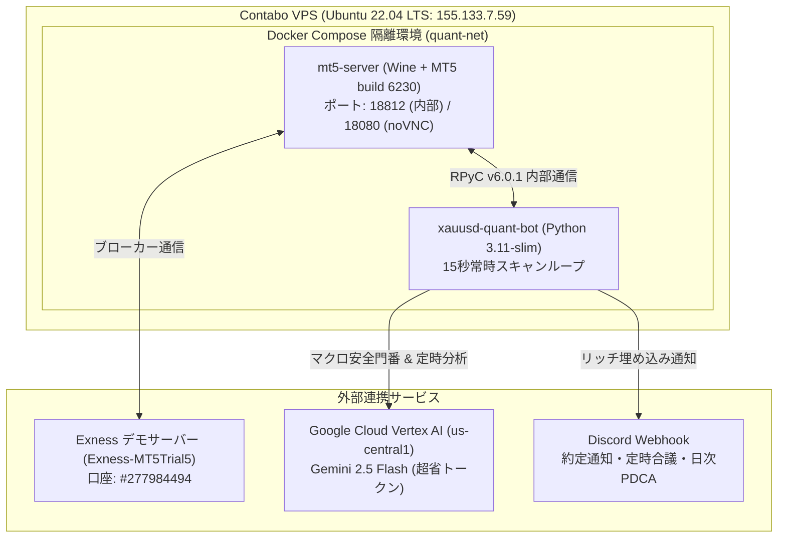

# 🤖 XAU/USD クオンツ自律取引システム マスター仕様書 ＆ 確定ルール (v8.3 Institutional Pro)

> [!IMPORTANT]
> 本ドキュメントは、`/compact` 後のコンテキスト復元および Gemini NotebookLM「Antigravity」ノートブック用のマスターリファレンスです。
> 過去の合意事項・禁止事項・設計原則を固定し、先祖返り（デグレ）を防止するために作成されました。

---

## 1. プロジェクト概要 ＆ インフラ構成

Contabo VPS 上で Docker コンテナにより完全隔離された環境下で、MetaTrader 5 (MT5) と Python クオンツエンジンが 24 時間 365 日リアルタイムに連携稼働する完全自律型ゴールド取引システム。

### 認証・環境情報
* **VPS接続**: `ssh root@155.133.7.59` (SSH鍵認証済み、パスワード不要)
* **VPSプロジェクトパス**: `/root/xauusd_ai_hedge_fund`
* **ローカルプロジェクトパス**: `C:\Users\user\.gemini\antigravity\scratch\xauusd_ai_hedge_fund`
* **MT5ブローカー情報**:
  * Broker: Exness Demo
  * Account Login: `277984494`
  * Server: `Exness-MT5Trial5`
  * Password: `aA!24861793`
* **Google Cloud Vertex AI**:
  * Project ID: `xauusd-ai-fund` (ADC認証済)
  * Model: `gemini-2.5-flash` (`thinking_budget: 0` 指定)
* **Discord Webhook**:
  * `https://discord.com/api/webhooks/1556945137257680907/CzP5QETlItJvdLr1zyLFSfPeFJJO_M9x2RnD0zcPDKRgqtNY0e_bCSafNkRvW7pY_GW4`

---

## 2. トレード戦略 (`SMC_Institutional_Pro_v8.3`)

「トレードしなさすぎる」問題を根本解決し、平常相場において**1日 5〜10 回**の優位性あるエントリーを安定執行する3大プロトリガー。

### 3大プロトリガー（マルチセットアップ並行監視）
1. **トリガー①: フラクタル・ピボット流動性スイープ (Fractal Pivot Sweep)**
   * M5足の直近フラクタル高安（左右2本より高い/低いピボット）および日次高安（PDH/PDL/AsiaH/L）を一瞬ヒゲで抜けた後、実体で押し戻されたストップ狩りを狙い撃つ。
   * SL: スイープ先 + 0.35 ATR (12〜55 pips) / TP: RR 1:1.8〜2.0 / 確信度: 0.88
2. **トリガー②: ICT Fair Value Gap (FVG / 不均衡ゾーン) リテスト**
   * 大口のインパルス急伸・急落で作られた未埋めギャップ（0.4ドル以上の価格空白）への戻りを検知し、順張り押し目・戻り目エントリー。
   * SL: FVG外側 + 0.3 ATR / TP: RR 1:1.8以上 / 確信度: 0.84
3. **トリガー③: トレンドモメンタム EMA20 プルバック反発**
   * M5足でパーフェクトオーダー（EMA20 > EMA50 または EMA20 < EMA50）時、EMA20へのタッチ＆反発ヒゲから順張り加速に乗る。
   * 確信度: 0.80

---

## 3. リスク管理 ＆ プロップファーム仕様の確定原則

1. **単一ポジション限定インターロック (One Position Only)**:
   * 1つのポジションが決済（TPまたはSL）されるまで、追加発注（ナンピン・両建て）は絶対に禁止。
2. **ブローカー側ハードSL/TPの即時付与**:
   * 成行約定と同時に、必ずExnessブローカーサーバーへ直接ハードSLおよびTPをミリ秒でセット（VPS切断時も完全安全）。
3. **【プロップ流】建値自動移動 (Break-Even Auto-Sliding)**:
   * 含み益が `+20 pips`（初期リスクと同等）に達した瞬間、SLを即座に「建値 ＋ 1 pip（微益確保）」へ自動スライド。
   * 「負けゼロ」状態で利を伸ばし、急激な全戻しヒゲ相場による損失を完全回避。
4. **スプレッド上限インターロック**:
   * 現在スプレッドが 3.0 pips を超える急変・拡大時は発注を自動ブロック。
5. **日次最大損失サーキットブレーカー**:
   * 日次資産の 3.0% 以上の損失を検知した場合は当日の取引を完全停止。

---

## 4. Discord通知・自律PDCA確定仕様

1. **毎時00分 AI合議体 定時分析レポート (`🤖 XAU/USD AI合議体 定時分析レポート`)**:
   * 📝 **合議体エグゼクティブ解説**（テクニカル・高安・相場レジーム）
   * 😈 **デビルズアドボケート (リスク反論)**（フェイクアウトや罠の指摘）
   * 🎬 **AIプロデューサー助言**（次セッションの立ち回り方針）
   * プロンプト高密度化 ＆ `thinking_budget: 0` により、1回約300トークンの超省トークンを厳守。
2. **実エントリー即時通知 (`⚡ 【実約定完了】 XAUUSD BUY/SELL`)**:
   * エントリーの瞬間に、売買種別、価格、SL/TP、動的ATR根拠、セットアップ解説、Geminiマクロ安全判定を即時通知。
3. **安全門番通知の廃止方針**:
   * 「AIマクロ安全門番発動（シグナル一時静観）」のDiscord通知およびメッセージ作成処理は、通知過多とノイズ排除のため**完全に停止（ログのみ記録）**。
4. **毎朝06:00 自律振り返り ＆ 安全パラメータ自己最適化 (`📋 【XAU/USD 日次トレード振り返り ＆ 自律改善レポート】`)**:
   * 取引回数（平常時目標5回以上に対しどうだったか？）、勝敗、相場とロジックの相性をGeminiが自己診断。
   * **安全ガードレール付き自動パラメータチューニング (`core/dynamic_optimizer.py`)**:
     * 資金防衛枠（単一ポジション限定、最大損失率、ハードSL付与、最大スプレッド上限）は絶対に自己変更不可。
     * 可変パラメータ（ヒゲ比率閾値 0.20〜0.60、FVGギャップ 0.20〜0.80ドル、最小RR 1.2〜2.5等）のみ、1回あたりの最大変動ステップ幅制限とハード上下限クランプを通過させて `config/dynamic_params.json` を安全に自動更新・常時ホットリロード。
   * 改善教訓を `logs/learning_journal.md` に永続蓄積。

---

## 5. 過去の失敗と教訓（Lessons Learned - デグレ厳禁）
* **【教訓1: RPyCバージョン不一致】**: Wine側MT5サーバー（RPyC 6系）とBot側クライアントでバージョンが異なると通信不能になる。Bot側は `rpyc==6.0.1` 固定。
* **【教訓2: 日次高安のみの監視による取引過少】**: 前日高安・アジア高安だけだと数日に1回しかエントリーされない。直近フラクタル高安・FVG・M5足の併用が必須。
* **【教訓3: 思考トークンの無制限消費】**: Gemini 2.5 Flashでthinking_budgetを指定しないとトークンを浪費する。`thinking_budget: 0` を常に指定すること。
* **【教訓4: 戻り相場での利益消失】**: ゴールドは急伸後の全戻しが多いため、+20pips乗った時点での建値移動（Break-Even）が不可欠。
* **【教訓5: コード直接自己書き換えによる破綻リスク】**: AIにPythonコードそのものを自己書き換えさせると構文エラーや過剰レバレッジ、ナンピン化の破綻リスクが生じるため、動的パラメータファイル（JSON）と安全クランプモジュール（ガードレール）を分離して自己最適化させること。

* **【教訓6: 過剰フィルターによる取引不全】**: 資金保護を意識しすぎてヒゲ比率40%やRR1.8を初手から要求すると高勝率な波を取りこぼす。ヒゲ比率0.30、直近2本合成スイープ検知、セッション空白時間（ロンドン前プレ市場等）の解放により、安全枠内で1日5〜10回の執行機会を確保すること。
