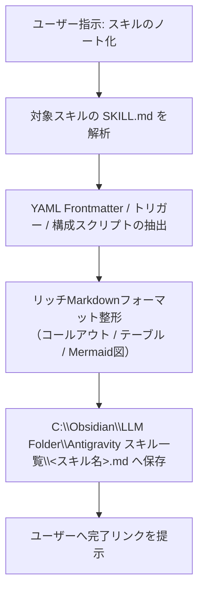

---
aliases:
  - "0bsidianTest001"
tags:
  - antigravity/skill
  - system/automation
  - obsidian
created_at: "2026-11-01 12:40"
updated_at: "2026-11-01 12:40"
skill_type: "custom"
status: "active"
---

# 🛠️ 0bsidianTest001

> [!NOTE]
> **概要**: Antigravityの各種スキル仕様・ワークフローをスキャンし、Obsidian上に人間が直感的に理解できるリッチなビジュアルノート（1スキル1ファイル）として自動生成・管理するスキルです。

---

## 📋 クイックサマリー

| 項目 | 内容 |
| :--- | :--- |
| **スキル名** | `0bsidianTest001` |
| **種別** | Antigravity Custom Skill |
| **保存先ディレクトリ** | `C:\Obsidian\LLM Folder\Antigravity スキル一覧\` |
| **実体定義ファイル** | [SKILL.md](file:///C:/Users/user/.gemini/config/skills/0bsidianTest001/SKILL.md) |
| **主な用途** | スキルのカタログ化、視覚的マニュアルの自動生成、第二の脳（Obsidian）連携 |

---

## 🎯 発動トリガー & 使用シナリオ

以下のような指示を受けた際に、Antigravityが自律的にこのスキルを呼び出します。

- 「このスキルをObsidianのスキル一覧にメモして」
- 「スキル一覧に新しいスキルのノートを作って」
- 「手持ちのスキルをObsidianにリッチなデザインでまとめて」
- 新規スキル作成時の自動ドキュメント生成フロー

---

## ⚡ ワークフロー・アーキテクチャ



---

## 🎨 ノートのデザイン標準

このスキルが生成する個別ノートは、以下の視覚要素を標準装備します：

1. **Obsidian Callouts (`[!NOTE]`, `[!TIP]`, `[!IMPORTANT]`)**: 要点や注意事項をハイライト
2. **Mermaid ダイアグラム**: 処理手順・データフローの図解
3. **ローカル絶対リンク (`file:///...`)**: ノート上からワンクリックで実際の `SKILL.md` や実行スクリプトを開く
4. **YAMLメタデータ**: ObsidianのDataviewやグラフビューでの検索・集計に最適化

---

## 💡 コピペで使えるプロンプト例

```text
0bsidianTest001 スキルを使用して、<スキル名> の仕様と使い方を「C:\Obsidian\LLM Folder\Antigravity スキル一覧\」にリッチなノートとして作成してください。
```

---

## 📁 関連ファイル
- スキル定義: [SKILL.md](file:///C:/Users/user/.gemini/config/skills/0bsidianTest001/SKILL.md)
- 保存先フォルダ: `C:\Obsidian\LLM Folder\Antigravity スキル一覧\`
