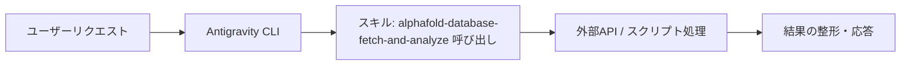

---
aliases:
  - "AlphaFold Database Fetch & Analyze"
  - "alphafold-database-fetch-and-analyze"
tags:
  - antigravity/skill
  - skill/plugin
created_at: "2026-11-01 13:00"
updated_at: "2026-11-01 13:00"
skill_type: "plugin"
status: "active"
---

# 🛠️ AlphaFold Database Fetch & Analyze (`alphafold-database-fetch-and-analyze`)

> [!NOTE]
> **概要**: UniProt IDからAlphaFoldのタンパク質立体構造予測データを取得し、信頼度（pLDDT）やドメイン境界を解析するスキル。

---

## 📋 クイックサマリー

| 項目 | 内容 |
| :--- | :--- |
| **スキル識別名** | `alphafold-database-fetch-and-analyze` |
| **カテゴリ** | plugin |
| **定義ファイル** | [SKILL.md](file:///C:/Users/user/.gemini/config/plugins/science/skills/alphafold_database_fetch_and_analyze/SKILL.md) |
| **主要機能** | AlphaFold DBからの構造データ取得、ドメイン境界・ディスオーダー予測の評価 |

---

## 🎯 発動トリガー & 使用シナリオ

- **発動キーワード / 指示例**:
  - UniProt IDを指定しての立体構造予測取得、pLDDT信頼度解析
- **典型的なユースケース**:
  - AlphaFold DBからの構造データ取得、ドメイン境界・ディスオーダー予測の評価 に関するタスクをAntigravityに依頼した際に自動で発動・参照されます。

---

## ⚡ ワークフロー



---

## 💡 プロンプト例

```text
UniProt IDを指定しての立体構造予測取得、pLDDT信頼度解析
```

---

## 📁 関連ファイル
- スキル定義: [SKILL.md](file:///C:/Users/user/.gemini/config/plugins/science/skills/alphafold_database_fetch_and_analyze/SKILL.md)
