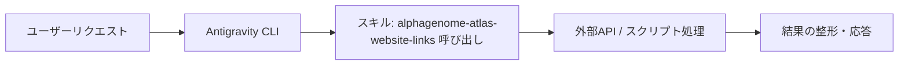

---
aliases:
  - "AlphaGenome Atlas Deep Links"
  - "alphagenome-atlas-website-links"
tags:
  - antigravity/skill
  - skill/plugin
created_at: "2026-11-01 13:00"
updated_at: "2026-11-01 13:00"
skill_type: "plugin"
status: "active"
---

# 🛠️ AlphaGenome Atlas Deep Links (`alphagenome-atlas-website-links`)

> [!NOTE]
> **概要**: AlphaGenome Atlas WebサイトのディープリンクURLを構築し、ゲノム変異や遺伝子座の可視化を支援するスキル。

---

## 📋 クイックサマリー

| 項目 | 内容 |
| :--- | :--- |
| **スキル識別名** | `alphagenome-atlas-website-links` |
| **カテゴリ** | plugin |
| **定義ファイル** | [SKILL.md](file:///C:/Users/user/.gemini/config/plugins/science/skills/alphagenome_atlas_website_links/SKILL.md) |
| **主要機能** | AlphaGenome Atlasへのディープリンク生成、変異・遺伝子座のURLマッピング |

---

## 🎯 発動トリガー & 使用シナリオ

- **発動キーワード / 指示例**:
  - 変異探索リンク生成時、AlphaGenome Atlasでの視覚的確認要求時
- **典型的なユースケース**:
  - AlphaGenome Atlasへのディープリンク生成、変異・遺伝子座のURLマッピング に関するタスクをAntigravityに依頼した際に自動で発動・参照されます。

---

## ⚡ ワークフロー



---

## 💡 プロンプト例

```text
変異探索リンク生成時、AlphaGenome Atlasでの視覚的確認要求時
```

---

## 📁 関連ファイル
- スキル定義: [SKILL.md](file:///C:/Users/user/.gemini/config/plugins/science/skills/alphagenome_atlas_website_links/SKILL.md)
