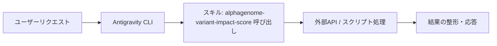

---
aliases:
  - "AlphaGenome Variant Impact Score (AVI)"
  - "alphagenome-variant-impact-score"
tags:
  - antigravity/skill
  - skill/plugin
created_at: "2026-11-01 13:00"
updated_at: "2026-11-01 13:00"
skill_type: "plugin"
status: "active"
---

# 🛠️ AlphaGenome Variant Impact Score (AVI) (`alphagenome-variant-impact-score`)

> [!NOTE]
> **概要**: AVIスコアを用いて遺伝子変異の機能的影響を数値化・アノテーションし、飽和変異導入スキャンを行うスキル。

---

## 📋 クイックサマリー

| 項目 | 内容 |
| :--- | :--- |
| **スキル識別名** | `alphagenome-variant-impact-score` |
| **カテゴリ** | plugin |
| **定義ファイル** | [SKILL.md](file:///C:/Users/user/.gemini/config/plugins/science/skills/alphagenome_variant_impact_score/SKILL.md) |
| **主要機能** | AlphaGenome Variant Impactスコアの取得、GENCODE座標マッピング |

---

## 🎯 発動トリガー & 使用シナリオ

- **発動キーワード / 指示例**:
  - AVIスコアの算出、変異アノテーション、飽和変異導入スキャンの実施時
- **典型的なユースケース**:
  - AlphaGenome Variant Impactスコアの取得、GENCODE座標マッピング に関するタスクをAntigravityに依頼した際に自動で発動・参照されます。

---

## ⚡ ワークフロー



---

## 💡 プロンプト例

```text
AVIスコアの算出、変異アノテーション、飽和変異導入スキャンの実施時
```

---

## 📁 関連ファイル
- スキル定義: [SKILL.md](file:///C:/Users/user/.gemini/config/plugins/science/skills/alphagenome_variant_impact_score/SKILL.md)
