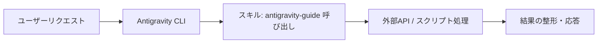

---
aliases:
  - "Antigravity Comprehensive Guide"
  - "antigravity-guide"
tags:
  - antigravity/skill
  - skill/builtin
created_at: "2026-11-01 13:00"
updated_at: "2026-11-01 13:00"
skill_type: "builtin"
status: "active"
---

# 🛠️ Antigravity Comprehensive Guide (`antigravity-guide`)

> [!NOTE]
> **概要**: Antigravity CLI (agy)、IDE、スラッシュコマンド、キーバインドなどの総合操作マニュアル・クイックリファレンス。

---

## 📋 クイックサマリー

| 項目 | 内容 |
| :--- | :--- |
| **スキル識別名** | `antigravity-guide` |
| **カテゴリ** | builtin |
| **定義ファイル** | [SKILL.md](file:///C:/Users/user/.gemini/antigravity-cli/builtin/skills/antigravity_guide/SKILL.md) |
| **主要機能** | CLI操作マニュアル、スラッシュコマンドリファレンス、ショートカットキー・設定ガイド |

---

## 🎯 発動トリガー & 使用シナリオ

- **発動キーワード / 指示例**:
  - 「Antigravityの使い方」「コマンド一覧」「設定項目の説明」
- **典型的なユースケース**:
  - CLI操作マニュアル、スラッシュコマンドリファレンス、ショートカットキー・設定ガイド に関するタスクをAntigravityに依頼した際に自動で発動・参照されます。

---

## ⚡ ワークフロー



---

## 💡 プロンプト例

```text
「Antigravityの使い方」「コマンド一覧」「設定項目の説明」
```

---

## 📁 関連ファイル
- スキル定義: [SKILL.md](file:///C:/Users/user/.gemini/antigravity-cli/builtin/skills/antigravity_guide/SKILL.md)
