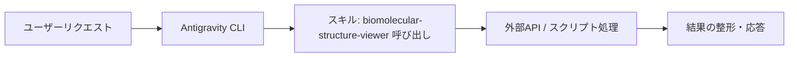

---
aliases:
  - "Biomolecular Structure Viewer"
  - "biomolecular-structure-viewer"
tags:
  - antigravity/skill
  - skill/plugin
created_at: "2026-11-01 13:00"
updated_at: "2026-11-01 13:00"
skill_type: "plugin"
status: "active"
---

# 🛠️ Biomolecular Structure Viewer (`biomolecular-structure-viewer`)

> [!NOTE]
> **概要**: Mol* を用いてタンパク質や核酸の3D生体分子構造をインタラクティブに表示・操作するサイドカービューワースキル。

---

## 📋 クイックサマリー

| 項目 | 内容 |
| :--- | :--- |
| **スキル識別名** | `biomolecular-structure-viewer` |
| **カテゴリ** | plugin |
| **定義ファイル** | [SKILL.md](file:///C:/Users/user/.gemini/config/plugins/science/skills/biomolecular_structure_viewer/SKILL.md) |
| **主要機能** | Mol* を用いたインタラクティブ3D立体構造描画、特定残基のハイライト |

---

## 🎯 発動トリガー & 使用シナリオ

- **発動キーワード / 指示例**:
  - 「タンパク質の3D構造を見せて」「分子構造を可視化して」
- **典型的なユースケース**:
  - Mol* を用いたインタラクティブ3D立体構造描画、特定残基のハイライト に関するタスクをAntigravityに依頼した際に自動で発動・参照されます。

---

## ⚡ ワークフロー



---

## 💡 プロンプト例

```text
「タンパク質の3D構造を見せて」「分子構造を可視化して」
```

---

## 📁 関連ファイル
- スキル定義: [SKILL.md](file:///C:/Users/user/.gemini/config/plugins/science/skills/biomolecular_structure_viewer/SKILL.md)
