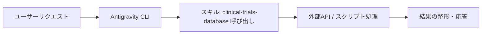

---
aliases:
  - "ClinicalTrials.gov Database"
  - "clinical-trials-database"
tags:
  - antigravity/skill
  - skill/plugin
created_at: "2026-11-01 13:00"
updated_at: "2026-11-01 13:00"
skill_type: "plugin"
status: "active"
---

# 🛠️ ClinicalTrials.gov Database (`clinical-trials-database`)

> [!NOTE]
> **概要**: ClinicalTrials.gov APIv2を利用し、疾患、薬剤、NCT IDに応じた臨床試験プロトコルや参加資格を検索するスキル。

---

## 📋 クイックサマリー

| 項目 | 内容 |
| :--- | :--- |
| **スキル識別名** | `clinical-trials-database` |
| **カテゴリ** | plugin |
| **定義ファイル** | [SKILL.md](file:///C:/Users/user/.gemini/config/plugins/science/skills/clinical_trials_database/SKILL.md) |
| **主要機能** | ClinicalTrials.govからの試験プロトコル、参加適格基準、結果データの検索 |

---

## 🎯 発動トリガー & 使用シナリオ

- **発動キーワード / 指示例**:
  - 治験情報・臨床試験の検索、特定の疾患や新薬の第1〜3相試験調査時
- **典型的なユースケース**:
  - ClinicalTrials.govからの試験プロトコル、参加適格基準、結果データの検索 に関するタスクをAntigravityに依頼した際に自動で発動・参照されます。

---

## ⚡ ワークフロー



---

## 💡 プロンプト例

```text
治験情報・臨床試験の検索、特定の疾患や新薬の第1〜3相試験調査時
```

---

## 📁 関連ファイル
- スキル定義: [SKILL.md](file:///C:/Users/user/.gemini/config/plugins/science/skills/clinical_trials_database/SKILL.md)
