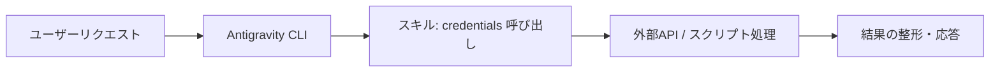

---
aliases:
  - "API Credentials Manager"
  - "credentials"
tags:
  - antigravity/skill
  - skill/plugin
created_at: "2026-11-01 13:00"
updated_at: "2026-11-01 13:00"
skill_type: "plugin"
status: "active"
---

# 🛠️ API Credentials Manager (`credentials`)

> [!NOTE]
> **概要**: APIキーや認証情報を安全に扱い、未設定時にユーザーへ安全な手順でセットアップを促すスキル。

---

## 📋 クイックサマリー

| 項目 | 内容 |
| :--- | :--- |
| **スキル識別名** | `credentials` |
| **カテゴリ** | plugin |
| **定義ファイル** | [SKILL.md](file:///C:/Users/user/.gemini/config/plugins/science/skills/credentials/SKILL.md) |
| **主要機能** | 各種外部APIキーの安全性チェック、未設定時の安全な入力ガイダンス |

---

## 🎯 発動トリガー & 使用シナリオ

- **発動キーワード / 指示例**:
  - APIキーの設定確認、認証エラー発生時、環境変数の安全なセットアップ時
- **典型的なユースケース**:
  - 各種外部APIキーの安全性チェック、未設定時の安全な入力ガイダンス に関するタスクをAntigravityに依頼した際に自動で発動・参照されます。

---

## ⚡ ワークフロー



---

## 💡 プロンプト例

```text
APIキーの設定確認、認証エラー発生時、環境変数の安全なセットアップ時
```

---

## 📁 関連ファイル
- スキル定義: [SKILL.md](file:///C:/Users/user/.gemini/config/plugins/science/skills/credentials/SKILL.md)
