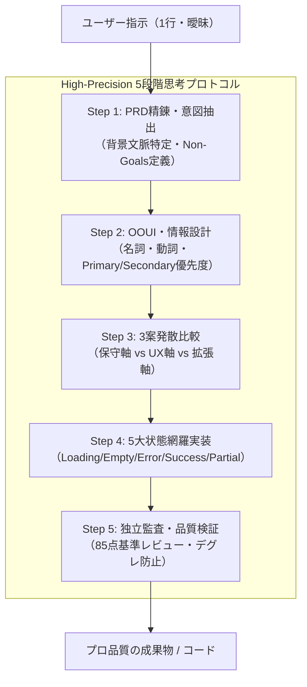

# 🎨 High-Precision UI Design Workflow

## 概要
AI特有の「無難な80点解」を打破し、熟練リードデザイナー／アーキテクトの思考プロセスを100%再現する5段階UI生成ワークフローです。
ローカル・リモートを問わず、新規プロジェクト作成時やUI実装タスクにおいて自動的に稼働します。

| 項目 | 内容 |
| :--- | :--- |
| **スキル名** | `high-precision-ui-workflow` |
| **適用範囲** | グローバル（全プロジェクト・ローカル・リモート共通） |
| **連携元** | Portable Brain Engine (`.brain/`) |
| **定義ファイル** | `C:\Users\user\.gemini\config\skills\high-precision-ui-workflow\SKILL.md` |

---

## 5段階思考パイプライン

---

## 5大状態の網羅基準（Phase 4）
1. **Loading State**: スケルトン表示、ボタンのスピナー、レイアウトシフト防止
2. **Empty State**: データ0件時の案内、初期アクション誘導
3. **Error State**: エラーメッセージ、リトライボタン、入力値保持
4. **Success State**: 通常表示
5. **Partial / Edge Cases**: 長文テキストの三点リーダー/折り返し、二重送信ガード

---

## 関連リンク
- 実装元スキル: [SKILL.md](file:///C:/Users/user/.gemini/config/skills/high-precision-ui-workflow/SKILL.md)
- グローバルルール: [AGENTS.md](file:///C:/Users/user/.gemini/config/AGENTS.md)
