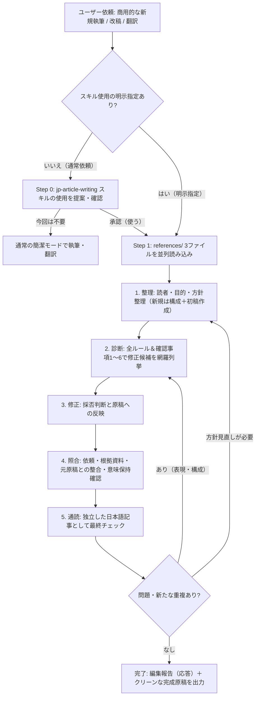

---
aliases:
  - "jp-article-writing"
  - "日本語記事執筆ルール"
tags:
  - antigravity/skill
  - writing/japanese
  - editorial
  - obsidian
created_at: "2026-11-07 09:28"
updated_at: "2026-11-07 09:28"
skill_type: "custom"
status: "active"
---

# ✍️ jp-article-writing

> [!NOTE]
> **概要**: 「読者が一度で理解できる日本語の記事を書くための指針」に基づき、LLM特有の冗長さ・曖昧な評価・過剰な留保を排した**商用・公開品質の日本語執筆・改稿・翻訳**を行うスキルです。デフォルトでは自動発動せず、対象タスク発生時に**事前提案（Opt-in確認）**を行う省トークン設計になっています。

---

## 📋 クイックサマリー

| 項目 | 内容 |
| :--- | :--- |
| **スキル名** | `jp-article-writing` |
| **種別** | Antigravity Custom Skill（事前提案型 / On-Demand） |
| **発動方式** | 商用・公開向けの執筆／改稿／翻訳タスク検知時に**使用を提案**（承認後に本稼働） |
| **実体定義ファイル** | [SKILL.md](file:///C:/Users/user/.gemini/config/skills/jp-article-writing/SKILL.md) |
| **リファレンス群** | `references/` 配下3ファイル（元ルール全510行・100%完全収録） |
| **主な用途** | 商用記事の新規執筆、既存原稿の改稿・校正、英語記事等の日本語記事化（翻訳） |

---

## 🎯 発動トリガー & 使用シナリオ

> [!IMPORTANT]
> **デフォルト非適用・提案モード**: 日常のチャット応答、コードコメント、自分用Obsidianメモ等では発動しません。以下のような**商用・公開品質の日本語執筆タスク**が発生した際、エージェントがまずスキルの使用を提案します。

- **新規執筆**: Webメディア記事、技術解説記事、製品レビュー、調査・試算レポート、ホワイトペーパー等の執筆
- **改稿・推敲・校正**: 既存原稿の読みやすさ改善、構成整理、重複や「LLMっぽさ」の解消、文体・表記統一
- **翻訳・日本語記事化**: 海外ブログ・論文・技術仕様書などを日本語の想定読者向け記事として翻訳・再構成する作業

---

## ⚡ ワークフロー・実行アーキテクチャ



---

## 🛠️ 構成ファイル & パス一覧

- **メイン定義**: [SKILL.md](file:///C:/Users/user/.gemini/config/skills/jp-article-writing/SKILL.md)
- **詳細ルール（3分割・全文完全収録）**:
  1. [01_workflow_style_and_paragraphs.md](file:///C:/Users/user/.gemini/config/skills/jp-article-writing/references/01_workflow_style_and_paragraphs.md) — 5工程手順、読者と目的、断定と推測、留保条件、見出し・文長・段落構成・つなぎ方
  2. [02_explanation_evidence_and_vocabulary.md](file:///C:/Users/user/.gemini/config/skills/jp-article-writing/references/02_explanation_evidence_and_vocabulary.md) — 根拠対応、言い換えで保つ意味、文の構造表、比較、数値精度、語彙・用語導入・カタカナ長音
  3. [03_article_types_figures_and_checklist.md](file:///C:/Users/user/.gemini/config/skills/jp-article-writing/references/03_article_types_figures_and_checklist.md) — 記事種別ごとの構成、本文と補足・図表・表とリスト、執筆後の確認事項（1〜6）
- **グローバル提案ルーティング**: [GEMINI.md](file:///C:/Obsidian/LLM%20Folder/00_System/GEMINI.md)

---

## 💡 利用プロンプト例（コピペ用）

### パターンA：提案を受けてから判断する（通常の頼み方でOK）
```text
以下の英語記事を、日本のエンジニア向けWebメディアに掲載する解説記事として翻訳・構成してください。
```
*(→ エージェントが着手前に `jp-article-writing` スキルを使うか提案してくれます)*

### パターンB：最初からスキル指定で一気通貫実行する
```text
jp-article-writing スキルを使って、以下の下書き原稿を商業メディア掲載レベルに改稿してください。
```
