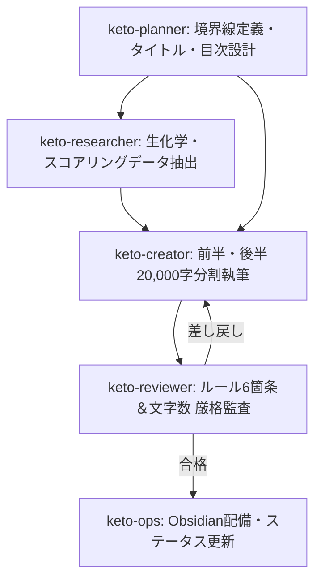

# keto-note-engine（ケトジェニック専門note自動作成エンジン）

ケトジェニック専門の商業用note記事（全100記事・各約20,000字・水増しゼロ）を、企画・科学リサーチ・執筆・品質監査・知識運用の5役割マルチエージェント体制で自律量産するための専門スキルです。

---

## 運用・執筆バイブル：遵守すべき【絶対ルール6箇条】

| # | ルール項目 | 厳格な規定内容 |
| :--- | :--- | :--- |
| 1 | **ターゲット読者** | **トレーニー偏重の完全禁止**。多忙なデスクワーカー、主婦・主夫、運動習慣がない一般生活者、体型・健康診断（血糖・コレステロール・中性脂肪）・食後昏睡・集中力低下・食欲暴走に悩む一般読者を主対象とし、日常の階段昇降や服のサイズ感、デスクワークの集中力など、誰もが共感できるリアルな生活ベネフィットに寄り添う。 |
| 2 | **タイトルの設計** | **パターン化禁止・ベネフィット直撃**。「〜の科学」「〜の教科書」等の紋切り型を禁止。6つの訴求軸（常識破壊・生活激変・損失回避・即効知恵・生化学兵器・現場攻略）を使い分け、情景が浮かぶ具体性と読者の切実なベネフィットを直撃させる。 |
| 3 | **100記事の境界線** | **他記事のネタ食い荒らし絶対禁止**。担当記事固有のテーマ（生化学・メカニズム・診断ツール・Q&A）のみを極限まで深掘りし、後続記事（筋トレ、食材買い出し、コンビニ、自炊レシピ、ケトフルー電解質プロトコル等）の内容を先出しして食い荒らさない。 |
| 4 | **文字数と比率** | **空白除き約20,000文字の超高密度**。無料部分（約3,500〜4,000字 / 2〜3割）で常識破壊・問題提起・購入ベネフィット。有料部分（約16,000字 / 7〜8割）で超実用データ・精密診断シート・マトリクス・具体的リカバリー手順・生化学Q&A。**医療免責事項やポエムによる水増しは一切禁止**。 |
| 5 | **タイポグラフィ** | **見出し・段落の採番（番号）完全禁止**（「第何回」「第何章」「No.〇」「1. 2. 3.」「一、二、三、」「兆候一：」等は振らず、見出し自体を魅力的なコピーにする）。**絵文字完全禁止**。**論文引用括弧書き完全禁止**（「生化学の実験データによれば」等の自然な大人の語り口に統一）。冒頭に全体目次を配置。 |
| 6 | **エージェント協調** | **手抜き手作業の禁止**。必ず正規のサブエージェント（`keto-planner`, `keto-researcher`, `keto-creator`, `keto-reviewer`, `keto-ops`）を `invoke_subagent` で連携させて制作する。 |

---

## 5役割エージェントの分担

- **`keto-planner` (企画・編集長)**: 全100記事シラバス管理、記事ごとの厳格な境界線定義、売れるタイトル（非パターン化・生活ベネフィット重視）・目次・無料有料ラインの設計。
- **`keto-researcher` (生化学リサーチ)**: PubMed / Europe PMCからの一次データ、代謝生理学データ、精密スコアリング基準、Tier分類の定量的データパック構築。
- **`keto-creator` (執筆・筆者)**: 絶対ルール6箇条に基づき、約20,000字（無料4,000字 ＋ 有料16,000字）を高密度に分割執筆。
- **`keto-reviewer` (品質・ルール監査)**: ルール6箇条（採番禁止・絵文字ゼロ・論文括弧ゼロ・免責事項水増しゼロ・一般生活者目線・20,000字水準）を機械的・論理的に監査。
- **`keto-ops` (運用・知識同期)**: Obsidian（`04_Drafts/`）への配備、シラバス更新、Gemini Notebook連携。

---

## 関連ファイル
- マスターシラバス: `C:\Obsidian\LLM Folder\02_Projects\Keto_Note_Engine\00_Meta\Content_Matrix_100.md`
- スキル定義: `C:\Users\user\.gemini\config\skills\keto-note-engine\SKILL.md`
