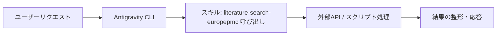

---
aliases:
  - "Europe PMC Literature Search"
  - "literature-search-europepmc"
tags:
  - antigravity/skill
  - skill/plugin
created_at: "2026-11-01 13:00"
updated_at: "2026-11-01 13:00"
skill_type: "plugin"
status: "active"
---

# 🛠️ Europe PMC Literature Search (`literature-search-europepmc`)

> [!NOTE]
> **概要**: Europe PMCから生命科学論文を検索し、オープンアクセス全文XML/テキストや引用文献リストを取得するスキル。

---

## 📋 クイックサマリー

| 項目 | 内容 |
| :--- | :--- |
| **スキル識別名** | `literature-search-europepmc` |
| **カテゴリ** | plugin |
| **定義ファイル** | [SKILL.md](file:///C:/Users/user/.gemini/config/plugins/science/skills/literature_search_europepmc/SKILL.md) |
| **主要機能** | Europe PMCからのオープンアクセス全文テキストおよび引用ネットワーク取得 |

---

## 🎯 発動トリガー & 使用シナリオ

- **発動キーワード / 指示例**:
  - オープンアクセス論文の全文取得、欧州PMC経由の引用情報検索時
- **典型的なユースケース**:
  - Europe PMCからのオープンアクセス全文テキストおよび引用ネットワーク取得 に関するタスクをAntigravityに依頼した際に自動で発動・参照されます。

---

## ⚡ ワークフロー



---

## 💡 プロンプト例

```text
オープンアクセス論文の全文取得、欧州PMC経由の引用情報検索時
```

---

## 📁 関連ファイル
- スキル定義: [SKILL.md](file:///C:/Users/user/.gemini/config/plugins/science/skills/literature_search_europepmc/SKILL.md)
