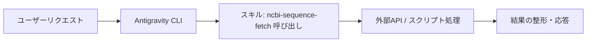

---
aliases:
  - "NCBI Sequence Fetcher"
  - "ncbi-sequence-fetch"
tags:
  - antigravity/skill
  - skill/plugin
created_at: "2026-11-01 13:00"
updated_at: "2026-11-01 13:00"
skill_type: "plugin"
status: "active"
---

# 🛠️ NCBI Sequence Fetcher (`ncbi-sequence-fetch`)

> [!NOTE]
> **概要**: NCBI E-utilitiesを介してアクセッション番号や遺伝子名から塩基配列およびアミノ酸配列を取得するスキル。

---

## 📋 クイックサマリー

| 項目 | 内容 |
| :--- | :--- |
| **スキル識別名** | `ncbi-sequence-fetch` |
| **カテゴリ** | plugin |
| **定義ファイル** | [SKILL.md](file:///C:/Users/user/.gemini/config/plugins/science/skills/ncbi_sequence_fetch/SKILL.md) |
| **主要機能** | NCBI Entrez E-utilities経由でのGenBank/FASTA配列データ自動取得 |

---

## 🎯 発動トリガー & 使用シナリオ

- **発動キーワード / 指示例**:
  - NCBIアクセッション番号（NM_, NP_等）から塩基・アミノ酸配列を取得したい時
- **典型的なユースケース**:
  - NCBI Entrez E-utilities経由でのGenBank/FASTA配列データ自動取得 に関するタスクをAntigravityに依頼した際に自動で発動・参照されます。

---

## ⚡ ワークフロー



---

## 💡 プロンプト例

```text
NCBIアクセッション番号（NM_, NP_等）から塩基・アミノ酸配列を取得したい時
```

---

## 📁 関連ファイル
- スキル定義: [SKILL.md](file:///C:/Users/user/.gemini/config/plugins/science/skills/ncbi_sequence_fetch/SKILL.md)
