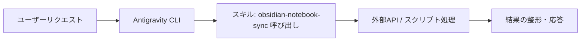

---
aliases:
  - "Obsidian & NotebookLM Sync"
  - "obsidian-notebook-sync"
tags:
  - antigravity/skill
  - skill/custom
created_at: "2026-11-01 13:00"
updated_at: "2026-11-01 13:00"
skill_type: "custom"
status: "active"
---

# 🛠️ Obsidian & NotebookLM Sync (`obsidian-notebook-sync`)

> [!NOTE]
> **概要**: Antigravity、Obsidian Vault、Gemini Notebook（NotebookLM）を省トークンでハイブリッド連携するスキル。

---

## 📋 クイックサマリー

| 項目 | 内容 |
| :--- | :--- |
| **スキル識別名** | `obsidian-notebook-sync` |
| **カテゴリ** | custom |
| **定義ファイル** | [SKILL.md](file:///C:/Users/user/.gemini/config/skills/obsidian_notebook_sync/SKILL.md) |
| **主要機能** | Obsidianのフォルダ構造管理、トークン節約型ピンポイント参照、Gemini Notebook（NotebookLM）への自動同期スクリプト連携 |

---

## 🎯 発動トリガー & 使用シナリオ

- **発動キーワード / 指示例**:
  - 「Obsidianに保存して」「NotebookLMに送って」「過去の知見を検索して」
- **典型的なユースケース**:
  - Obsidianのフォルダ構造管理、トークン節約型ピンポイント参照、Gemini Notebook（NotebookLM）への自動同期スクリプト連携 に関するタスクをAntigravityに依頼した際に自動で発動・参照されます。

---

## ⚡ ワークフロー



---

## 💡 プロンプト例

```text
「Obsidianに保存して」「NotebookLMに送って」「過去の知見を検索して」
```

---

## 📁 関連ファイル
- スキル定義: [SKILL.md](file:///C:/Users/user/.gemini/config/skills/obsidian_notebook_sync/SKILL.md)
