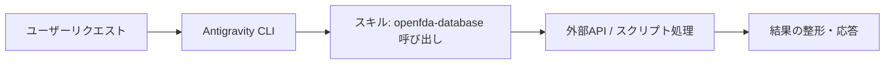

---
aliases:
  - "openFDA Regulatory Data"
  - "openfda-database"
tags:
  - antigravity/skill
  - skill/plugin
created_at: "2026-11-01 13:00"
updated_at: "2026-11-01 13:00"
skill_type: "plugin"
status: "active"
---

# 🛠️ openFDA Regulatory Data (`openfda-database`)

> [!NOTE]
> **概要**: FDA（米食品医薬品局）のAPIを通じて、医薬品の副作用報告、リコール情報、添付文書、承認情報を取得するスキル。

---

## 📋 クイックサマリー

| 項目 | 内容 |
| :--- | :--- |
| **スキル識別名** | `openfda-database` |
| **カテゴリ** | plugin |
| **定義ファイル** | [SKILL.md](file:///C:/Users/user/.gemini/config/plugins/science/skills/openfda_database/SKILL.md) |
| **主要機能** | FDA（米食品医薬品局）の公開APIによる医薬品・医療機器安全情報検索 |

---

## 🎯 発動トリガー & 使用シナリオ

- **発動キーワード / 指示例**:
  - 医薬品の副作用報告、リコール情報、添付文書、承認履歴の調査時
- **典型的なユースケース**:
  - FDA（米食品医薬品局）の公開APIによる医薬品・医療機器安全情報検索 に関するタスクをAntigravityに依頼した際に自動で発動・参照されます。

---

## ⚡ ワークフロー



---

## 💡 プロンプト例

```text
医薬品の副作用報告、リコール情報、添付文書、承認履歴の調査時
```

---

## 📁 関連ファイル
- スキル定義: [SKILL.md](file:///C:/Users/user/.gemini/config/plugins/science/skills/openfda_database/SKILL.md)
