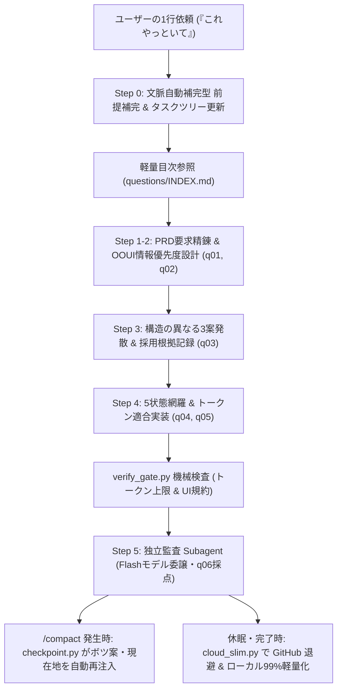

---
aliases:
  - "Portable Brain"
  - "ポータブル・ブレイン"
  - "portable-brain"
tags:
  - antigravity/skill
  - system/automation
  - skill/custom
created_at: "2026-11-07 09:25"
updated_at: "2026-11-07 09:48"
skill_type: "custom"
status: "active"
---

# 🧠 Portable Brain v1.1 (`portable-brain`)

> [!IMPORTANT]
> **概要**: 「プロ設計思考・思考プロセスの再現性（5段階パイプライン＋問い駆動ナレッジ）」と「文脈自動補完型・これやっといて文脈自動補完＆タスク分解」に加え、「`/compact` ゼロ健忘症（自動引き継ぎフック）」および「GitHub クラウド退避・ローカル容量スリム化（95〜100%削減）」を統合したマルチAI共通ブレインスキル。

---

## 📋 クイックサマリー

| 項目 | 内容 |
| :--- | :--- |
| **スキル識別名** | `portable-brain` |
| **カテゴリ** | custom（マルチAI対応ワークスペース＆配布用マスターキット v1.1） |
| **主な実行言語** | Markdown / Python 3（標準ライブラリのみ・外部依存ゼロ） |
| **トリガーキーワード** | 「これやっといて」「画面を作って」「`/compact`」「容量を空けて / GitHubへ退避して」 |
| **定義ファイル** | [SKILL.md](file:///C:/Users/user/.gemini/antigravity/scratch/portable-brain/.agents/skills/portable-brain/SKILL.md) |
| **マスターキットパス** | [portable-brain](file:///C:/Users/user/.gemini/antigravity/scratch/portable-brain/) |

---

## 🎯 発動トリガー & 使用シナリオ

- **発動キーワード / 指示例**:
  - 「〇〇画面に退会手続きモーダルを追加しといて」（文脈自動補完型の1行依頼 → 自動補完＆3案発散が始動）
  - `/compact` 実行時（Claude Code / Antigravity のフックが自動発火し、ボツ案・確定仕様・直近編集ファイルを再注入）
  - 「この案件は一旦落ち着いたから GitHub に退避してローカル容量を空けて」（`cloud_slim.py --slim` / `--offload`）
- **典型的なユースケース**:
  - AI特有の「無難で平均的な80点UI・コード」への収束を防ぎ、OOUI情報設計と3案比較根拠を伴うプロ品質の成果物を安定生成したいとき。
  - 長時間セッションで `/compact` を打っても「さっきボツにした案」へ先祖返りさせずシームレスに開発を継続したいとき。
  - `node_modules` や休眠案件によるローカルPC・Obsidian同期フォルダの容量圧迫を95〜100%削減したいとき。

---

## ⚡ ワークフロー・実行アーキテクチャ



---

## 🛠️ 構成ファイル & パス一覧

- **コア思考定義・ナレッジ**:
  - [pipeline.md](file:///C:/Users/user/.gemini/antigravity/scratch/portable-brain/.brain/pipeline.md) — 思考再現5段階プロトコル
  - [DECISIONS_SNAPSHOT.md](file:///C:/Users/user/.gemini/antigravity/scratch/portable-brain/.brain/DECISIONS_SNAPSHOT.md) — 確定仕様・ボツ案（先祖返り禁止リスト）
  - [current_task.md](file:///C:/Users/user/.gemini/antigravity/scratch/portable-brain/.brain/current_task.md) — 文脈自動補完型ゴール＆タスク分解ツリー
  - [INDEX.md](file:///C:/Users/user/.gemini/antigravity/scratch/portable-brain/.brain/questions/INDEX.md) — 問い駆動ルーティング目次（`q01`〜`q06`）
- **管理・検証・容量削減スクリプト群**:
  - [setup_brain.py](file:///C:/Users/user/.gemini/antigravity/scratch/portable-brain/.brain/scripts/setup_brain.py) — 他プロジェクト配備・新AIオンボーディングCLI（Claude `/compact` フック自動設定込）
  - [checkpoint.py](file:///C:/Users/user/.gemini/antigravity/scratch/portable-brain/.brain/scripts/checkpoint.py) — `/compact` ゼロ健忘症・引き継ぎカプセル自動生成＆フック注入CLI（Git非依存）
  - [cloud_slim.py](file:///C:/Users/user/.gemini/antigravity/scratch/portable-brain/.brain/scripts/cloud_slim.py) — 容量診断・キャッシュ削除・GitHub退避（`--slim` / `--offload`）・Shallow Clone復元（`--restore`）
  - [uninstall.py](file:///C:/Users/user/.gemini/antigravity/scratch/portable-brain/.brain/scripts/uninstall.py) — 一時停止(`--disable`) / Obsidian退避(`--eject`) / 完全削除(`--purge`)
  - [verify_gate.py](file:///C:/Users/user/.gemini/antigravity/scratch/portable-brain/.brain/scripts/verify_gate.py) — 省トークン行数上限監視 ＆ コード品質ゲート
  - [sync_web.py](file:///C:/Users/user/.gemini/antigravity/scratch/portable-brain/.brain/scripts/sync_web.py) — Grok/ChatGPT用カプセル出力 ＆ ルール・ボツ案圧縮学習CLI

---

## 💡 利用プロンプト・コマンド例（コピペ用）

```powershell
# 既存プロジェクトへの配備（Claude Code と Antigravity の /compact フックも自動設定）
python "C:\Users\user\.gemini\antigravity\scratch\portable-brain\.brain\scripts\setup_brain.py" --target "C:\path\to\project" --add-ai antigravity claude cursor web

# 容量診断 → 既定リポジトリ (https://github.com/aopekoe-ai/AI_brain.git) へPush＆重量キャッシュ全削除
python .brain/scripts/cloud_slim.py --analyze
python .brain/scripts/cloud_slim.py --slim

# 完全クラウド退避（AI_brain.git の projects/<案件名> ブランチへ保存しローカル0MB化）＆ 高速復元
python .brain/scripts/cloud_slim.py --offload
python "C:\Users\user\.gemini\antigravity\scratch\portable-brain\.brain\scripts\cloud_slim.py" --restore "<案件名>"
```
