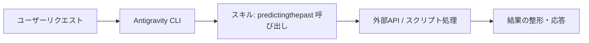

---
aliases:
  - "Predicting the Past (Aeneas / Ithaca)"
  - "predictingthepast"
tags:
  - antigravity/skill
  - skill/plugin
created_at: "2026-11-01 13:00"
updated_at: "2026-11-01 13:00"
skill_type: "plugin"
status: "active"
---

# 🛠️ Predicting the Past (Aeneas / Ithaca) (`predictingthepast`)

> [!NOTE]
> **概要**: IthacaやAeneasモデルを用いて、古代ギリシャ語・ラテン語の碑文のテキスト欠損復元、執筆年代・地域の推定を行うスキル。

---

## 📋 クイックサマリー

| 項目 | 内容 |
| :--- | :--- |
| **スキル識別名** | `predictingthepast` |
| **カテゴリ** | plugin |
| **定義ファイル** | [SKILL.md](file:///C:/Users/user/.gemini/config/plugins/science/skills/predictingthepast/SKILL.md) |
| **主要機能** | Ithaca/Aeneasモデルを用いた古代碑文の欠損補完および歴史的年代推定 |

---

## 🎯 発動トリガー & 使用シナリオ

- **発動キーワード / 指示例**:
  - 古代ギリシャ語・ラテン語の碑文テキスト復元、年代推定、執筆地推定時
- **典型的なユースケース**:
  - Ithaca/Aeneasモデルを用いた古代碑文の欠損補完および歴史的年代推定 に関するタスクをAntigravityに依頼した際に自動で発動・参照されます。

---

## ⚡ ワークフロー



---

## 💡 プロンプト例

```text
古代ギリシャ語・ラテン語の碑文テキスト復元、年代推定、執筆地推定時
```

---

## 📁 関連ファイル
- スキル定義: [SKILL.md](file:///C:/Users/user/.gemini/config/plugins/science/skills/predictingthepast/SKILL.md)
