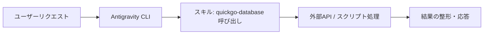

---
aliases:
  - "QuickGO Gene Ontology"
  - "quickgo-database"
tags:
  - antigravity/skill
  - skill/plugin
created_at: "2026-11-01 13:00"
updated_at: "2026-11-01 13:00"
skill_type: "plugin"
status: "active"
---

# 🛠️ QuickGO Gene Ontology (`quickgo-database`)

> [!NOTE]
> **概要**: QuickGO APIを利用してGene Ontology（GO）用語や、特定の生物学的プロセス・分子機能に関連する遺伝子を探索するスキル。

---

## 📋 クイックサマリー

| 項目 | 内容 |
| :--- | :--- |
| **スキル識別名** | `quickgo-database` |
| **カテゴリ** | plugin |
| **定義ファイル** | [SKILL.md](file:///C:/Users/user/.gemini/config/plugins/science/skills/quickgo_database/SKILL.md) |
| **主要機能** | EBI QuickGO APIによる遺伝子機能とGOタームの相互マッピング |

---

## 🎯 発動トリガー & 使用シナリオ

- **発動キーワード / 指示例**:
  - 遺伝子の機能アノテーション（生物学的プロセス・分子機能など）の探索時
- **典型的なユースケース**:
  - EBI QuickGO APIによる遺伝子機能とGOタームの相互マッピング に関するタスクをAntigravityに依頼した際に自動で発動・参照されます。

---

## ⚡ ワークフロー



---

## 💡 プロンプト例

```text
遺伝子の機能アノテーション（生物学的プロセス・分子機能など）の探索時
```

---

## 📁 関連ファイル
- スキル定義: [SKILL.md](file:///C:/Users/user/.gemini/config/plugins/science/skills/quickgo_database/SKILL.md)
