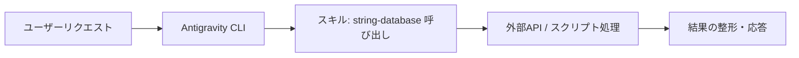

---
aliases:
  - "STRING Protein Interaction Networks"
  - "string-database"
tags:
  - antigravity/skill
  - skill/plugin
created_at: "2026-11-01 13:00"
updated_at: "2026-11-01 13:00"
skill_type: "plugin"
status: "active"
---

# 🛠️ STRING Protein Interaction Networks (`string-database`)

> [!NOTE]
> **概要**: STRINGデータベースからタンパク質間相互作用（PPI）ネットワーク、機能的エンリッチメント、エビデンススコアを取得するスキル。

---

## 📋 クイックサマリー

| 項目 | 内容 |
| :--- | :--- |
| **スキル識別名** | `string-database` |
| **カテゴリ** | plugin |
| **定義ファイル** | [SKILL.md](file:///C:/Users/user/.gemini/config/plugins/science/skills/string_database/SKILL.md) |
| **主要機能** | STRING APIによるPPIネットワーク構築および信頼度スコアの取得 |

---

## 🎯 発動トリガー & 使用シナリオ

- **発動キーワード / 指示例**:
  - タンパク質間相互作用ネットワークの解析、結合パートナーの探索時
- **典型的なユースケース**:
  - STRING APIによるPPIネットワーク構築および信頼度スコアの取得 に関するタスクをAntigravityに依頼した際に自動で発動・参照されます。

---

## ⚡ ワークフロー



---

## 💡 プロンプト例

```text
タンパク質間相互作用ネットワークの解析、結合パートナーの探索時
```

---

## 📁 関連ファイル
- スキル定義: [SKILL.md](file:///C:/Users/user/.gemini/config/plugins/science/skills/string_database/SKILL.md)
