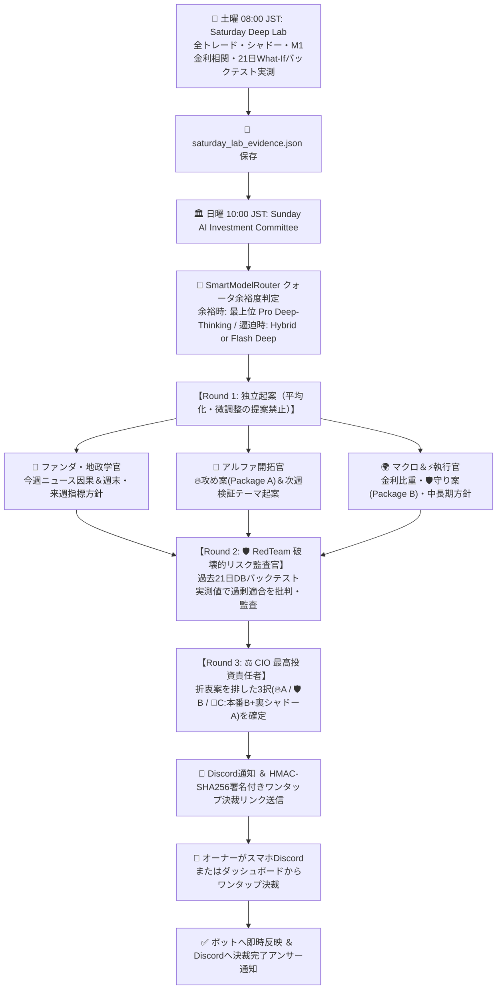

---
aliases:
  - "sunday-quant-ic"
  - "日曜AI投資委員会スキル"
tags:
  - antigravity/skill
  - system/automation
  - quant/xauusd
created_at: "2026-11-19 17:19"
updated_at: "2026-11-19 17:19"
skill_type: "custom"
status: "active"
---

# 🏛️ sunday-quant-ic: 土日2段階・6役マルチエージェントAI投資委員会スキル

> [!IMPORTANT] **一言サマリー**
> XAU/USD自律型クオンツファンド（Contabo VPS稼働）において、**土曜日の徹底バックテスト検証**と**日曜日の6役マルチエージェント投資委員会（ファンダメンタルズ分析・次週検証テーマ・中長期構造ロードマップ・平均化禁止の3択パッケージ策定・Discordワンタップ暗号署名決裁）**を統合運用するためのカスタムスキルです。

---

## 📋 クイックサマリー表

| 項目 | 内容 |
| :--- | :--- |
| **スキル名** | `sunday-quant-ic` |
| **主な目的** | 土日2段階検証・6役エージェント激論（折衷案禁止）・ファンダ分析・Discordワンタップ決裁 |
| **稼働環境** | Contabo VPS (`155.133.7.59`) 自律稼働 ＋ Antigravity (`Gemini 4 Neon`) ハイブリッド |
| **モデル制御** | クォータ余裕度連動 `SmartModelRouter`（最上位Pro Deep Thinking優先＋無停止自動フォールバック） |
| **セキュリティ** | SSHパスワード認証無効化・VNCポート外部遮断・IPブルートフォース遮断・HMAC-SHA256署名決裁URL |
| **スキル定義ファイル** | [SKILL.md](file:///C:/Users/user/.gemini/config/skills/sunday-quant-ic/SKILL.md) |

---

## 🎯 発動トリガー & 使用シナリオ

- **自動トリガー（PCオフでもVPSで100%自動実行）**:
  - **毎週土曜 08:00 JST**: 土曜ディープ検証（`run_saturday_deep_lab`）が自動起動し、1週間・21日間の全トレード・シャドートレード・毎分米金利（`US10Y`/`US02Y`/`DXY`）の相関・リードラグ・What-Ifバックテストを網羅実行。
  - **毎週日曜 10:00 JST**: 日曜6役AI投資委員会（`run_sunday_investment_committee`）が自動起動し、最新ニュース取得＋6役独立議論を行い、Discordへワンタップ決裁リンク付きレポートを配信。
- **手動・対話トリガー（Antigravity チャット & ダッシュボード）**:
  - 「日曜の投資委員会を今すぐ開いて」「今週のファンダメンタルズと値動きの因果を分析して」
  - 「投資委員会の中長期ロードマップにある分割利確ロジックを実装して」
  - ダッシュボードの「🧪 LAB検証」タブ内にある **『🏛️ 今すぐ投資委員会を開催＆Discord決裁送信』** ボタンをタップした時。

---

## ⚡ ワークフロー・実行アーキテクチャ



---

## 🛠️ 構成ファイル & パス一覧

- **Antigravity スキル定義**:
  - [SKILL.md](file:///C:/Users/user/.gemini/config/skills/sunday-quant-ic/SKILL.md)
- **VPS 本番稼働モジュール (`/root/xauusd_ai_hedge_fund/`)**:
  - `core/investment_committee.py` (`SmartModelRouter` & `WeekendInvestmentCommittee`)
  - `core/webhook_server.py` (IPブルートフォース遮断・HMAC署名決裁エンドポイント `/api/ic/decide`)
  - `core/dashboard_ui.py` (`🧪 LAB検証` タブ内の投資委員会パネル＆3択決裁ボタン)
  - `notifications/discord_manager.py` (`send_sunday_ic_report`, `send_ic_decision_confirmation`)

---

## 💡 利用プロンプト例（コピペ用）

```text
sunday-quant-ic スキルを使って、最新のVPSデータベースと週末のファンダメンタルズニュースから日曜投資委員会を開催し、来週の3択パッケージと次週の検証テーマをDiscordへ送って。
```
