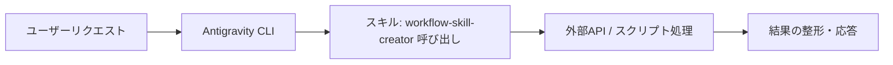

---
aliases:
  - "Workflow Skill Creator"
  - "workflow-skill-creator"
tags:
  - antigravity/skill
  - skill/plugin
created_at: "2026-11-01 13:00"
updated_at: "2026-11-01 13:00"
skill_type: "plugin"
status: "active"
---

# 🛠️ Workflow Skill Creator (`workflow-skill-creator`)

> [!NOTE]
> **概要**: 完了した対話セッションやワークフローを、再利用可能なAntigravityスキルとして自動的にパッケージ化するスキル。

---

## 📋 クイックサマリー

| 項目 | 内容 |
| :--- | :--- |
| **スキル識別名** | `workflow-skill-creator` |
| **カテゴリ** | plugin |
| **定義ファイル** | [SKILL.md](file:///C:/Users/user/.gemini/config/plugins/science/skills/workflow_skill_creator/SKILL.md) |
| **主要機能** | 対話セッションで成功したワークフローを自動抽出し、SKILL.mdとして構造化出力 |

---

## 🎯 発動トリガー & 使用シナリオ

- **発動キーワード / 指示例**:
  - 「この一連の作業をスキル化して」「さっきの作業手順をスキルにして」
- **典型的なユースケース**:
  - 対話セッションで成功したワークフローを自動抽出し、SKILL.mdとして構造化出力 に関するタスクをAntigravityに依頼した際に自動で発動・参照されます。

---

## ⚡ ワークフロー



---

## 💡 プロンプト例

```text
「この一連の作業をスキル化して」「さっきの作業手順をスキルにして」
```

---

## 📁 関連ファイル
- スキル定義: [SKILL.md](file:///C:/Users/user/.gemini/config/plugins/science/skills/workflow_skill_creator/SKILL.md)
