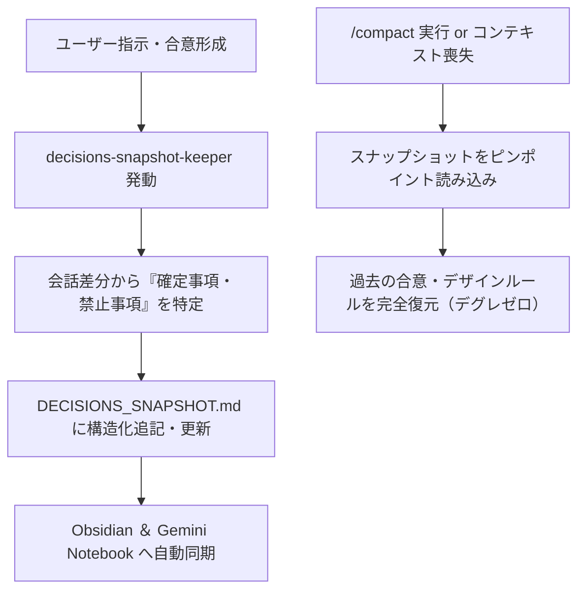
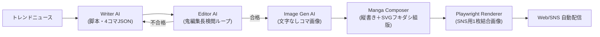
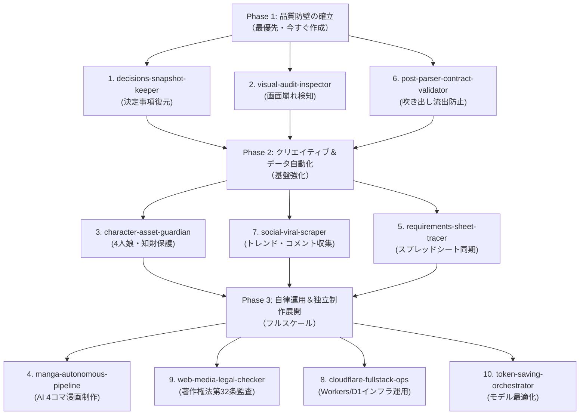

---
aliases:
  - "Antigravityスキル作成案"
  - "Antigravity Recommended Skills Proposal"
tags:
  - antigravity/proposal
  - antigravity/skills
  - project/sns-news
  - system/automation
created_at: "2026-11-01 20:55"
updated_at: "2026-11-01 20:55"
status: "proposal"
---

# 🚀 Antigravity 開発加速＆品質保証スキル作成案（全10選）

> [!NOTE] 本ドキュメントの背景と目的
> 本書は、完全自律型キュレーションメディア『**SNSにゅーす**（[https://sns-news.jp/](https://sns-news.jp/)）』および連動する『**4人娘キャラクター・AI漫画制作プロジェクト**』の全開発ログ（`transcript_full.jsonl`：Step 0 〜 Step 5720+、ユーザー指示292件）を徹底精査し、**開発中に実際に直面した重大トラブル、手戻り、手作業の反復、デグレ、および知財・法務リスク**を根本から自動解決するために「今すぐ作成すべきAntigravityのカスタムスキル」を体系的に提案するものです。

---

## 📊 スキル提案一覧・クイックマトリクス

| No | スキル識別名 | 種別 | カバー領域 | 解決する過去の課題・トリガー | 推奨優先度 |
| :---: | :--- | :---: | :--- | :--- | :---: |
| 1 | **`decisions-snapshot-keeper`** | 品質/記憶 | コンテキスト要約・決定事項復元 | `/compact` 後の先祖返り・勝手な推測・デザインルールの忘却 | 🔴 **S (最優先)** |
| 2 | **`visual-audit-inspector`** | 検証/テスト | ヘッドレス自動キャプチャ・回帰テスト | 巨大SVGアイコンによるスクロール崩壊、画像欠落、モバイル崩れ | 🔴 **S (最優先)** |
| 3 | **`character-asset-guardian`** | クリエイティブ | 4人娘一貫性担保＆知財保護 | 画風ブレ、配色ミス（乃愛の水色化）、他社IP（セーラームーン等）排除 | 🔴 **S (最優先)** |
| 4 | **`manga-autonomous-pipeline`** | 自律制作 | 4コマ漫画自動生成・組版 | ネーム生成、鬼編集長自己検閲、文字なしコマ生成、縦書き組版 | 🟡 **A (高)** |
| 5 | **`requirements-sheet-tracer`** | 管理/分析 | 会話ログ要件抽出＆GSheets同期 | チャットログに埋もれた指示の抽出、スプレッドシートへの自動差分同期 | 🟡 **A (高)** |
| 6 | **`post-parser-contract-validator`** | 設計/品質 | CMSデータとUIの整合性契約検証 | 吹き出しUIのパース失敗（平文流出）、一次URL・YouTube埋め込み欠落 | 🔴 **S (最優先)** |
| 7 | **`social-viral-scraper`** | データ収集 | SNSトレンド抽出＆個人発信選定 | 企業PR排除、個人発信トレンド優先、YouTubeコメント取得、重複排除 | 🟡 **A (高)** |
| 8 | **`cloudflare-fullstack-ops`** | インフラ/運 | Workers/D1/R2/EmDash環境運用 | スタードメイン連携、D1スキーマ更新、R2静的アセット、Wrangler操作 | 🟢 **B (中)** |
| 9 | **`web-media-legal-checker`** | 法務/セキュリティ | 著作権法第32条＆適法引用自動診断 | SNS画像直リンク禁止、一次ソース枠常置、AI架空論評免責文の全件検査 | 🟡 **A (高)** |
| 10 | **`token-saving-orchestrator`** | 運用/コスト | LLMモデル動的ルーティング・最適化 | 上位モデルの枠枯渇防止、タスク難易度に応じたモデル切替・要約実行 | 🟢 **B (中)** |

---

## 1. `decisions-snapshot-keeper`（決定事項デグレ防止＆コンテキスト復元スキル）

> [!IMPORTANT] 解決する過去の重大課題
> 長時間のコーディングやリファクタリングで `/compact` を実行した際、過去にユーザーと合意した「ボタン内テキストの絵文字禁止」「英字X表記」「有栖川乃愛の枠色＝ゴールド」「EmDash採用の経緯」が忘れ去られ、AIが古い推測に基づいて先祖返り・デグレを引き起こした（Step 3652等で深刻化）。

### 📋 スキル概要
会話セッション中の【確定した仕様・デザインルール・禁止事項・インフラ方針】をリアルタイムに検知・抽出し、プロジェクト直下の `DECISIONS_SNAPSHOT.md` および Obsidian のマスターノートに自動蓄積。`/compact` 実行時や新規セッション開始時に、自動的に確定ルールをプロンプト最優先層へ再注入して先祖返りを100%防止するスキル。

### 🎯 発動トリガー
- `/compact` 実行直前（自動フックまたは事前実行）
- 「決定事項を保存して」「決定事項を復元して」「今の合意をスナップショットに残して」
- 新規タスク着手前の前提確認時

### ⚡ アーキテクチャフロー

### 🛠️ スキル構成案
- `SKILL.md`: 決定事項の抽出規約と優先順位定義
- `scripts/snapshot_decisions.py`: `transcript.jsonl` から確定事項・禁止ルールを自動差分抽出するスクリプト
- `scripts/restore_decisions.py`: 確定事項の要約を生成し、システムプロンプト層へ読み込ませるスクリプト

---

## 2. `visual-audit-inspector`（ヘッドレスブラウザ・ビジュアル回帰テスト＆レイアウト監査スキル）

> [!CAUTION] 解決する過去の重大課題
> Step 5315において、HeroセクションのインラインSVGアイコン（インフォメーション「i」や推しトレンド「★」）のサイズ指定が抜け、画面いっぱいに巨大化して縦スクロールを完全に破壊。また、モバイル表示での横はみ出しや画像の404欠落など、人間の目視指摘を受けるまでAI自身が検知できなかった。

### 📋 スキル概要
ローカルおよび公開URL（[https://sns-news.jp/](https://sns-news.jp/)）に対し、ヘッドレスChrome（Puppeteer / Playwright）を立ち上げ、**全画面・全コンポーネント（PC: 1280px / モバイル: 390px）のスクリーンショット撮影、SVG・画像・レイアウト要素の寸法監査、コンソールエラー・404レスポンスの自動検証**を一括実行してレポートを生成するスキル。

### 🎯 発動トリガー
- 「画面キャプチャして問題ないか確認して」「デザイン崩れていないかテストして」
- デプロイ直後（自動検証パイプライン）
- CSS・コンポーネント大幅改修直後の品質チェック

### ⚡ 監査チェック項目（自動判定）
1. **SVG要素寸法検査**: 全 `<svg>` 要素の `getBoundingClientRect()` が幅・高さともに上限値（例: 48px以下）に収まっているか。
2. **要素はみ出し検査**: 横スクロール（`scrollWidth > clientWidth`）が意図せず発生していないか。
3. **画像ロード検査**: 全 `` タグの `naturalWidth > 0` かつ HTTP 200 で返却されているか（空枠・broken image の排除）。
4. **ナビボタン反転検査**: 現在URLとアクティブ状態のボタンが1対1で合致しているか。

### 🛠️ スキル構成案
- `SKILL.md`: ビジュアル監査のしきい値・テストケース定義
- `scripts/audit_runner.mjs`: ヘッドレスChromeによるマルチデバイス全画面キャプチャ＆DOM寸法検査
- `scripts/generate_audit_report.py`: 検査結果からMarkdown差分レポートを出力

---

## 3. `character-asset-guardian`（4人娘キャラクター一貫性維持＆知財保護スキル）

> [!WARNING] 解決する過去の重大課題
> 4人娘（有栖川乃愛・若葉芽依・緋宮詩羽・黒曜怜衣）の画像生成やプロンプト作成において、乃愛の配色が水色に戻ってしまうミスや、芽依・詩羽・怜衣の個別プロフィール画像パスが抜けて空枠になるトラブルが発生。さらに、セーラームーン等、他社既存作品の単語・デザイン類似への強い懸念・禁止要請があった（Step 5682）。

### 📋 スキル概要
4人娘の【公式設定画・配色比率・性格口調・モチーフ・3D/2Dアセット】を一元管理し、AIプロンプト生成時に**正しいキャラ設定・ネガティブプロンプトを自動注入**するとともに、**他社商業作品・IPキーワードの混入を静的解析で完全遮断**する知財防衛＆クリエイティブ一貫性スキル。

### 🎯 発動トリガー
- 「キャラ画像を作成して」「4人娘の会話を生成して」
- `characters.astro` やキャラ関連コンポーネントの修正時
- 記事対話生成プロンプトの設計・監査時

### ⚡ 管理マスターパラメータ
- **有栖川 乃愛 (Noa)**: 金髪ツインテール、IT/データ、テーマ色＝ゴールド/アンバー（水色絶対禁止）、メイン70% #FFD700
- **若葉 芽依 (Mei)**: 緑髪ショートボブ、健康/トレンド、テーマ色＝ネオエメラルド、メイン70% #00D68F
- **緋宮 詩羽 (Uta)**: 赤髪ウルフ、音楽/炎上ウォッチャー、テーマ色＝クリムゾンレッド、メイン70% #FF1E56
- **黒曜 怜衣 (Rei)**: 紺黒髪ロング、美大生デザイナー/法務、テーマ色＝ミッドナイトネイビー、メイン70% #1B264A
- **知財保護ブラックリスト**: セーラームーンをはじめとする既存アニメ・マンガ作品のキャラ名、衣装、技名、パロディの完全検閲

### 🛠️ スキル構成案
- `SKILL.md`: 4人娘マスタープロンプト規約、配色・頭身・口調リファレンス
- `references/characters_master.json`: 4キャラの公式プロファイル構造化データ
- `scripts/verify_ip_compliance.py`: 生成テキストやプロンプトから他社IP・禁止ワードを検知・排除するチェッカー

---

## 4. `manga-autonomous-pipeline`（4コマWeb漫画企画・自律制作パイプラインスキル）

> [!NOTE] 解決する過去の課題
> キュレーションサイトに連動する完全自律型AI 4コマWeb漫画プロジェクト（『01_AI漫画制作システム_基本設計・総合仕様書.md』）において、企画・脚本・自己検閲・作画・組版・SNSレンダリングという高度なマルチステップを、人の手を介さずVPS上で安全に自律実行する仕組みが必要とされた。

### 📋 スキル概要
トレンドニュースを入力として、①起承転結プロット生成 → ②鬼編集長（Editor AI）による4大アンチパターン検閲ループ → ③リファレンス固定画像生成（文字・フキダシ完全遮断） → ④HTML/CSS縦書きSVG組版 → ⑤SNS（X等）投稿用1枚画像の高解像度レンダリングまでをワンストップで統括する自律制作パイプラインスキル。

### 🎯 発動トリガー
- 「今日のトレンドから4コマ漫画を作って」「漫画の第○話を生成して」
- 漫画制作パイプラインのテスト実行・プロトタイプ検証時

### ⚡ 制作パイプライン構造

### 🛠️ スキル構成案
- `SKILL.md`: 4コマ制作ワークフロー、プロンプトテンプレート、4大アンチパターン定義
- `scripts/manga_editor_eval.py`: 鬼編集長AIプロンプトと自己修正ループ実行スクリプト
- `scripts/render_manga_strip.mjs`: Playwrightによる縦スクロール4コマのSNS用1枚画像レンダリング

---

## 5. `requirements-sheet-tracer`（会話ログ要件抽出＆Googleスプレッドシート双方向トレーサビリティスキル）

> [!IMPORTANT] 解決する過去の課題
> 会話セッションが長大化（200Step超）した際、ユーザーがチャット内で伝えた数々の細かな指示（「Xのホバー色」「総合ボタンの反転」「一次情報の位置」「YouTubeコメント取得」）が散逸し、実装状況の確認が困難になった。今回のプロンプトでも、スプレッドシートへの抽出・整理が明示的に求められた。

### 📋 スキル概要
会話ログ（`transcript_full.jsonl`）からユーザーの入力（`USER_INPUT` / `USER_EXPLICIT`）を自動抽出し、重複やノイズを除去して【要件・指示・決定事項一覧】を作成。Google Sheets API（`gsheets` CLI）と連携して「該当箇所（概要）」「該当箇所（詳細）」「現状」「やり取り」「修正をするかどうか」のフォーマットでスプレッドシートを自動生成・更新し、添削結果をコードに逆反映するスキル。

### 🎯 発動トリガー
- 「やり取りから要件をスプレッドシートにまとめて」「スプレッドシートを作成して」
- 「これまでの指示に漏れがないか確認して」
- マイルストーン完了時の要件監査時

### 🛠️ スキル構成案
- `SKILL.md`: スプレッドシート出力規約、カラム定義、ステータス遷移ルール
- `scripts/extract_requirements.py`: `transcript_full.jsonl` からユーザー指示とAI回答を抽出・分類するスクリプト
- `scripts/sync_to_gsheets.cmd`: `gsheets` CLI を用いてGoogleスプレッドシートの作成・インポート・装飾を一括実行するスクリプト

---

## 6. `post-parser-contract-validator`（CMSコンテンツ構文解析・リッチUIコントラクト検証スキル）

> [!CAUTION] 解決する過去の重大課題
> 今回の最新監査で発覚した最大の問題点：記事詳細ページにおいて、記事本文内の『【AI 乃愛】「...」』という対話文や一次情報URLが、Astroパーサー（`post-parser.ts`）の想定する正規表現と食い違っていたため、吹き出しUI（`CharacterDiscussion.astro`）やYouTubeプレーヤーに変換されず、プレーンテキストとして流出してしまった。

### 📋 スキル概要
バックエンドのAI要約・記事生成パイプライン（`summarizer.ts`）が出力するMarkdown/JSONブロックと、フロントエンド（Astro / EmDash）のパーサー（`post-parser.ts`）との間で、**「データ構造の契約（Contract）」が一致しているかを自動テスト・検証するスキル**。ダミー記事や本番記事を流し込み、すべての対話・一次情報・動画埋め込みが想定通りリッチコンポーネントに変換されるかを静的検証する。

### 🎯 発動トリガー
- `summarizer.ts` または `post-parser.ts` の変更時
- 「記事詳細の表示が正しいかテストして」「パーサーが動いているか確認して」
- 新しい記事フォーマット（アンケート、タイムライン等）の追加時

### ⚡ 検証マトリクス
| 入力パターン | 想定パース結果 | 失敗時のリスク |
| :--- | :--- | :--- |
| `【AI 乃愛】「...」` | `CharacterCommentItem`（乃愛, smile） | 吹き出しUI化されず平文流出（今回発生） |
| `一次情報: https://youtube.com/watch?v=...` | `sources` 配列 ＆ `embed: youtube` | 動画プレーヤーが表示されず「精査中」表示（今回発生） |
| `### 3秒でわかるファクト要約` | `factSummary` ブロック | リード文に埋もれて専用カードにならない |

### 🛠️ スキル構成案
- `SKILL.md`: CMSデータコントラクト仕様、入出力インターフェース定義
- `scripts/test_post_parser.ts`: 多様なMarkdown構文を入力し、コンポーネント抽出率100%を検証する単体テストスクリプト

---

## 7. `social-viral-scraper`（SNSトレンド自動収集＆個人アカウントバイラル抽出スキル）

> [!NOTE] 解決する過去の課題
> Step 622において「元ネタは会社アカウントが発信してるものより個人が発信しているものがいい」「各SNS種別ごとにアルゴリズムが全然違うので専用ロジックが必要」とユーザーが強く指定。また、動画本体だけでなく「YouTubeのコメント欄のリアルな反響」を収集する要件があった。

### 📋 スキル概要
X（Twitter）、YouTube、TikTokの各プラットフォームから、公式・企業のPR投稿を強力にフィルタリングし、**「一般ネット民の間で自然発生的にバズっている話題」を高精度に抽出**するスキル。重複排除（`dedupeStore`）、レート制限回避、YouTubeコメントの感情極性抽出を標準搭載。

### 🎯 発動トリガー
- 「最新のSNSトレンドを収集して」「YouTubeの急上昇とコメントを取ってきて」
- VPS常駐デーモン（`daemon.ts`）の巡回ジョブ実行時

### 🛠️ スキル構成案
- `SKILL.md`: SNS各社API・スクレイピング規約、個人アカウント選定アルゴリズム定義
- `scripts/fetch_trends.ts`: X/YouTube/TikTokからのバイラルトレンド並行取得スクリプト
- `scripts/extract_youtube_comments.ts`: YouTube Data API / スクレイピングによるコメント上位取得と感情分析

---

## 8. `cloudflare-fullstack-ops`（Cloudflare Workers/D1/R2/EmDash環境運用スキル）

> [!NOTE] 解決する過去の課題
> 本番環境の構築時、スタードメインで取得した独自ドメイン `sns-news.jp` のネームサーバー設定、Cloudflareアカウント間の権限、D1データベースのマイグレーション、R2ストレージのCORS設定、Wranglerシークレットの管理など、複数のインフラ作業でユーザーが手順に迷う場面があった（Step 1386, Step 4163等）。

### 📋 スキル概要
Cloudflareを中心としたフルスタック環境（Workers, Pages, D1 SQL, R2 Object Storage, DNS, EmDash CMS）の構築・設定・マイグレーション・デプロイを、Wrangler CLIコマンドと安全チェックを用いて一気通貫で自動化・ガイドするスキル。

### 🎯 発動トリガー
- 「Cloudflareにデプロイして」「D1のテーブル構造を更新して」「ドメインの設定を確認して」
- 本番リリースタスク実行時

### 🛠️ スキル構成案
- `SKILL.md`: Cloudflareリソース一覧、デプロイコマンド手順、DNSレコード構成図
- `scripts/cf_deploy.ps1`: ビルドからWrangler Pages/Workersデプロイまでの自動スクリプト
- `scripts/cf_healthcheck.mjs`: D1接続、R2画像配信、SSL証明書、DNSルーティングの死活監視

---

## 9. `web-media-legal-checker`（Webメディア著作権法第32条＆適法引用自動診断スキル）

> [!IMPORTANT] 解決する過去の課題
> Step 2585およびStep 3907において、シニアエンジニアおよびメディア法務エキスパートによる厳格な監査を実施。SNS元ネタ画像の直接保存・流用は著作権侵害リスクがあるため、公式埋め込み（oEmbed）に限定し、一次ソースの明記（主従関係の明確化）、AI架空論評免責事項の常置が義務付けられた。

### 📋 スキル概要
生成された記事コンテンツおよびサイト全体のコンポーネントを静的・動的に走査し、**日本の著作権法第32条（適法引用）および各SNSプラットフォーム規約に適合しているかを自動判定するコンプライアンス監査スキル**。サムネイル直リンクの有無、一次出典リンクの有効性、架空論評免責文の漏れを1秒で判定する。

### 🎯 発動トリガー
- 「法務チェックをして」「著作権の監査をして」「記事公開前のコンプライアンスチェック」
- 記事の自動生成・公開パイプラインの前処理フック

### ⚡ 自動監査ルール
1. **主従関係チェック**: 本文文字数に対する引用文の割合が30%以下であること。
2. **直リンク・無断転載チェック**: 外部サイトの画像URL（特にSNS投稿画像）を直接 `` で読み込んでいないこと（公式WidgetまたはAI独自画像のみ許可）。
3. **一次情報常置チェック**: `sources` 配列にURLが存在し、クリック可能なリンクとして配置されていること。
4. **AI免責事項チェック**: `※本記事内のキャラクターによる対話・コメントは…` が末尾に必ず含まれていること。

### 🛠️ スキル構成案
- `SKILL.md`: Webメディア適法引用ガイドライン、コンプライアンス判定基準
- `scripts/legal_audit.py`: 記事MarkdownおよびHTMLの著作権適合度スコアリングスクリプト

---

## 10. `token-saving-orchestrator`（LLMモデル動的ルーティング＆トークン最適化スキル）

> [!NOTE] 解決する過去の課題
> Step 608、Step 1575、Step 3977等で、Claudeや最上位モデルの利用枠（週枠51%制限等）が急速に枯渇し、作業が一時中断する事態が発生。ユーザーから「勝手にコーディングを進めるな」「トークンを節約したい」「AIモデルを切り替えながらやりたい」との指示があった。

### 📋 スキル概要
タスクの難易度（単純なスクレイピング、ファイル移動、定型CSS修正 vs アーキテクチャ設計、高度なセキュリティ監査、漫画ネーム生成）を自動判定し、**最適なAIモデル（軽量な Flash / Flash-Lite / Haiku vs 高推論な Pro / Opus / GPT-4o）への切り替えを推奨・自律ルーティングするスキル**。プロンプトから不要な過去ログを間引いてトークン消費を最大80%削減する。

### 🎯 発動トリガー
- 「トークンを節約して」「どのモデルでやるべき？」「重い処理の前に最適化して」
- 長大なファイル読み込みや反復実行タスクの開始前

### 🛠️ スキル構成案
- `SKILL.md`: タスク分類マトリクス、モデル推奨基準（Lite/Standard/Heavy）
- `scripts/token_budget_analyzer.py`: トークン消費量の試算とプロンプト圧縮を行うスクリプト

---

## 🎯 スキル実装ロードマップ（推奨作成順）

本プロジェクトの成功とデグレ完全防止のため、以下の順番でAntigravityスキルとしてパッケージ化することを強く推奨します：

---

> [!TIP] 次のアクション
> 上記のスキル案から、ユーザーの優先度に応じて特定のスキル（例: `decisions-snapshot-keeper` や `visual-audit-inspector`、`post-parser-contract-validator`）の実装（`SKILL.md` および実行スクリプトの作成）を即座に開始できます。
